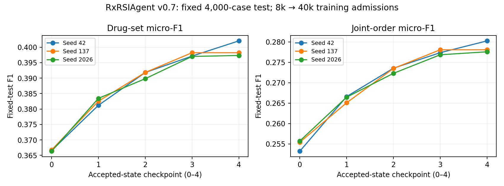
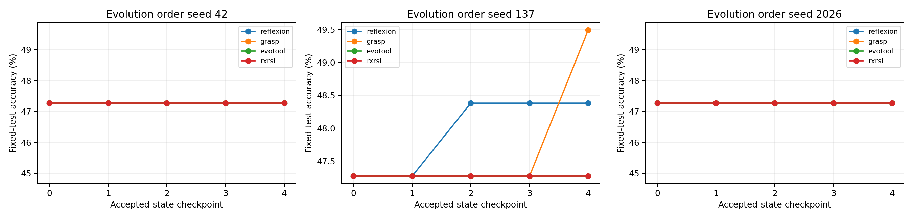

# RxRSIAgent: current method tables, evolution evidence and execution status

<!-- RXRSI_CURRENT_EXECUTION_START -->
## Current executed increment — rule memory and tool repair

**Manuscript navigation:** Study A contains the common ATC-L4 method comparison; Study B covers structured orders and external hospitals; Study C language skills; Study D parameter updates; Study E real FHIR execution. The agent-state section maps each task to its output and evolving objects, and states the actual selection roles. [Reading index](README.md).

**Execution notice:** new OpenRouter requests returned HTTP402 after the previous recharge. Unfinished API branches retain checkpoints and await credit; completed results and independent local training/audits continue. Missing requests are never scored as model errors.

**Actual training:** 6/6 rule runs finish five rounds; 10/15 author-model runs finish their full 50 epochs, with 502/750 completed epochs overall. Training/audit queues continue. The final common ATC-L4 test table opens only after all registered choices and audits freeze.

**Recorded method budgets:** the receipt ledger separates shared fits, optimizer steps, proposal searches and logical response prices. It checks completed author-epoch records against their original logs, counts shared policy fitting once, and identifies exact v29-to-v30 model reuse. SafeDrug has 3 audited seeds; molecular guard patient F1 is 0.53689 ± 0.00244. [Actual compute and development results](COMPUTE_ACCOUNTING.en.md)

**Executed cross-method recount:** 54 completed method runs are recounted on the same 1,231 guard visits / 467 patients, with patient-paired intervals using matched seeds. All available conventional, author-core and rule-memory methods are included. This remains a development comparison; the final test is gated. [Cross-method table and every paired contrast](../upgrade_v27/DEVELOPMENT_METHODS.en.md)

**Executed eICU learning curves:** all 45 completed policy/tool states are reexecuted on the 2,000-stay development guard, with independent set counts, original proposal choices and acceptance decisions. Raw and accepted trajectories are separate. At 40k encountered cases, raw own-error-minus-uniform drug/order F1 is -0.00655/-0.00264. These guard cases participate in selection; this is not the held-out hospital test. [Raw/accepted curves, three seeds and regressions](../upgrade_v25/DEVELOPMENT_CURVES.en.md)

### Completed eICU held-out hospital test

All three seeds and 13 methods/components finish the same 8,005 stays / 6,227 patients / 16 unseen hospitals. Independent checks cover frozen selections, feedback weights, all saved prediction scores and per-seed patient/hospital intervals. Integer accumulation exactly reproduces all 144 interval bounds after a numerical warning; no scores were replaced. Selected results below are three-seed means; the full report retains all methods, seed SD and raw/accepted curves.

| Method | Drug F1 | Joint-order F1 |
|---|---:|---:|
| retrieval_conditional | 0.09501 | 0.02460 |
| word_char_ensemble | 0.10736 | 0.02847 |
| full_data_uniform | 0.11956 | 0.03087 |
| uniform | 0.11825 | 0.02993 |
| error_prioritized | 0.11306 | 0.02838 |
| permuted_priority | 0.11474 | 0.02799 |
| error_priority_initial_tool | 0.11306 | 0.02334 |

[Complete external method table, uncertainty and fitting budgets](../upgrade_v25/RESULTS.en.md)

**Public-data coverage:** a source/identity recount confirms all300 released RxQA OpenFDA questions and all2,000 deduplicated RxSafeBench cases in the historical full-set runs. Later adaptive comparisons use988 frozen test cases, keeping their625/190/197 development cases separate. The unavailable BNF component is excluded. [Exact scope, recounted results and metadata correction](PUBLIC_BENCHMARKS.en.md)

**Common main-table extension:** all v29/v30 program methods, frozen raw rounds and proposal-selected states are now registered for the exact v27 test cases and label spaces. The evaluator and independent prediction reexecution are implemented; execution waits for every author method and all program audits. [Common test table and protocol](../upgrade_v30/COMMON_TEST.en.md)

**Prior-case audit:** 11 recorded families and 38 roles are independently reconstructed. Excluding prior/reserved patients from the890 current test patients freezes **318 patients / 801 visits** before test predictions. The full main table is unchanged; this is a separate sensitivity subset with explicit registry-coverage limits. [Membership audit and subgroup results](EXPOSURE.en.md)

### Parameter repair: randomized positions and causal learning controls

v0.31 runs four arms across three seeds and three rounds: ranked uniform, permuted uniform, permuted own-error and permuted shuffled-error updates. Each round uses the same 400-example/100-step budget. Original retrieval ranks and candidate order fields remain visible. This tests whether weight updates learn drug decisions beyond display position, and whether own errors add value over ordinary training. Candidate tools and order templates stay fixed.

Completed optimizer runs: **3/36**; fully audited seeds: **0/3**. Old test cases are excluded. Proposal selects checkpoints; the reused 200-case guard is exploratory development evidence, not an untouched test.

| State on 100 proposal cases | Ranked drug/order F1 | Permuted drug/order F1 |
|---|---:|---:|
| Frozen base | 0.16846/0.10223 | 0.14129/0.09434 |
| permuted_uniform, round 1 | 0.00000/0.00000 | 0.00000/0.00000 |
| ranked_uniform, round 1 | 0.23301/0.14815 | 0.10800/0.06960 |
| permuted_own_error, round 1 | 0.00000/0.00000 | 0.00000/0.00000 |

**Observed failure:** seed42/permuted_uniform/round1 has 100% empty predictions in both proposal views and drug/order micro-F1=0. The frozen promotion rule rejects it; original results remain.

**Observed failure:** seed42/permuted_own_error/round1 has 100% empty predictions in both proposal views and drug/order micro-F1=0. The frozen promotion rule rejects it; original results remain.

The separate probability diagnostic covers the first permuted-uniform adapter (seed42, round1) and independently recounts 384 vectors. On 32 permuted proposal cases, AUROC changes from 0.7385 with oracle GT prefixes to 0.5503 with label-free zero prefixes, where no decision probability reaches 0.5. [Diagnosis and figure](../upgrade_v31/COLLAPSE.en.md)

[Actual parameter updates, audit and results](../upgrade_v31/RESULTS.en.md)

**Controlled decision repair:** v32 crosses teacher/zero answer prefixes with uniform/balanced binary-decision loss on the same 400 examples and 100 steps per arm. 3/4 fits have completion receipts. No repair performance score is available yet. The implemented scorer separates fixed 0.5 decisions, proposal calibration and weight-update effects. Its independent recount covers all thresholds, unreachable GT, patient intervals and empty-output/invariance diagnostics; the 120 synthetic bindings are preflight checks, not clinical results. [Actual repair results and gates](../upgrade_v32/RESULTS.en.md)

### Memory repair now executing: compatibility and separate confirmation

The 14-arm v0.30 factorial revalidates old memory after policy changes and checks the whole update on patients separate from individual-edit verification. Greedy, own-error and shuffled-evidence methods each run all four gate combinations. Resetting correction memory retains the calibrated prescription policy. Original v0.29 fits are reused exactly; source probabilities, every gate and outputs receive independent audits.

| Panel | Audited seeds | Calibration F1 | Own C0P0 F1 | Own C1P1 F1 | Greedy C1P1 F1 |
|---|---:|---:|---:|---:|---:|
| full | 1 | 0.60719 | 0.60694 | 0.60706 | 0.60719 |
| molecular | 1 | 0.57911 | 0.57874 | 0.57911 | 0.57972 |

[All gate combinations, raw rounds and independent audits](../upgrade_v30/RESULTS.en.md)

### New executed mechanism: isolated witnesses and program synthesis

6/6 runs have frozen five rounds; 6/6 pass independent model/program audits. Each seed uses 5,692 fit patients and permanently excludes 1,423 witness patients from all model fits and candidate statistics. The agent generates one/two-predicate programs; raw policy, ordinary class calibration, greedy/random programs and shuffled evidence are separate controls. These are development results.

| Panel | Audited seeds | Raw policy F1 | Class calibration F1 | Greedy program F1 | Own-agent F1 |
|---|---:|---:|---:|---:|---:|
| full | 3 | 0.60570 | 0.60803 | 0.60801 | 0.60790 |
| molecular | 3 | 0.57564 | 0.57989 | 0.58094 | 0.58021 |

[Actual conditional-program experiment and replay diagnosis](../upgrade_v29/RESULTS.en.md)

### Development method comparison: same guard set

1,231 visits/467 patients; these are development scores, not the final test main table. Each included seed passes independent source/cross-fit/candidate/prediction audits.

| Panel | Audited seeds | Shared policy F1 | Greedy-rule F1 | Own-error agent F1 | Shuffled-evidence agent F1 |
|---|---:|---:|---:|---:|---:|
| full | 3 | 0.61151 | 0.61267 | 0.61260 | 0.61219 |
| molecular | 3 | 0.58113 | 0.58230 | 0.58198 | 0.58255 |

The changed artifact is executable rule memory: aggregate error evidence → LLM edit proposal → training-witness check → retained rules. Policy coefficients update through ordinary supervised fits. Current increments are small; improvement from more data does not establish a unique RSI advantage. The language model maintains the policy offline; it does not generate a full prescription for each patient in this experiment.

[Full method table, five-round trajectories and paired intervals](../upgrade_v27/RESULTS.en.md)

### FHIR repairs: actual audited executions

| Contract C | Statistics S | Frozen skills K | Validation /80 | ID /64 | Held-out types /60 |
|---|---|---|---:|---:|---:|
| 0 | 0 | 0 | 45 | 38 | 18 |
| 0 | 0 | 1 | 53 | 45 | 10 |
| 0 | 1 | 0 | 49 | 36 | 43 |
| 0 | 1 | 1 | 59 | 46 | 50 |
| 1 | 0 | 0 | 52 | 46 | 29 |
| 1 | 0 | 1 | 54 | 49 | 25 |
| 1 | 1 | 0 | 57 | 47 | 45 |
| 1 | 1 | 1 | 66 | 54 | pending |

C enforces the instruction-derived answer shape through actual budgeted retries. S computes source-bound latest/24h Observation statistics with paging and unit separation. K reuses the exact two learned skills. C/S are fixed engineering repairs; no autonomous tool evolution is claimed. All conditions are fixed and all splits reused: exploratory repair, not untouched confirmation.

[Execution receipts, costs and repair contrasts](../upgrade_v28/RESULTS.en.md) · [System diagram](RXRSI_DESIGN.en.md)

Updated 15 October 2026. Versioned historical studies below retain their original protocols and results.
<!-- RXRSI_CURRENT_EXECUTION_END -->

## Earlier completed increment: real tools and evolution diagnosis (v0.19/v0.26)

**FHIR method comparison is complete.** Direct tools / fixed harness / learned skills score **39/38/45 out of64** on ID tasks, and **27/17/10 out of60** on held-out task types. The skill-minus-fixed ID patient interval includes zero; transfer declines with a negative interval. Only two language-skill files evolve. A read-only audit contradicts the name-encoding explanation because the HTTP tool already encodes spaces. Task7 produces30 value-plus-time answers;15 first values are correct and15 wrong, so the0/30 strict score includes a substantial output-contract failure. Frozen skill attribution is complete: neither/name/lab/both score38/44/39/45 ID and17/14/11/10 transfer; interaction intervals include zero. [Full table, intervals and exact skill artifacts](../upgrade_v19/RESULTS.en.md).

**Position diagnostic is complete.** On200 guard cases, preserving original ranks while permuting display order lowers the priority adapter's drug F1 **0.27471→0.17441**; both adapters select display prefixes in100% of nontrivial permuted outputs. All2,400 outputs parse successfully. This identifies a weakness requiring repair; it is not a new test win. [Results](../upgrade_v26/RESULTS.en.md).

**Actual cross-method training is running.** The retrospective ATC-L4 cohort has8,905 patients/23,177 visits. NDC row coverage is27.23%; compare full271-class and molecular219-class panels separately. ARMR-2025/GAMENet/SafeDrug begin50-epoch, three-seed runs with real molecular graphs and verified runtime adaptations. Four conventional methods are fitted and independently audited: full-panel guard patient-average F1 is prevalence0.45794, prior visit0.30154, retrieval0.55081, logistic0.61151. These1,231-visit/467-patient development results are not the gated final test table. [Protocol and real development table](../upgrade_v27/RESULTS.en.md).

The [recent-method registry](LATEST_METHODS.en.md) keeps ARMR/HADRec/LT3 original scores in their original protocols. eICU v0.25 three-seed training continues. No restricted records, predictions or fitted models are published.

Historical snapshot from 15 October 2026. The earlier funding recovery completed the missing requests in the reported v0.17/v0.18 public studies. Current execution and new interruptions are reported at the top of this document. **Our method has not yet surpassed the strongest completed control.**

## Newly completed: binary parameter intervention (v0.15)

Same 500 admissions / 494 patients and fixed candidate tools as the earlier parameter study; the binary intervention was declared before its test scores. One learning seed, three feedback rounds, equal 400-example/100-step budgets.

| Method | Drug F1 | Joint-order F1 |
|---|---:|---:|
| Frozen model with binary prompt | 0.17414 | 0.10141 |
| Uniform binary updates | 0.24094 | 0.15072 |
| Own-error-prioritized binary updates | 0.29192 | 0.19329 |
| Direct top-8 candidate tools | **0.31169** | **0.20739** |

Priority improves over uniform in this run, with positive paired patient intervals, but remains below the strong direct-tool control. Both select round2. The raw round3 priority model emits only zeros and is rejected; 99% of selected-model masks select a prefix of the ranked candidates. This does not show learned clinical reasoning or monotonic model improvement. Six actual adapters/step logs, sampling and labels are audited; 10/3,600 duplicate-input feedback generations cannot be exactly recovered, a disclosed reproducibility gap. Saved test predictions are fully recounted.

[Full results and raw/accepted curves](../upgrade_v15/RESULTS.en.md)

## Latest order task: controlled recorded availability

Decision: actual admission plus6h; predict new/changed orders in the following6h using previously recorded orders, blood labs and demographics. Provider/pharmacy clocks and identities must agree. Split:40,000 training /2,000 proposal /2,000 guard / **1,082 test admissions (1,024 patients)**; patient-disjoint and excluding previous test patients. Independent reconstruction checks198,850 targets,589,393 prior orders and506,710 lab rows; all12 checks pass. This selected coherent-time, nonempty-target cohort does not represent all admissions.

| Method | Drug F1 mean ± SD | Core-order F1 mean ± SD |
|---|---:|---:|
| Reuse prior orders | 0.09508 ± 0.00000 | 0.05564 ± 0.00000 |
| Case retrieval + order tool | 0.15592 ± 0.00000 | 0.09518 ± 0.00077 |
| Word/character ensemble + tool | 0.20096 ± 0.00255 | 0.12071 ± 0.00283 |
| RxRSI selected state | 0.19136 ± 0.00154 | 0.11533 ± 0.00094 |
| Freeze initial order tool | 0.19136 ± 0.00154 | 0.11425 ± 0.00043 |
| Freeze initial memory | 0.19555 ± 0.00250 | 0.11832 ± 0.00109 |

All three-seed method/ablation and round predictions are independently recounted. Separate from the earlier start-time task.
Round-mean drug F1 rises from0.1660 to0.1914, but the strong control scores0.2010 and frozen initial memory is better. A unique RSI advantage is not established.

[Full protocol/results / 完整协议结果](../upgrade_v21/RESULTS.en.md)

## Latest mechanism study: does error feedback add value?

Three seeds/five rounds with fixed word+numeric features. Uniform, own-error-weighted and shuffled-weight arms share cases and exactly60 training epochs. Order tools use only cases seen by that round. Evaluation follows joint selection freeze.

| Method | Drug F1 mean ± SD | Core-order F1 mean ± SD |
|---|---:|---:|
| Initial state | 0.16840 ± 0.00076 | 0.10130 ± 0.00101 |
| Uniform updates | 0.20446 ± 0.00098 | 0.12403 ± 0.00054 |
| Own-error priorities | 0.20143 ± 0.00143 | 0.12219 ± 0.00050 |
| Shuffled priorities | 0.20204 ± 0.00083 | 0.12197 ± 0.00291 |
| Full-data uniform | 0.20446 ± 0.00098 | 0.12403 ± 0.00054 |

1,082 admissions/1,024 patients; exploratory reuse of the previously observed v0.21 test. Weight assignment, training budgets, tool members and every prediction are independently checked.

[Full results / 完整结果](../upgrade_v23/RESULTS.en.md)

## 1. Main method comparisons

### A. Medication and structured-order agreement

Same MIMIC-IV/ED preprocessing, 40,000 training and 4,000 test admissions (3,440 patients), three seeds. The frozen vocabulary contains 128 raw drug names; joint orders match drug, route, dose string and unit. This is not the original ATC-L4/RxNorm protocol. Saline-presence F1 is absent.

| Method | Drug micro-F1 | Core-order micro-F1 |
|---|---:|---:|
| Word/character ensemble + tools | 0.40209 ± 0.00058 | 0.28110 ± 0.00062 |
| RxRSI selected state | 0.39920 ± 0.00251 | 0.27865 ± 0.00142 |
| Freeze initial memory | 0.39976 ± 0.00224 | 0.27926 ± 0.00113 |
| Freeze initial order tool | 0.39920 ± 0.00251 | 0.27494 ± 0.00142 |

[Full 12-row comparison and trajectories](../upgrade_v7/RESULTS.en.md). Existing GT enables automatic scoring without mandatory new clinician annotation.

### B. Public prescription-option method comparison

2,000 deduplicated RxSafeBench questions, scenario-group split 625/190/197/988 train/proposal/guard/test. This is a labeled three-option derived task. Every row uses DeepSeek-V4.1-Flash; rows compare methods. ± denotes SD over three evolution orders; fixed outputs are reused. Author-core results use seed 42. Inference calls differ and development costs are separately recorded, so not every row has an equal budget.

| Method | Accuracy (%) | Calls/case | Evidence |
|---|---:|---:|---|
| Direct LLM | 46.15 ± 0.00 | 1 | [v0.8](../upgrade_v8/RESULTS.en.md) |
| CoT | 47.27 ± 0.00 | 1 | [v0.8](../upgrade_v8/RESULTS.en.md) |
| Self-Refine | 47.57 ± 0.00 | 2 | [v0.8](../upgrade_v8/RESULTS.en.md) |
| Case RAG | 49.09 ± 0.00 | 1 | [v0.8](../upgrade_v8/RESULTS.en.md) |
| Reflexion task adaptation | 47.64 ± 0.64 | 1 | [v0.8](../upgrade_v8/RESULTS.en.md) |
| GRASP task adaptation | 48.01 ± 1.29 | 1 | [v0.8](../upgrade_v8/RESULTS.en.md) |
| EvoTool task adaptation | 47.27 ± 0.00 | 1 | [v0.8](../upgrade_v8/RESULTS.en.md) |
| RxRSI language artifacts | 47.27 ± 0.00 | 1 | [v0.8](../upgrade_v8/RESULTS.en.md) |
| Author GRASP core + task adapter | **50.81** | 1 | [v0.10](../upgrade_v10/RESULTS.en.md) |
| Fixed balanced evidence review | 48.99 | 2 | [v0.11](../upgrade_v11/RESULTS.en.md) |
| Fixed safety evidence review | 49.29 | 2 | [v0.11](../upgrade_v11/RESULTS.en.md) |
| Fixed indication evidence review | 48.38 | 2 | [v0.11](../upgrade_v11/RESULTS.en.md) |
| Outcome verifier: uniform | 49.12 ± 0.23 | 2 | [v0.13](../upgrade_v13/RESULTS.en.md) |
| Outcome verifier: error_prioritized | 49.02 ± 0.06 | 2 | [v0.13](../upgrade_v13/RESULTS.en.md) |
| One-call fixed grounding | 50.51 | 1 | [v0.17](../upgrade_v17/RESULTS.en.md) |
| Grounded skill evolution | 50.71 | 1 | [v0.17](../upgrade_v17/RESULTS.en.md) |

The author GRASP core is the strongest completed control. Named task adaptations are not original implementations. The author-core source is unchanged, with our task adapter. Cross-paper original numbers appear only in the manuscript's separate literature panels.

## 2. What actually evolves?

| Study | Changing object | Evidence and interpretation |
|---|---|---|
| v0.7 | Supervised policy parameters, episodes, joint-order templates | Three seeds/five checkpoints improve with data; the static same-data ensemble is stronger |
| v0.8 | Proposed LLM skills, memories, evidence-focus terms | Full RxRSI rejects every candidate in all three orders; no successful final-state evolution |
| v0.10 | Author-core GRASP skill files | 50.81% on the derived task; RxQA transfer declines from 193 to 189/300 |
| v0.12–13 | Router/verifier coefficients and thresholds | Actual updates, some acceptances and test regressions; no stable error-priority advantage |
| v0.9 | Local Qwen LoRA parameters | All 500-case checkpoint tests completed; both arms trail direct top-8 tools |
| v0.15 | LoRA under explicit binary inclusion supervision | Complete: priority beats uniform in one seed but trails direct top-8; final raw checkpoint collapses |
| v0.17 | GRASP skills over frozen label evidence | Complete: 501/988 versus fixed grounding 499 and author core 502; transfer declines |

Hashes, promotions/rejections and case repairs/regressions accompany the artifacts.

## 3. New executed evidence after funding recovery

- Indication review: **478/988, 48.38%**; all missing requests recovered with the original selection protocol.
- Gemini development repair: on the same 190 questions, CoT improves 72→105 correct and 69→2 invalid; evidence improves 62→100 correct and 85→1 invalid. Reasoning effort and completion cap change jointly. These are development/budget measurements, not test or RSI gains. [Report](../upgrade_v16/RESULTS.en.md).
- Real FHIR: five integration checks pass. Direct tools score 10/16 and a fixed verified harness 8/16 on development tasks. All 11 created resources pass readback and cleanup; independent grading agrees. [Report](../upgrade_v14/RESULTS.en.md).

## 4. Execution order and completion criteria

1. v0.9 all-checkpoint tests, independent recount and patient-cluster intervals are complete; see the new parameter table below.
2. v0.15 completes all checkpoints: priority 0.29192/0.19329, uniform 0.24094/0.15072, direct top-8 0.31169/0.20739. Both select round2; raw collapse and 10/3,600 incomplete feedback receipts are disclosed.
3. v0.17 four-component, all-round and RxQA evaluations are complete. v0.18 is complete and independently recounted: fixed grounding538/988 versus frozen grounded skills510/988. Transport interruptions were resumed from cache without scoring missing responses as model errors.
4. FHIR completes and passes full independent audits; learned skills improve ID counts but harm held-out task types (see current top section). eICU v0.25 training is running; all choices freeze before testing.
5. Retain an unobserved confirmation test, multiple orders, ablations, costs and regressions. Negative superiority outcomes remain visible rather than selecting favorable controls or changing test labels.

[English paper](latex/v0.3/prismatic_v03_en.tex) · [Maintained plan](COMPLETION_PLAN.en.md) · [History](CHANGELOG.md). Restricted records, checkpoints, raw patient traces and credentials remain outside GitHub.

## Newly completed table: local parameter evolution on 500 admissions

Separate from the 4,000-admission table: 500 reserved admissions, 494 patients, same initial-8k candidate tools. Mean gold/reachable drugs are 6.784/3.802. All selection was frozen before test scoring.

| Method | Drug F1 | Core-order F1 | Mean drugs |
|---|---:|---:|---:|
| base | 0.23399 | 0.13593 | 5.46 |
| uniform_sft | 0.28694 | 0.19115 | 17.42 |
| error_prioritized_sft | 0.28432 | 0.19137 | 18.98 |
| all_20_candidate_tools | 0.28390 | 0.19181 | 20.00 |
| guard_selected_top_k_tools | 0.31169 | 0.20739 | 8.00 |

[Full local results / 完整本地结果](../upgrade_v9/RESULTS.en.md)

## New temporal-protocol audit

Among 1,788,195 historical target rows, 42,005 matching provider orders precede admission and 276,269 occur after the original six-hour horizon. Timestamp counts exclude 438 admission-link conflicts. Source linkage paths agree, but the differing pharmacy/provider clocks still require an explicit prospective availability protocol. [Full results](../upgrade_v20/RESULTS.en.md).

## Frozen-method comparison on Gemini

Same988 questions, one2,048-token/low-reasoning call, no test-time learning.

| Method | Correct /988 | Accuracy (%) | Invalid |
|---|---:|---:|---:|
| cot | 532 | 53.85 | 4 |
| frozen_author_grasp | 527 | 53.34 | 5 |
| fixed_grounded | 538 | 54.45 | 5 |
| frozen_grounded_grasp | 510 | 51.62 | 24 |

[Transfer, paired intervals and costs / 迁移、区间与费用](../upgrade_v18/RESULTS.en.md)

## Continued improvement: numerical-state development pilot complete

Represent existing lab/dose values numerically with observed flags; no future context is added. The proposal-selected word+typed policy reaches guard drug/order F1 **0.22456/0.13656**, versus the same-guard control at **0.21942/0.13458**. The continuation rule passes, but both patient-paired intervals include zero. This is one-seed development evidence, with no test scoring or RSI superiority claim.

[Development protocol/results / 开发协议与结果](../upgrade_v22/RESULTS.en.md)

## External-data preparation: eICU hospital audit complete

Retain 142,485 stays, including 8,188 test stays from 16 hospitals, with zero patient/hospital overlap across splits. Of 6,283 test-window orders without names, 6,064 retain HICL codes; name-only filtering is inappropriate. Exclude 238,680 lab values revised after the decision. This is a data audit without model scores, under a different time/order-field protocol from MIMIC.

[External audit / 外部数据审计](../upgrade_v24/RESULTS.en.md)

## External method experiment now running: v0.25

The identity-complete native-HICL cohort is built and independently audited:40,000/2,000/2,000/8,005 stays,6,227 test patients and16 test hospitals, without cross-partition patient/hospital overlap. Zero-target test stays:3,842. Complete joint labels:11,853/15,594. Three seeds/five rounds compare13 methods/ablations, including matched uniform/error/shuffled feedback. No eICU model test score yet. [Protocol and cohort](../upgrade_v25/RESULTS.en.md).

FHIR revision:13 development false negatives arose from valid note arrays versus a legacy object reference. The adapted endpoint applies identical lossless views/readback criteria to all methods and preserves raw grades. Learning restarted from empty skills. This is a scoring repair, not evolution gain. [Evidence](../upgrade_v19/RESULTS.en.md).

## Development follow-up running: candidate-position sensitivity

v0.26 completed all12 state/condition cells and2,400 case-bound outputs. Position sensitivity remains despite preserved ranks; no new learning or test score is claimed. [Complete audited results](../upgrade_v26/RESULTS.en.md).
