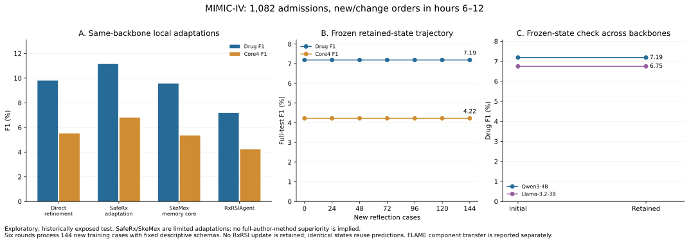

## Latest repair pilot: 2026-10-20

<!-- V52:START -->
## New-patient conditional-memory study

256 eICU audit patients;6 rounds/192 feedback patients; drug F1 7.13% → 6.94%, native4 F1 1.23% → 1.17%; 3 retained rules. New API spend USD 0. This does not establish recursive optimizer improvement. [Full results](../upgrade_v52/RESULTS.en.md).
<!-- V52:END -->

Candidate loss is decomposed: 18.87% of GT drug instances are outside the 128-name vocabulary and 29.51% are inside it but pruned by top24. Repairs add executable candidate/evidence actions, explicit conditions and exceptions, root/action compatibility, no-op checks and cumulative reflection.

Three rounds reuse 72 reflection admissions; proposal24, guard32, post-freeze audit48. The stronger aggregate proposer retains 2 skills. Audit drug F1: 7.21% → 16.96%; Core4: 3.87% → 9.22%.

After uniform complete-array decoding replay, final drug F1 is 16.10%. Five restored outputs add no GT hits. This engineering repair is separate from the original learning result; states are not reselected.

The local-proposer control retains 1 skills. Static-tool and Llama-transfer controls are complete. This small historically exposed audit does not replace the 1,082-admission main table below or prove monotonic/clinical improvement. Growing error memory is not itself capability growth.

New API cost: USD 0.085203 / 10. Only aggregate statistics reach the proposer; patient records remain local.

[完整修复结果 / Repair results](../upgrade_v51/RESULTS.en.md) · [逐轮记录 / Trajectory](../upgrade_v51/results/cloud/trajectory.json) · [代码与复现 / Code](../upgrade_v51/README.md)

---

<!-- REPAIR_PILOT_END -->

# RxRSIAgent: current experimental evidence

Updated 2026-10-17. Local order results below are new; public-QA results remain unchanged.

## 1. Main result and task

**RxRSIAgent: drug F1 7.19%; Core4 F1 4.22% on all 1,082 test admissions.**

This is a local Qwen3-4B prescription-task adaptation, not the frozen hosted DeepSeek QA agent. Predict the full set of new/change orders in hours 6–12 after admission, using observations available at hour 6. Output comprises joint drug/route/dose/unit/frequency templates selected from a common 24-drug catalogue; it is not unrestricted prescribing or the entire hospital-stay regimen. The cohort is retrospectively restricted to admissions with nonempty future targets, complete 12-hour follow-up and no ambiguous candidate target rows. Provider order time and pharmacy entry time must both fall in hours 6–12, with verification by hour 12; prior-order and lab availability use recorded clocks. Released data lack complete field-version histories. This is not an all-admission evaluation. The 128-name vocabulary and 40,000-admission supervised candidate tool are frozen. Out-of-vocabulary GT remains scored.

## 2. Measured comparison

All numbers below are percentages. The first four local rows use the same cases, candidate catalogue, offline label resource, Qwen backbone and maximum 128+128+96 output tokens. Actual token use and offline learning compute differ. **SafeRx and SkeMex are explicitly limited task/subsystem adaptations. FLAME uses a released trained list-policy checkpoint with a different backbone and initializer; its row is a separate transfer experiment, not a full-method, equal-information comparison. These measurements do not establish superiority over the original papers.**

| Method | Drug P | Drug R | Drug F1 | Core4 F1 | Core5 F1 | Empty |
|---|---:|---:|---:|---:|---:|---:|---:|
| Direct self-refinement | 7.69 | 13.53 | 9.81 | 5.51 | 4.14 | 0.46 |
| SafeRx-Agent task adaptation | 7.92 | 18.85 | 11.15 | 6.79 | 4.85 | 0.18 |
| SkeMex author memory core + common actor | 8.73 | 10.56 | 9.55 | 5.34 | 3.88 | 5.55 |
| RxRSIAgent, retained state | 8.38 | 6.29 | 7.19 | 4.22 | 2.86 | 0.18 |

| Separate component / initializer | Drug F1 | Core4 F1 | Core5 F1 |
|---|---:|---:|---:|
| Frozen supervised top-8 + order tool | 17.57 | 10.58 | 7.58 |
| FLAME released list-policy transfer | 16.06 | 9.59 | 6.66 |

Core4 requires an exact joint match of drug, route, dose and unit; Core5 also requires frequency. Drug recall measures coverage of recorded target drugs, and precision measures the fraction of selected drugs present in that reference.

Candidate coverage ceiling: **51.62% of GT drugs**. Complete Core5 reference coverage: **60.20%**. Missing frequency does not become a match. No saline-presence metric is used. All scores apply to compiled orders. Unknown requested identifiers are discarded by the compiler and separately counted in the audit; they are not hidden as successful raw model output.

## 3. Sequential experience updates

| Round | New cases processed | Retained rules | Proposal drug / Core4 F1 | Guard drug / Core4 F1 | Test drug / Core4 F1 | Accepted |
|---:|---:|---:|---:|---:|---:|---|
| 0 | 0 | 0 | 7.30 / 4.91 | 3.96 / 1.83 | 7.19 / 4.22 | False |
| 1 | 24 | 0 | 7.30 / 4.91 | 3.96 / 1.83 | 7.19 / 4.22 | False |
| 2 | 48 | 0 | 7.30 / 4.91 | 3.96 / 1.83 | 7.19 / 4.22 | False |
| 3 | 72 | 0 | 7.30 / 4.91 | 3.96 / 1.83 | 7.19 / 4.22 | False |
| 4 | 96 | 0 | 7.30 / 4.91 | 3.96 / 1.83 | 7.19 / 4.22 | False |
| 5 | 120 | 0 | 7.30 / 4.91 | 3.96 / 1.83 | 7.19 / 4.22 | False |
| 6 | 144 | 0 | 7.30 / 4.91 | 3.96 / 1.83 | 7.19 / 4.22 | False |

Six rounds process 24 new training admissions each (144 total, disjoint from the previous 144 training admissions). The local reflector receives full available-input, plan, evidence, checker and reference traces for discrepant examples and a comparatively better example; better does not mean correct. A researcher-defined interface permits conditional procedure text and selected/all-observed fact scope. It cannot change weights, executable tool code, vocabulary, templates or descriptive output schemas. Each proposed rule requires an observable trigger and counterexample. The frozen validator filters numeric dose strings in either instructions or counterexamples, and copied drug actions; later replay audits overbroad rejections. Explicit {} means no proposed update. Retention requires a strictly higher proposal mean of drug/Core4 F1 and no decrease in either guard endpoint. Proposal/guard subsets (48/64) are reused. All states freeze before new test inference; earlier literal-schema test scores had already been observed. A flat trajectory is not successful RSI. The available trigger language contains only five observation-presence predicates (or a two-predicate conjunction), and the only tool configuration is fact scope; this does not yet express a broad clinical indication/dose skill library.

## 4. Frozen-memory transfer

On Llama-3.2-3B, all 1,082 cases: initial drug/Core4 F1 **6.75/3.81%**; retained memory **6.75/3.81%**. Drug-F1 change **+0.00 percentage points**. No Llama-specific rule selection or retraining. Since the retained memory is empty, this is a second-backbone baseline check; it does not test transfer of a learned rule or establish model-independent benefit.

## 5. Failure findings and cases

- Initial protocol diagnostic, 48 proposal cases: drug/Core4 F1 9.59/4.26%; 25 parseable plans, zero parseable assessments and zero verified-fact cases. Fact-ID binding and concise intermediate JSON repair this contract. This is a researcher repair, not autonomous RSI; syntax improvement alone did not establish accuracy improvement.
- Training observability audit: 1,722/40,000 admissions belong to 144 groups with identical visible context and differing reference drug sets. This supports an information/variation limitation, not a claim that every error is unavoidable.
- Selected test predictions miss 1722 targets already inside the catalogue; 1838 targets are outside it. These distinguish selection and candidate-generation bottlenecks.
- Case-level GT/prediction differences and before/after interventions are saved locally as `failure_case_studies.json` in the restricted experiment directory. No patient-level content is published.
- Recorded actions are not unique clinical optima. No clinical-safety, DDI, allergy or renal-dose success is inferred from F1 or source quotation. A second restricted file, `EVIDENCE_CASE_STUDIES.bilingual.md`, shows two reference-agreement corrections and two regressions from the paired evidence-removal experiment; these are illustrative development cases, not independent clinical validation.

## 6. Cost, provenance and limitations

**New paid API cost: USD 0; authorization cap: USD 10.** All patient inference and reflection are local. Public checkpoint downloads do not call paid inference APIs. Local compute is not monetized. Earlier located response expenditure remains approximately USD 89.53 and is not charged to this new cap.

The test has historical exposure from earlier supervised studies; the result is exploratory. Source pins, exact predictor hashes, costs, denominators and patient-bootstrap contrasts are in `results/audit.json`, `results/*`, and `test_freeze_scope.json`. See the README for comparator fidelity and runnable commands. Publication-quality claims still require complete author-workflow controls and a new untouched clinical evaluation.

## 7. Retention is not the same as verified improvement

Full-test initial-to-retained drug-F1 change: **+0.00 pp**, patient-cluster 95% interval **[+0.00, +0.00] pp**; Core4 interval **[+0.00, +0.00] pp**. There are 0 changed cases, 0 with higher per-case drug F1 and 0 with lower per-case drug F1. These exploratory intervals do not adjust for repeated development. A positive point estimate alone does not establish reliable improvement.

| Module | Initial | Retained |
|---|---:|---:|
| Procedural cards | 0 | 0 |
| Cards enabling all-observed verification | 0 | 0 |
| Model-weight updates | 0 | 0 |
| New executable tool code | 0 | 0 |
| Candidate model / vocabulary changes | 0 | 0 |

Retained state identifiers:

No retained rule / 未保留规则。

Full generated text remains in restricted local learning.json; public cards expose hashes and structural fields only. / 完整生成文本保留在受限目录，公开卡片仅含哈希及结构字段。

The executable trigger is the declared condition enum. Natural-language counterexamples are recorded but not formally enforced as separate predicates. The model's root description remains a hypothesis. The fact-scope interface was written by the researcher before this trajectory; its selection was made by the updater.

| Component, 128 fixed test cases | Drug F1 | Core4 F1 | Mean checked facts |
|---|---:|---:|---:|
| initial | 7.50 | 4.93 | 2.87 |
| retained | 7.50 | 4.93 | 2.87 |
| instruction_only | 7.50 | 4.93 | 2.87 |
| fact_scope_only | 7.50 | 4.93 | 2.87 |

No-edit replay control / 无改动重放对照: 18/128 semantic order sets differ between the cached full-cohort run and the fresh fixed-layout subset run. All four component arms use the same case order/chunks and fresh per-batch generation. / 四个消融臂采用相同病例顺序与分批方式，逐批重新生成。

The subset and component arms were fixed before the corrected-interface test, after earlier literal-schema test scores had been observed. They are diagnostic only, and do not choose a new main-table method.

Catalogue permutation preserves the drug set in 17/128 cases. Drug F1 changes from 7.50% to 4.44%. This tests whole-pipeline order/identifier sensitivity; evidence content changes in 25/128 cases. Retrieval tie-breaks may change, so this is not isolated LLM position bias or absence of pretrained drug priors.

For retained RxRSIAgent, mean drug Jaccard is 4.07%, exact drug-set agreement 0.46%; reference-relative omissions/extras average 3.29/2.41 per admission. Recall is 13.16% for target drugs present in prior orders and 4.78% for other target drugs. The shared catalogue covers 30.17% of complete reference Core4 tuples. Order fields are supplied by the frozen joint-template tool, not independently generated by the LLM. Core4/Core5 tuples are complete in 100.00%/72.15% of predicted orders. Tuple F1 scores only tuples whose fields are observed; completeness is therefore a separate endpoint.

## 8. Evidence-removal intervention and comparator learning

Training-only trace audit (144 admissions): 287/530 reference drugs enter the catalogue; 133 of those have an exact-name cached label, but only 21 reference drugs receive a selected excerpt. Conversely, 169/379 predicted drugs have an excerpt. Only two sentences are allocated globally per case. This exposes uneven evidence availability/selection; it does not establish its causal effect. The checker covers 421/3201 supplied facts; the LLM still sees the complete supplied input. No extra clinical context is created by expanding checker scope.

On the same 48 proposal cases, with label excerpts: drug/Core4 F1 **6.52/4.18%**; without excerpts: **10.55/6.67%**. Both arms use fresh generation with the same case order and batch layout; metadata is preserved and only source spans are removed. This changes information and input length, and is an exploratory development ablation. It does not prove that drug labels are intrinsically harmful or that their clinical use is unnecessary.

SkeMex author-memory training, with all 144 training admissions:

| Round | Cases | Created | Active skills | Schema/materialization errors |
|---:|---:|---:|---:|---:|
| 1 | 24 | 15 | 15 | 0 |
| 2 | 48 | 0 | 15 | 0 |
| 3 | 72 | 3 | 15 | 0 |
| 4 | 96 | 4 | 16 | 0 |
| 5 | 120 | 1 | 16 | 0 |
| 6 | 144 | 2 | 16 | 0 |

| Round | Materialized skills | New files | Changed procedure bodies | Changed existing utility entries |
|---:|---:|---:|---:|---:|
| 0 | 0 | 0 | 0 | 0 |
| 1 | 15 | 15 | 0 | 0 |
| 2 | 15 | 0 | 2 | 6 |
| 3 | 18 | 3 | 2 | 6 |
| 4 | 22 | 4 | 1 | 5 |
| 5 | 23 | 1 | 2 | 5 |
| 6 | 25 | 2 | 0 | 5 |

The author core is pinned; the actor, embedding backend and continuous prescription reward are adaptations. The first reflection batch exhausted GPU memory before any learning round completed. Recovery restores the initial skill-store snapshot and uses two independent reflection requests per batch with cleared prefix caches; actor batches and source token caps remain unchanged. Quantized outputs may depend on batch layout. The source's original ReAct/tool benchmark is not reproduced. RxRSIAgent additionally uses 48 proposal and 64 guard labels; SkeMex directly updates on 144 training admissions. Validation supervision and offline update compute are not matched. The second state table counts actual snapshot differences, not CREATE/PATCH proposals; metadata-only changes are not new procedures. FLAME executes the actual released trained list policy after merging 224 adapter layers; all adapter tensors are consumed. Its source classifier and patient/diagnosis/procedure embeddings are absent, so only component transfer is claimed. Cross-release source-training patient disjointness is unverified. In 648/1,082 cases, at least one list-edit step emits a nonempty line that does not exactly match a current catalogue name; matched compiled orders are still scored. This flag is not equivalent to the final-JSON failure rate of the common actors.

An engine-only prefill-batch probe changed 2/16 development outputs. That optimization was rejected; the main run retains prefill batch 2 and completion batch 8. Quantized greedy decoding is still batch-sensitive, and cached requests reuse their first recorded output.

Primary method sources: [SafeRx-Agent](https://arxiv.org/html/2605.29146v1), [FLAME paper](https://arxiv.org/html/2505.20218v1) and [author code](https://github.com/cxfann/Flame), [SkeMex paper](https://arxiv.org/html/2606.09365v4) and [author code](https://github.com/manglu097/SkeMex). Published numbers are preserved separately in `published_reference_scores.json`, never inserted as matched local rows.

## 9. Controlled format-example intervention and failed updates

| Format intervention, 48 training cases | Drug F1 | A1 selections | A23 selections |
|---|---:|---:|---:|
| original | 3.57% | 36 | 5 |
| swapped_examples | 3.39% | 0 | 46 |
| descriptive | 7.57% | 8 | 3 |

Patients, catalogue contents and batch layout remain fixed; only valid identifier examples are changed or removed. Moving the example from A1 to A23 moves selections from A1 (36→0 cases) to A23 (5→46), confirming format-example anchoring in this local adapter. Descriptive schemas remove this shortcut and are applied to all common local controls. This is a researcher interface repair, **not an accepted RSI update**. Full-test initial actor comparison: 7.34% → 7.19% (95% CI of difference: [-1.21, +0.94] pp). Earlier literal-schema tests are exposed, so this is exploratory.

The earlier bounded-scope learner passed development but failed on all 1,082 test cases: drug F1 7.34→7.27%; +3 correct drugs accompanied by +138 extras. This negative result is preserved. Corrected-trajectory proposal dispositions: `{'unsupported_dose_rule': 3, 'condition_never_applies_in_training': 2, 'explicit_no_edit': 3, 'valid_candidate': 2}`. Validator rejection, empty proposals, unchanged predictions and failed gates are distinct failure modes; none is successful evolution. Replay finds that all three dose-string rejections concern observational counterexamples, not dose actions. Corrected validation distinguishes these fields and instead flags case-specific trace references that require abstraction. It also flags those references in the two previously schema-valid candidates. Four regression tests pass; frozen retention decisions and predictions remain unchanged. This fixes feedback classification, not clinical policy or measured performance. The two valid candidates activate only when both prior orders and labs are absent. In each development subset they trigger on just two cases containing only one observed fact, so all-observed scope adds no checked facts and changes no orders. This is a measured condition/action mismatch, not successful tool improvement; see learning_diagnostics.json.

## 10. Source-route attribution repair

The 144-case training audit finds 66/288 retrieved excerpts with no declared source/order route overlap, 104 with partial oral/nasogastric overlap, and 118 with declared overlap. Overlap does not validate formulation, indication or dose. [FDA terminology](https://www.fda.gov/drugs/data-standards-manual-monographs/route-administration) distinguishes nasal, nasogastric and oral routes. A label for a different route is insufficient direct support, but does not prove that an order is contraindicated; off-label use and cross-route warnings still require separate assessment.

The new executable `route_evidence.py` filters non-overlapping labels before the original ranking, preserves unknown/partial route records, and leaves the two-excerpt limit, catalogue and compiler fixed. Five route-boundary checks passed. On 48 previously used proposal cases, both arms run fresh with identical case order, batch layout and output allowance: **Drug F1 6.52% → 8.03%; Core4 4.18% → 4.91%; drug-difference 95% CI [+0.03, +3.66] pp.** Evidence changes in 17/48 cases; first-stage plans change in 0/48. This is an exploratory researcher repair, not an autonomous RSI update or a main-table checkpoint. Its source-content and input-length intervention does not establish clinical safety. The paired result, including regressions, is preserved in `results/route_evidence_trial.json`.

On 64 disjoint guard cases, the same frozen tool changes drug F1 3.94% → 4.39%, Core4 1.82% → 1.80%; drug-difference 95% CI [-0.06, +1.59] pp. This guard split was reused in earlier learning; it is separate from the proposal cases, not a new untouched test. No new rule or checkpoint is selected from it.

### Cross-backbone output-format replay

Llama has 156 malformed final outputs, 123 without an order_ids key. A fixed, non-generative delimiter repair recovers only 6 cases: drug F1 6.75% → 6.89%. Qwen is unchanged. It never extracts IDs from prose, invents incomplete items or bypasses catalogue checks. Six parser-boundary checks pass. This post hoc replay is separate from the frozen main results and does not demonstrate learned or prospective improvement. Most failures remain unresolved.

## 11. Public-QA results retained alongside the order task

| Method | RxSafe 988 | RxQA 300 | Output allowance |
|---|---:|---:|---:|
| GRASP task adaptation | 50.10% | 61.67% | 4,608 |
| MedAgents task adaptation | 46.76% | 66.67% | 4,608 |
| MDAgents task adaptation | 48.08% | 65.67% | 4,608 |
| Supervised calibration control | 56.28% | 66.33% | 4,608 |
| **RxRSIAgent (hosted QA adapter)** | **49.70%** | **65.33%** | **4,608** |
| MedAgents, higher allowance | 47.37% | 69.33% | 24,000 |

MedPIC remains 274/467 (58.67%), with 3/35 strict pairs both correct. The QA learner retained zero changes. These are different tasks and backbones from the local MIMIC table; accuracy is not prescription recall. Two-QA-benchmark superiority remains unachieved.

[Earlier detailed QA record](versions/qa-results-before-local-2026-10-16.en.md) · [English ACL source](latex/v0.3/prismatic_v03_en.tex) · [Local reproduction](../upgrade_v50/README.md).

