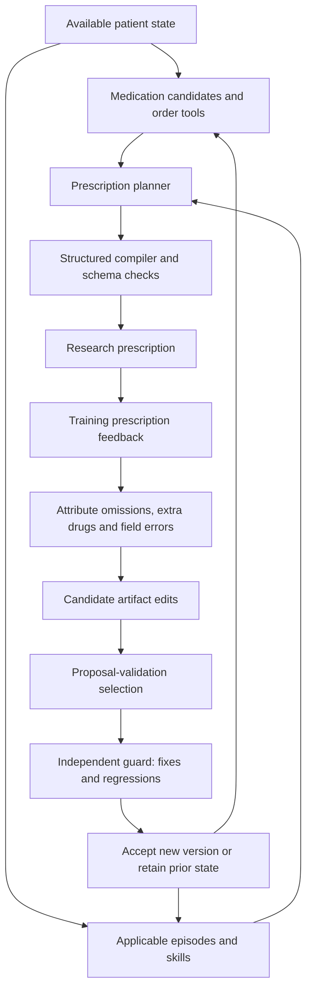

# RxRSIAgent: prescription workflow and evolution evidence

Target: ACL 2027. Beating prior methods is a research objective, never a patient-level inference instruction.

## Workflow

Test labels never enter the update loop. Schema validity does not establish clinical safety.

## Evolving objects

| Object | Update | Evidence | Experiment |
|---|---|---|---|
| Drug policy W | Refit on accumulated training cases | Parameter hashes, freeze-W ablation | v0.7 complete |
| Episode memory M | Add observed training episodes | Membership and freeze-M ablation | v0.7 complete; v0.8 running |
| Order tool T | Learn context-conditioned joint field templates | Template/parameter hashes, freeze-T ablation | v0.7 complete |
| Language skills K | LLM edits reusable procedures from its errors | Full text changes, fixes/regressions, remove-K ablation | v0.8 running |
| Evidence-tool configuration | Learn focus terms for exact dialogue excerpts | Config changes and ablation | v0.8 running; tool code fixed |
| LLM parameters | QLoRA, uniform versus error-prioritized sampling | Actual adapter hashes, equal-budget generation evaluation | v0.9 running |

These studies isolate distinct objects; their fully combined superiority has not been established. v0.7 is supervised artifact learning, v0.8 tests LLM-authored persistent skills, and v0.9 updates LLM weights.

## Required evidence

Freeze every checkpoint and score the same held-out cases. Record case counts, edited objects, accepted/rejected versions, repaired/regressed cases and total compute. Compare with ordinary learning using the same data and with a fixed agent. Increasing scores with more data is insufficient to prove a unique RSI mechanism.

The three-seed v0.7 accepted curves improve from 8k to 40k cases. However, the full system trails the word/character ensemble control, and memory expansion is not consistently helpful. Subsequent increments must address this gap rather than rename ordinary learning as RSI.

## Ground truth and current limits

Observed drug/route/dose/unit labels support automatic evaluation without mandatory clinician review. Missing attributes remain unknown. Optional clinical review can assess acceptable alternatives and safety absent from GT.

MIMIC inputs currently use chief complaint, acuity and home-medication proxies; source entry timestamps remain incomplete. Public option selection is not free full-order generation. Official RxEval/SafeRx test data are unavailable locally, so runnable datasets remain the immediate priority.
