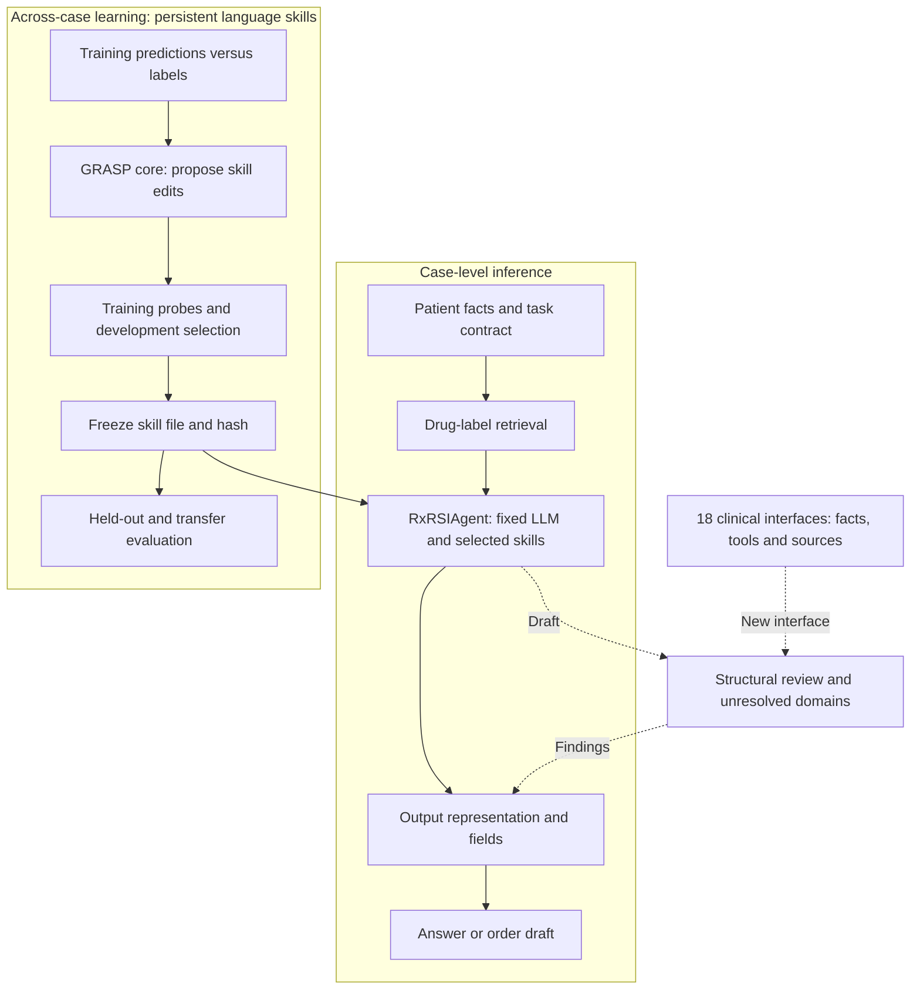

# RxRSIAgent: prescription workflow, evolving state and clinical risk map

Updated 2026-10-15. The method is **RxRSIAgent**. This document explains the retained configuration and new review interfaces; historical prototypes do not define the current method. The [existing English manuscript](latex/v0.3/prismatic_v03_en.tex) contains the full architecture in Figure1. [Current results](CURRENT_RESULTS.en.md) · [中文](RXRSI_DESIGN.zh.md)

## 1. Method and research question

**RxRSIAgent uses drug-label evidence for prescription-related decisions, retains reusable skills from training-case feedback, and selects a skill state on development data. For order drafts, it explicitly exposes missing fields and unresolved clinical checks.**

The central question is **what accumulated experience changes in the agent, and whether those changes reduce medication-selection and order errors beyond the cases used to choose them.**

The measured full configuration is an option-selection agent: fixed LLM, frozen label retrieval, selected persistent skill, and output validation. The revised retriever and clinical-review interfaces are implemented additions, without a new end-to-end accuracy estimate.

## 2. Complete workflow

Solid edges describe the evaluated QA core and learning lifecycle. Dashed edges are new review interfaces. Labels are used for training feedback or independent scoring, not inference inputs. Test feedback cannot update skills. The current review package makes no clinical writes.

An inference call obtains permitted context, retrieves source-tagged evidence, verifies the selected skill hash, passes skill/evidence/task context to an actor, and checks its output. Exact drug-name matching does not establish product applicability. Missing clinical tools remain `not_assessed`; an empty order set requires resolution. The [entry point](../rxrsiagent/core.py) accepts an injected actor; it does not implicitly call a provider. The [evaluated profile](../rxrsiagent/evaluated_profile.json) traces the saved scored configuration.

## 3. Prescribing problems and implementation boundaries

NICE medicines-optimization guidance motivates reconciliation, review and patient involvement; WHO discusses safety under polypharmacy. [NICE NG5](https://www.nice.org.uk/guidance/ng5/chapter/Recommendations), [WHO technical report](https://www.who.int/publications/i/item/WHO-UHC-SDS-2019.11)

RxBench organizes fourteen prescription-review errors, Rx-LLM separates medication tasks, and MedAgentBench evaluates interactive record actions. Our eighteen domains are an **engineering synthesis**, not an exhaustive clinical taxonomy or a claim that a source uses the same eighteen categories. [RxBench](https://arxiv.org/abs/2512.02024), [Rx-LLM](https://doi.org/10.64898/2025.12.01.25341004), [MedAgentBench](https://arxiv.org/abs/2501.14654)

| Problem | Intended procedure/tool | Current implementation boundary |
|---|---|---|
| 1. Missing or late patient facts | Verify observation source and decision-time availability | Required facts declared; new entry point lacks a temporal filtering engine |
| 2. Unsupported treatment or omissions | Link each drug to a documented purpose; review untreated goals | Purpose-field check; treatment appropriateness unvalidated |
| 3. Incomplete medication history | Reconcile active, OTC, start/change/stop medications | Interface; full reconciliation engine pending |
| 4. Allergy information | Check recorded ingredients and reaction context | Exact supplied-ID matches and unknown status implemented; cross-reactivity unresolved |
| 5. Interactions and cumulative effects | Obtain versioned evidence, severity and action | Tool dependency; absence of an entry cannot clear a pair |
| 6. Renal impairment, AKI or dialysis | Use product-required measures and a validated calculator | Fact contract; no automatic dose adjustment |
| 7. Hepatic impairment | Use product-specific severity and recommendations | Tool dependency; clinical decision not implemented |
| 8. Pediatric, older, pregnant or lactating patients | Establish applicable population restrictions | Interface; model-authored skills are not authoritative rules |
| 9. Dose, concentration and units | Separate ingredient amount from volume; validate arithmetic | Positive finite numeric-dose check; clinical range unassessed |
| 10. Wrong product, formulation or route | Resolve exact product before applying instructions | Alias retrieval exists; formulation applicability unresolved |
| 11. Frequency, duration and PRN limits | Check separate schedule fields and review dates | Missing frequency/duration checks; correct schedule unassessed |
| 12. IV diluent, compatibility, volume and rate | Require product/mode-specific preparation evidence | IV mode and evidence-field checks; evidence content unvalidated |
| 13. Unsupported adjuncts or fluids | Link adjunct to explicit purpose and primary order | Missing-purpose check; no saline-presence F1 endpoint |
| 14. Duplicate ingredients or missed discontinuation | Distinguish intentional combinations and overlaps | Duplicate supplied ingredient IDs detected; class/deprescribing rules pending |
| 15. Missing monitoring | Specify observations, timing and action thresholds | Interface; complete monitoring plan unvalidated |
| 16. Feasibility, access and preferences | Check formulary, administration capability and goals | Interface; external resources pending |
| 17. Fabricated, outdated or inapplicable evidence | Preserve original text and provenance; expose conflicts | Retrieval and exact-span audit implemented; relevance/currency unvalidated |
| 18. Incorrect order execution | Validate identity, units, duplicate writes and saved state | Structural checks only in this package; clinical writes disabled |

The [registry](../rxrsiagent/clinical_skills.json) records each domain's required facts, procedure, tool names, sources and memory boundaries. FDA/DailyMed support source/product identification; ISMP provides source material for IV-push preparation concerns, not a universal infusion rule. [FDA prescribing-information resources](https://www.fda.gov/drugs/fdas-labeling-resources-human-prescription-drugs/prescribing-information-resources), [DailyMed](https://dailymed.nlm.nih.gov/dailymed/app-support-web-services.cfm), [ISMP IV-push guidelines](https://www.ismp.org/sites/default/files/attachments/2017-11/ISMP97-Guidelines-071415-3.%20FINAL.pdf)

## 4. Persistent evolution versus per-case prompting

The measured sequence is training error → bounded skill proposal → training probes → development selection → saved file → reuse on later cases. Artifact changes and hashes are recorded. Evaluation labels never enter the inference context.

New memory contracts require scope, source hashes, trigger, action and counterexamples, and accept only declared training-experience candidates. These checks validate record structure, **not the truth of its provenance or permission to promote it**. Promotion needs separate development/regression evaluation. Current evidence concerns one selected language skill, not simultaneous successful evolution of weights, tool code and all memory types.

- Weights remain fixed in the retained method.
- The new retrieval repair is a researcher implementation, not demonstrated autonomous tool-code evolution.
- The eICU learned order tool is auxiliary component evidence, not an end-to-end QA gain.
- GRASP supplies the credited optimizer; prescription interfaces, tool repair and traceable evaluation are our additions.

The observed trajectory is non-monotonic and transfer worsens. Future evidence must isolate feedback-specific benefit under matched experience and budgets, with independent tasks and artifact-level attribution. Changed memory alone is insufficient evidence of successful RSI; the current updater does not recursively redesign itself.

## 5. Ground truth and clinical assessment

Available reference medication sets, order fields and QA labels permit automated agreement scoring without waiting for clinicians. Recorded labels do not cover every clinically appropriate choice. Claims about clinical appropriateness, avoided harm or patient outcomes require separately defined evidence and evaluation. The two available reviewers can support those additional analyses without replacing or blocking the GT main comparison.

## 6. Introduction structure

**Field and survey → benchmark coverage → methods and obstacles → bold central question → RxRSIAgent approach → contributions.** Historical version inventories are excluded from the paper. Missing medical-agent comparisons and unvalidated clinical tools are explicit limitations, not completed contributions.
