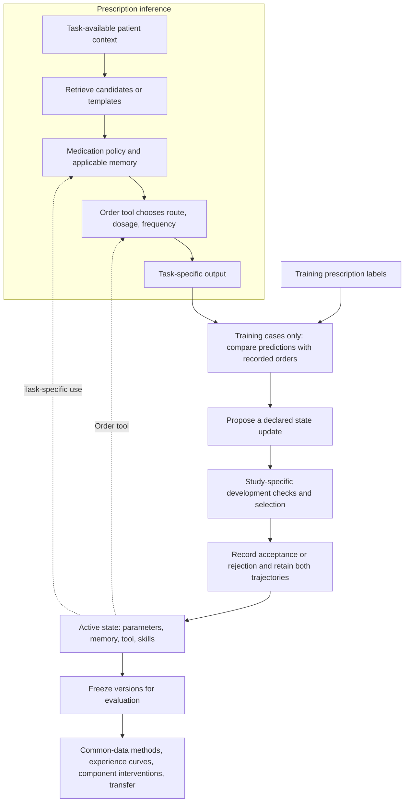
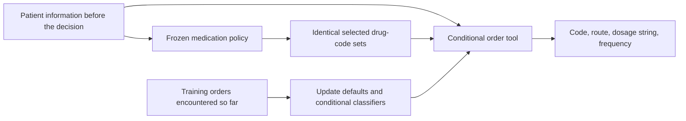
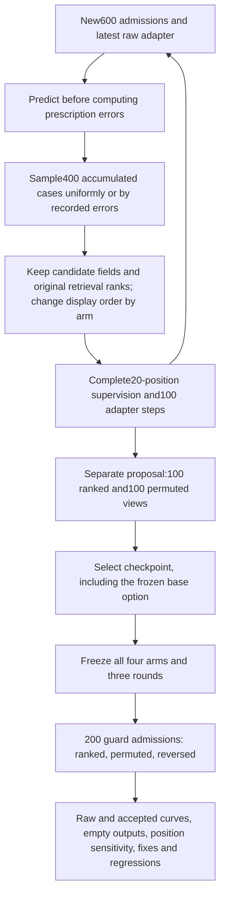
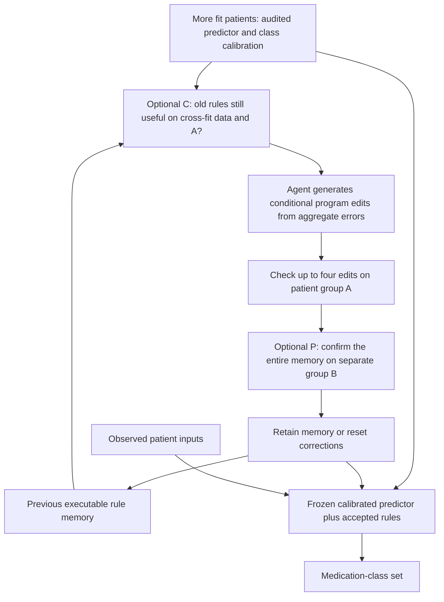
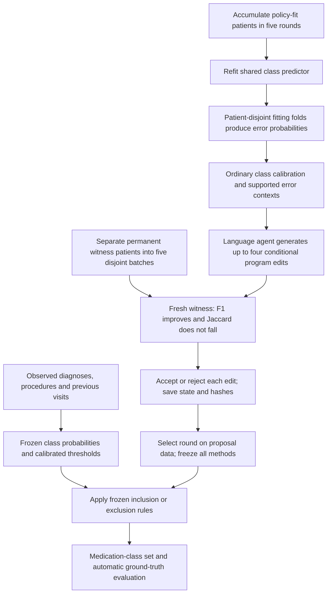
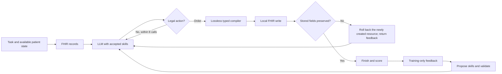

# RxRSIAgent: prescription workflow and evolution evidence

Target: ACL 2027. Beating prior methods is a research objective, never a patient-level inference instruction.

## 15 October 2026: overall method and Introduction structure

RxRSIAgent connects prescription inference with updates from training-case feedback. Its harness organizes task-available context, candidates, medication selection, order fields, output contracts, version selection and evaluation. Different task adapters activate different components; the current evidence does not describe one model jointly evolving all four state objects with an established overall advantage.

The ATC adapter omits order completion; eICU selects historical order tuples; the local LLM selects supplied templates; QA returns options; FHIR executes and reads back simulated record changes. Evaluation labels do not enter the learning loop. Development selection has different roles in the different experiments.

| Updated object | Actual mechanism | Current evidence |
|---|---|---|
| Memory | Conditional inclusion/exclusion rules from aggregate errors | Full-space F1 0.61260 vs greedy rules 0.61267; no unique language-agent advantage |
| Order tool | Learned tuple defaults and conditional tuple classifiers | Fixed drug sets: joint-order F1 0.02334 to 0.02838 |
| Language skills | Persistent instructions for QA or FHIR tasks | In-distribution gains and transfer regressions |
| Parameters | Structured-policy refits or local LLM LoRA updates | Ordinary learning improves; local LLM updates can collapse or depend on position |

Tool learning changes fitted state; the completed eICU study does not autonomously rewrite tool code. Matching recorded labels can be scored automatically. Clinical appropriateness remains a separate endpoint.

The revised English Introduction follows six steps: **field and survey → benchmark scope → methods and the obstacles they address → central problem → our approach → contributions**. It adds Ali et al.'s medication-recommendation survey, RxEval, Rx-LLM, and medication-aware language-model alignment to the existing sources. The [Chinese explanation](RXRSI_DESIGN.zh.md) includes the detailed benchmark and method map with original-source links.

**Central problem: How can a prescription agent convert accumulated case-level feedback into reusable improvements in medication selection and order completion, and how can we attribute those improvements to specific updates and verify their transfer beyond the cases used to select them?**

The supported contributions are the prescription-specific update framework, controlled improvement-attribution protocol, and evidence identifying useful order-tool changes and unsuccessful updates. The update algorithm is fixed; recursive algorithm redesign and overall superiority are not established. Research and experiment queues remain paused. The detailed version records below are retained.

## Completed order-tool intervention: what was learned

The eICU path separates medication-code selection from order completion. Given selected codes and patient context, the tool chooses route, dosage string and frequency from tuples observed in training. As cases grow from 8k to 40k, default tuples and conditional classifier parameters change while executable code stays fixed. This path uses no language model and generates no novel doses.

The actual intervention holds the selected policy and every predicted drug set fixed, replacing only the initial versus updated tool. Across 8,005 stays from held-out hospitals, complete exact matches increase by 49, 31 and 48 for the three seeds. Output completeness nevertheless falls from 53.67% to 51.13%. A post-test sensitivity that also counts incomplete outputs in the prediction denominator changes the score from 0.01770 to 0.02114. Historical tuples may contain missing fields; matching and completeness must be evaluated separately. Own-error priorities still trail uniform updates overall, so this component result does not establish a winning complete RSI system. [Original main table, all methods and denominator sensitivity](../upgrade_v25/RESULTS.en.md).

## Current parameter experiment: drug decisions beyond display position

v0.31 updates local Qwen3-4B low-rank adapters while keeping the backbone, candidate generator and order templates fixed. Each round predicts600 new admissions before computing errors against reachable prescription targets, samples400 accumulated admissions and performs100 optimizer steps. Three seeds and three rounds compare ranked uniform, permuted uniform, own-error priority and shuffled own-error priority updates.

Training continues from the latest raw adapter; proposal selects the serving candidate. Both trajectories remain visible. Earlier cases keep their original pre-update errors rather than receiving fresh scoring each round. A distinct feedback benefit requires own-error updates to outperform ordinary and shuffled controls; changing parameter hashes or falling training loss is insufficient. [Actual execution and results](../upgrade_v31/RESULTS.en.md).

## Current implementation: verify memory as the policy changes

The v0.30 agent reuses the independently audited v0.29 base policies and learns new rule trajectories. After each case-growth step, **C** checks whether old rules still help under the changed policy. New edits are verified on witness group **A**. **P** then confirms the whole memory on a separate group **B**. If a gate fails, the system clears the correction memory and continues using the calibrated medication policy.

All four C/P combinations are executed for language synthesis, greedy search and shuffled evidence; raw/calibrated policies remain explicit controls. C/P are fixed verification policies, while the rules are generated and revised. Original v0.29 fits are shared; no extra fitting or test inference occurs. [All methods, gate actions and actual scores](../upgrade_v30/RESULTS.en.md).

## Foundation: isolated-witness conditional-program agent

The current v0.29 path has two phases. During offline maintenance, the language agent synthesizes executable conditional rules using aggregate error evidence. At inference, a frozen structured policy, class calibration and those rules produce a medication-class set. Each seed permanently separates 5,692 policy-fit patients from 1,423 witness patients; a fresh witness batch checks each round. The language model does not run on each patient's restricted record in this experiment.

| What changes? | How it changes | Required comparison |
|---|---|---|
| Structured predictor coefficients | Ordinary refitting on more training patients | Shared predictor without rules |
| Class thresholds | Ordinary calibration on cross-fitted fit-patient outputs | Calibrated policy without memory |
| Executable rule memory | Agent synthesizes one/two-predicate ADD/DELETE programs | Greedy enumeration, random programs and shuffled evidence |
| Verification policy | Fixed in the main arm | Same proposals without the witness gate |
| Language-model weights and tool code | Fixed in this experiment | No claim of autonomous weight/tool evolution |

All raw round states are retained. Witness patients are excluded from every fit and candidate statistic; within-round adaptive verification remains disclosed. Rule associations do not establish clinical indications, dose correctness or human-like reasoning. [Current conditional-program rounds](../upgrade_v29/RESULTS.en.md). The preceding [v0.27 study](../upgrade_v27/RESULTS.en.md) tests memory/policy substitutions and has weaker witness isolation. Six audited replay runs separate prior-memory compatibility from new-edit transfer; the v0.30 factorial above implements the resulting compatibility/confirmation intervention and reports completed audited seeds.

The separate v0.28 real-FHIR experiment repairs answer contracts and source-bound lab statistics while learned skills stay frozen. Those human-written repairs are evaluated in a full factorial and are not labeled self-evolution. [Execution results](../upgrade_v28/RESULTS.en.md).

## Workflow

Test labels never enter the update loop. Schema validity does not establish clinical safety.

## Evolving objects

| Object | Update | Evidence | Experiment |
|---|---|---|---|
| Drug policy W | Refit on accumulated training cases | Parameter hashes, freeze-W ablation | v0.7 complete |
| Episode memory M | Add observed training episodes | Membership and freeze-M ablation | v0.7/v0.8 complete |
| Order tool T | Learn context-conditioned joint field templates | Template/parameter hashes, freeze-T ablation | v0.7 complete |
| Language skills K | LLM edits reusable procedures from its errors | Full text changes, fixes/regressions, remove-K ablation | v0.8 complete; full RxRSI accepted no change |
| Evidence-tool configuration | Learn focus terms for exact dialogue excerpts | Config changes and ablation | v0.8 complete; tool code fixed |
| LLM parameters | QLoRA, uniform versus error-prioritized sampling | Actual adapter hashes, equal-budget generation evaluation | v0.9/v0.15/v0.26 complete; v0.31 four-arm, three-seed position-randomized training running |

These studies isolate distinct objects; their fully combined superiority has not been established. v0.7 is supervised artifact learning, v0.8 tests LLM-authored persistent skills, and v0.9 updates LLM weights.

## Required evidence

Freeze every checkpoint and score the same held-out cases. Record case counts, edited objects, accepted/rejected versions, repaired/regressed cases and total compute. Compare with ordinary learning using the same data and with a fixed agent. Increasing scores with more data is insufficient to prove a unique RSI mechanism.

The three-seed v0.7 accepted curves improve from 8k to 40k cases. However, the full system trails the word/character ensemble control, and memory expansion is not consistently helpful. Subsequent increments must address this gap rather than rename ordinary learning as RSI.

## Ground truth and current limits

Observed drug/route/dose/unit labels support automatic evaluation without mandatory clinician review. Missing attributes remain unknown. Optional clinical review can assess acceptable alternatives and safety absent from GT.

The older MIMIC task uses chief complaint, acuity and home-medication proxies with incomplete entry timestamps. v0.21 rebuilds an admission6h→next6h task using previously recorded orders, blood labs and demographics, with provider/pharmacy and laboratory-storage clock audits. It remains a selected coherent-time, nonempty-target cohort, and source field-version history is incomplete. Public option selection is not free full-order generation. Official RxEval/SafeRx test data are unavailable locally, so runnable datasets remain the immediate priority.

## Implemented execution paths and limits

1. **Local orders:** patient proxies → frozen candidate catalogue → Qwen selection → exact recorded order templates. v0.9 updates real LoRA weights, but over-selects and loses to direct top-8 tools. v0.15 completes binary supervision; v0.26 exposes continued display-prefix dependence. These paths do not generate unseen doses.
2. **Public decisions:** dialogue/options → optional label retrieval → optional learned skill injection → a single choice. v0.17 evolves one skill through three accepted edits, scores 501/988 versus fixed grounding 499 and author GRASP 502, and regresses on RxQA.
3. **Recorded-time-controlled order prediction:** demographics and prior orders/labs → learned selection policy and case retrieval → conditional joint-order tool → at most20 structured orders. v0.21 compares three seeds/five rounds and equal-data controls on1,082 new test admissions. W/M/T change; no LLM is used in this path.
4. **Interactive prescriptions:** available task/context → FHIR search → conditional ordering → typed order compiler → real write → complete field readback → finish. Invalid action feedback consumes the existing eight-turn budget. v0.19 completes the comparison: learned skills improve observed ID counts but harm held-out task types.

The route compiler is a manual engineering improvement, not an automatically evolved tool. The model weights are fixed in public skill experiments. GRASP-based studies use the credited author's probe/epoch-validation selection, not the independent guard used in some other studies. All of these distinctions remain in the reported protocol.

## 15 October execution revision

The local binary parameter path finishes with selected round2, while raw round3 collapses. Accepted-state protection and underlying learning progress are distinct.99% of selected priority masks are catalogue prefixes; candidate-position bias requires a controlled development intervention. Future local inference deduplicates prompts and stores immutable case-bound feedback receipts; the old10/3,600 feedback reconstruction gap remains disclosed.

The FHIR path now separates three objects: original reference grades, lossless reference-shape views, and actual canonical-field readback. The fixed compiler/reference repair is not a learned artifact. Only language skill files evolve in that study, restarted from empty skills after a development-only scoring discovery.

## Audited mechanism update

The FHIR study changes exactly two persistent language files; compiler and weights do not evolve. Original hashes/text, repaired/regressed cases and single-removal attribution are released. A plausible generated explanation is disproved by the unchanged HTTP encoder, motivating training-witness validation in a future registered intervention. Position diagnostics likewise find that both learned adapters keep selecting display prefixes when candidates are permuted. Neither artifact change alone establishes better prescribing. See [FHIR evidence](../upgrade_v19/RESULTS.en.md) and [position evidence](../upgrade_v26/RESULTS.en.md).
