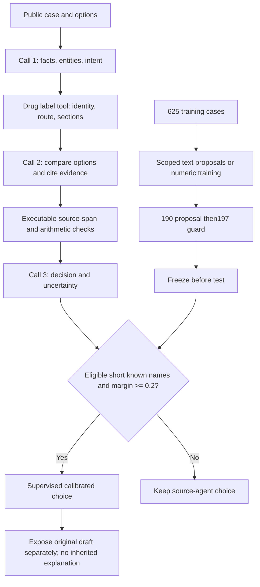

# RxRSIAgent: current architecture and boundaries

The current selected pipeline is shown below. It uses three LLM calls and a supervised numeric calibrator. The text-memory channel has no accepted update. Product/source checks do not establish full clinical applicability. Historical eighteen-domain interfaces remain in the clinical registry and have not all become validated tools.

[Full results and limits](CURRENT_RESULTS.en.md)

Current entry:`rxrsiagent/selected_agent.py`. Historical interface details:[v0.34 archive](versions/v0.34_source/RXRSI_DESIGN.en.md).
