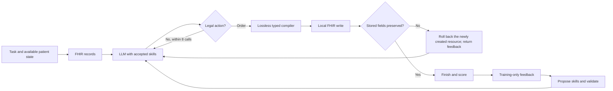

# RxRSIAgent: prescription workflow and evolution evidence

Target: ACL 2027. Beating prior methods is a research objective, never a patient-level inference instruction.

## Workflow

Test labels never enter the update loop. Schema validity does not establish clinical safety.

## Evolving objects

| Object | Update | Evidence | Experiment |
|---|---|---|---|
| Drug policy W | Refit on accumulated training cases | Parameter hashes, freeze-W ablation | v0.7 complete |
| Episode memory M | Add observed training episodes | Membership and freeze-M ablation | v0.7/v0.8 complete |
| Order tool T | Learn context-conditioned joint field templates | Template/parameter hashes, freeze-T ablation | v0.7 complete |
| Language skills K | LLM edits reusable procedures from its errors | Full text changes, fixes/regressions, remove-K ablation | v0.8 complete; full RxRSI accepted no change |
| Evidence-tool configuration | Learn focus terms for exact dialogue excerpts | Config changes and ablation | v0.8 complete; tool code fixed |
| LLM parameters | QLoRA, uniform versus error-prioritized sampling | Actual adapter hashes, equal-budget generation evaluation | v0.9 complete; v0.15 complete; v0.26 position diagnostic complete |

These studies isolate distinct objects; their fully combined superiority has not been established. v0.7 is supervised artifact learning, v0.8 tests LLM-authored persistent skills, and v0.9 updates LLM weights.

## Required evidence

Freeze every checkpoint and score the same held-out cases. Record case counts, edited objects, accepted/rejected versions, repaired/regressed cases and total compute. Compare with ordinary learning using the same data and with a fixed agent. Increasing scores with more data is insufficient to prove a unique RSI mechanism.

The three-seed v0.7 accepted curves improve from 8k to 40k cases. However, the full system trails the word/character ensemble control, and memory expansion is not consistently helpful. Subsequent increments must address this gap rather than rename ordinary learning as RSI.

## Ground truth and current limits

Observed drug/route/dose/unit labels support automatic evaluation without mandatory clinician review. Missing attributes remain unknown. Optional clinical review can assess acceptable alternatives and safety absent from GT.

The older MIMIC task uses chief complaint, acuity and home-medication proxies with incomplete entry timestamps. v0.21 rebuilds an admission6h→next6h task using previously recorded orders, blood labs and demographics, with provider/pharmacy and laboratory-storage clock audits. It remains a selected coherent-time, nonempty-target cohort, and source field-version history is incomplete. Public option selection is not free full-order generation. Official RxEval/SafeRx test data are unavailable locally, so runnable datasets remain the immediate priority.

## Implemented execution paths and limits

1. **Local orders:** patient proxies → frozen candidate catalogue → Qwen selection → exact recorded order templates. v0.9 updates real LoRA weights, but over-selects and loses to direct top-8 tools. v0.15 completes binary supervision; v0.26 exposes continued display-prefix dependence. These paths do not generate unseen doses.
2. **Public decisions:** dialogue/options → optional label retrieval → optional learned skill injection → a single choice. v0.17 evolves one skill through three accepted edits, scores 501/988 versus fixed grounding 499 and author GRASP 502, and regresses on RxQA.
3. **Recorded-time-controlled order prediction:** demographics and prior orders/labs → learned selection policy and case retrieval → conditional joint-order tool → at most20 structured orders. v0.21 compares three seeds/five rounds and equal-data controls on1,082 new test admissions. W/M/T change; no LLM is used in this path.
4. **Interactive prescriptions:** available task/context → FHIR search → conditional ordering → typed order compiler → real write → complete field readback → finish. Invalid action feedback consumes the existing eight-turn budget. v0.19 completes the comparison: learned skills improve observed ID counts but harm held-out task types.

The route compiler is a manual engineering improvement, not an automatically evolved tool. The model weights are fixed in public skill experiments. GRASP-based studies use the credited author's probe/epoch-validation selection, not the independent guard used in some other studies. All of these distinctions remain in the reported protocol.

## 15 October execution revision

The local binary parameter path finishes with selected round2, while raw round3 collapses. Accepted-state protection and underlying learning progress are distinct.99% of selected priority masks are catalogue prefixes; candidate-position bias requires a controlled development intervention. Future local inference deduplicates prompts and stores immutable case-bound feedback receipts; the old10/3,600 feedback reconstruction gap remains disclosed.

The FHIR path now separates three objects: original reference grades, lossless reference-shape views, and actual canonical-field readback. The fixed compiler/reference repair is not a learned artifact. Only language skill files evolve in that study, restarted from empty skills after a development-only scoring discovery.

## Audited mechanism update

The FHIR study changes exactly two persistent language files; compiler and weights do not evolve. Original hashes/text, repaired/regressed cases and single-removal attribution are released. A plausible generated explanation is disproved by the unchanged HTTP encoder, motivating training-witness validation in a future registered intervention. Position diagnostics likewise find that both learned adapters keep selecting display prefixes when candidates are permuted. Neither artifact change alone establishes better prescribing. See [FHIR evidence](../upgrade_v19/RESULTS.en.md) and [position evidence](../upgrade_v26/RESULTS.en.md).
