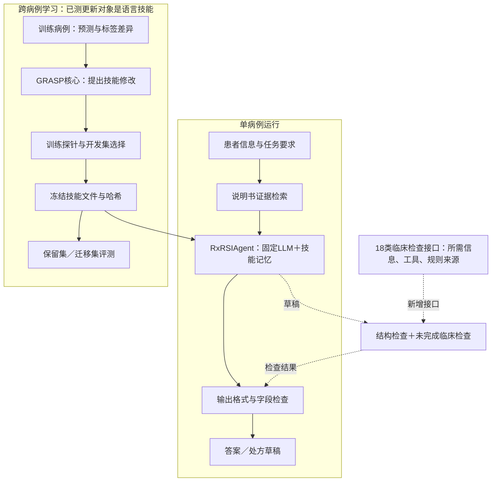

# RxRSIAgent：处方流程、自进化对象与临床问题映射

更新：2026-10-15。方法名统一为 **RxRSIAgent**。本文解释当前保留的方法与新增工具接口；旧版本不再组成当前方法。英文论文保持[原编辑路径](latex/v0.3/prismatic_v03_en.tex)，架构主图是 Figure 1。[当前结果](CURRENT_RESULTS.zh.md) · [English](RXRSI_DESIGN.en.md)

[本轮详细机制与每轮变化](EVOLUTION.zh.md) · [医生视角指标与盲评方案](CLINICAL_EVALUATION.zh.md)

## 1. 一句话说清方法

**RxRSIAgent 用药品说明书支持处方相关决策，把训练病例中获得的经验保存成可复用技能，并通过开发集检验决定保留哪份技能；生成处方草稿时，再显式检查缺失字段与尚未解决的临床问题。**

我们要研究的核心是：**病例经验究竟改变了 agent 的什么，能否在未用于选择的病例上减少漏开、误开和订单错误，而不是只提高开发集分数？**

当前已经测过的完整配置是药物问答／选项决策：固定LLM＋冻结说明书检索＋选中的技能记忆＋输出检查。新增的处方检查层和修复检索器已经写进代码，但尚未得到完整模型重跑的准确率。因此两者在图中分别标识。

## 2. 完整流程图

实线对应已测问答核心及其学习过程；虚线对应新增检查接口。标签只用于训练反馈和独立评分，不传给推理模型。测试集不能给技能更新提供反馈。最终输出是研究草稿，不直接写入临床系统。

### 具体一次运行

1. 接收任务允许使用的患者事实和时间信息，区分“未知”与“正常”。问答模式接收题目和选项。
2. 查询冻结说明书。新检索器同时查看题干与选项，使用来源通用名／商品名匹配，保留原文、药品ID、日期、段落、偏移和快照哈希。**药名匹配仍不等于剂型适用。**
3. 校验保留技能文件的哈希，将技能、证据和任务交给actor。技能是经验，不是临床指南；当前权重不更新。
4. 检查输出。问答核对选项；订单核对成分、用途、剂量、单位、途径、频率、疗程和条件字段。空订单进入待解决状态。
5. 返回草稿、结构问题和未完成的临床检查。没有相互作用／肾功能／配伍工具的判断时返回 `not_assessed`，不当作通过。

[统一实现入口](../rxrsiagent/core.py)支持注入actor；当前新增接口没有隐式调用模型，也没有临床写入。完整旧协议推理与学习记录仍可从[评测配置](../rxrsiagent/evaluated_profile.json)追溯。

## 3. 真实开处方时，要解决哪些问题？

问题范围依据用药优化、用药安全和处方评测的原始来源整理。NICE强调用药核对、用药审查与患者参与；WHO讨论多重用药中的安全问题。[NICE NG5](https://www.nice.org.uk/guidance/ng5/chapter/Recommendations)、[WHO用药安全报告](https://www.who.int/publications/i/item/WHO-UHC-SDS-2019.11)

RxBench整理14类处方审核错误；Rx-LLM将药物任务拆成不同评测；MedAgentBench检验交互式EHR执行。下面18类是**我们据此设计的工程组织方式**，不是声称某篇文献给出了相同18类，也不是穷尽互联网上所有AI用药问题。[RxBench](https://arxiv.org/abs/2512.02024)、[Rx-LLM](https://doi.org/10.64898/2025.12.01.25341004)、[MedAgentBench](https://arxiv.org/abs/2501.14654)

| 临床问题 | RxRSIAgent应做什么 | 工具／记忆的职责 | 当前实现边界 |
|---|---|---|---|
| 1. 患者信息缺失或事后才可见 | 检查事实、来源和可用时间；缺失不能视为正常 | 时间筛选工具；记忆保存遗漏模式 | 已定义信息要求；新入口未实现时间筛选引擎 |
| 2. 没适应证却开药、应治问题漏处理 | 每项药物连接治疗目标，逐项审查未覆盖目标 | 说明书＋适应证规则；技能整理检查顺序 | 用途字段检查已实现；治疗选择未验证 |
| 3. 原有药物、非处方药未核对 | 区分新增、继续、替换和停药 | 成分解析和用药核对工具 | 接口已定义，完整核对引擎待接入 |
| 4. 过敏记录不全或被忽略 | 记录反应类型，检查同成分；未知状态提示 | 已知过敏匹配＋类别交叉反应规则 | 精确成分匹配已实现；交叉反应未评估 |
| 5. 相互作用及多药累积风险 | 取得相互作用证据、严重性和处理依据 | 有版本的相互作用库；记忆保存检索步骤 | 接口已定义；不能把无记录当作安全 |
| 6. 肾功能、AKI或透析影响剂量 | 核对规则要求的肾功能指标、时间、单位和人群 | 药品特异规则＋经过验证的计算器 | 所需事实已定义，自动调量未实现 |
| 7. 肝功能影响用药 | 使用药品适用的分级与来源规则 | 肝功能用药规则工具 | 接口已定义，临床判断未实现 |
| 8. 儿童、老年、妊娠和哺乳 | 确认适用人群，避免用普通成人规则代替 | 人群限制来源；技能触发检查 | 接口已定义，当前经验技能非临床权威 |
| 9. 剂量、浓度、单位算错 | 区分有效成分量和液体体积，检查单位 | 单位解析、规则约束的计算 | 非正值／非有限数检查已实现；剂量范围未判断 |
| 10. 成分对了但剂型或途径错 | 先解析确切产品，再应用说明书 | 药品产品映射与途径工具 | 当前按别名检索；产品适用性仍未知 |
| 11. 频率、疗程、必要时上限缺失 | 分别检查每个字段与复查／停药时间 | 频率／疗程规则；案例触发技能 | 频率／疗程缺失检查已实现；正确值未判断 |
| 12. 输液溶媒、配伍、容量和速度错误 | 取得针对药品和给药方式的来源，不使用通用默认值 | 配伍与输液规则工具 | 推注／输注及准备／速度证据字段检查已实现；证据内容待验证 |
| 13. 辅助药、液体“跟着开” | 要求明确用途、关联主药或液体治疗目标 | 辅助用药适应证审查；记忆不能凭共现授权 | 用途缺失检查已实现；无“盐水出现F1”指标 |
| 14. 重复成分、停药遗漏 | 区分有意联合与意外重复，核对现有用药 | 成分／类别解析、减停药规则 | 输入成分ID完全相同的重复检查已实现 |
| 15. 开药后没有监测或复查安排 | 明确观察指标、时间和处理触发条件 | 监测规则工具 | 接口已定义，完整监测计划待验证 |
| 16. 患者难以执行、费用或供应不适合 | 核对可获得性、偏好和给药能力 | 药房目录与患者目标核对 | 接口已定义，外部资源待接入 |
| 17. 编造、过时或不适用的依据 | 保存来源与原文；矛盾、缺失不强行下结论 | 标签检索与来源核对；来源不是可执行指令 | 说明书检索与逐段核对已实现；时效和适用性未全面验证 |
| 18. 正确草稿写成错误订单 | 核对患者、单位、唯一提交和保存后状态 | 订单编译与FHIR读回 | 当前包做结构检查、不执行临床写入；端到端执行另测 |

每类的必需事实、工具名、程序、来源和记忆边界都落在[临床技能注册表](../rxrsiagent/clinical_skills.json)。FDA与DailyMed用于来源与产品信息；输液准备问题另参考ISMP原始指南，不能将其扩展成所有输液场景的自动规则。[FDA说明书资源](https://www.fda.gov/drugs/fdas-labeling-resources-human-prescription-drugs/prescribing-information-resources)、[DailyMed服务](https://dailymed.nlm.nih.gov/dailymed/app-support-web-services.cfm)、[ISMP静脉推注指南](https://www.ismp.org/sites/default/files/attachments/2017-11/ISMP97-Guidelines-071415-3.%20FINAL.pdf)

## 4. 自进化如何区别于“加一段提示词”？

已测机制是跨病例的持久技能更新：训练预测与标签对比→提出有界修改→用训练探针检查→开发集选取→存为文件→下一轮／新病例复用。文件有真实变更和哈希；测试时不会为每个病例读取其标签。

新增记忆接口要求：适用范围、来源哈希、触发条件、动作和反例；仅接受声明为训练经验的候选。这个接口检查记录格式，**不自动证明来源真实，不自动批准技能上线**。需要独立的开发集／回归集验证。当前仅保留一个开发集选中技能；不是同时宣称参数、工具代码和所有记忆都已成功自进化。

- 模型权重在保留配置中固定。
- 本次检索器修复由研究开发实现，不算agent自主发现并编写工具。
- eICU订单工具的学习是独立组件实验，不算当前问答agent端到端收益。
- GRASP提供优化核心；我们新增的是处方接口、工具修复、问题组织与可追溯评测。

现有学习曲线与case study表明技能会改变行为，也会造成退步。下一步需在独立数据、匹配预算和反馈对照下证明收益；不能仅凭“记忆变了”就声称RSI成功。

## 5. 医生审核与GT的关系

药物集合、订单字段和问答答案只要有可评分GT，就可以自动计算一致性指标，不需要先拿到医生评价才出主表。历史处方或问答标签不覆盖所有合理治疗选择；若要声称临床合理性、风险规避或患者获益，则需另设证据来源和评测。两位评审者可用于这类额外分析，不替代GT主实验，也不阻塞自动评分。

## 6. Introduction保持的逻辑

**领域与综述 → benchmark覆盖范围 → 方法及其解决的问题 → 加粗的核心研究问题 → RxRSIAgent怎么做 → contributions。** 当前论文不放历史版本清单，贡献与真实证据对应；尚未完成的医学agent对比和临床工具在限制中明确说明。
