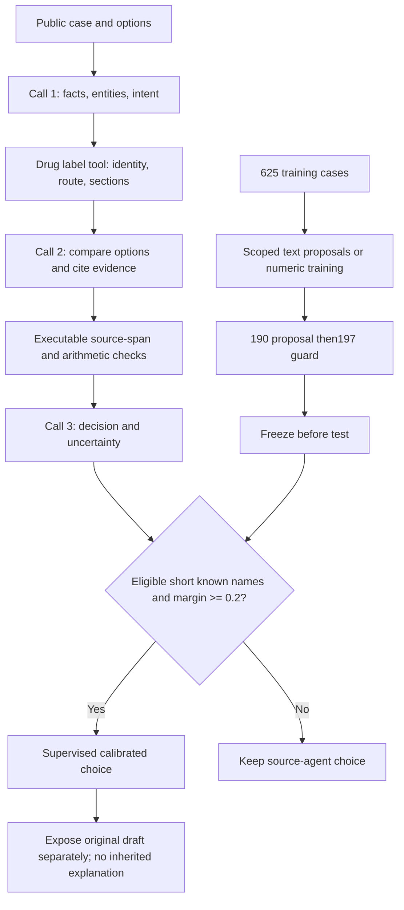

# RxRSIAgent：当前完整结构与能力边界

下图是当前实测配置。三次LLM调用后接普通监督数值校准；文本技能分支没有通过门槛的更新。药品身份、途径、引用核验不等于完整临床适用性验证。原有18类临床接口仍在registry中，但不能当成18个已验证的临床工具。

[完整实验与边界](CURRENT_RESULTS.zh.md)

Current entry:`rxrsiagent/selected_agent.py`. Historical interface details:[v0.34 archive](versions/v0.34_source/RXRSI_DESIGN.zh.md).
