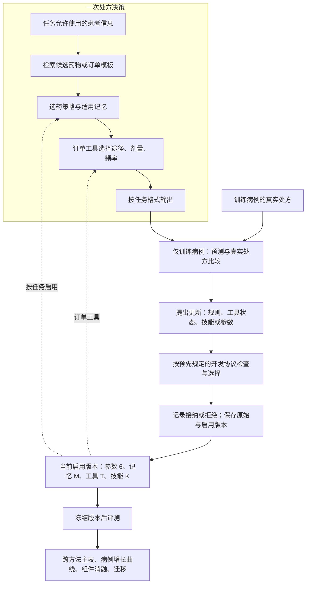
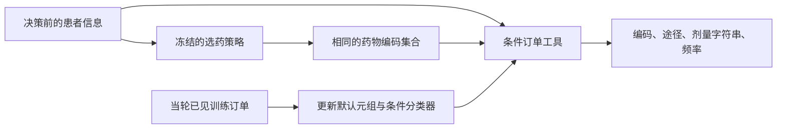
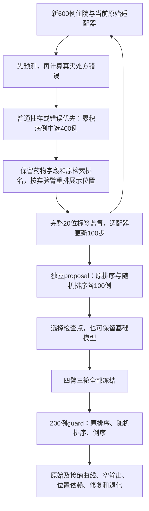
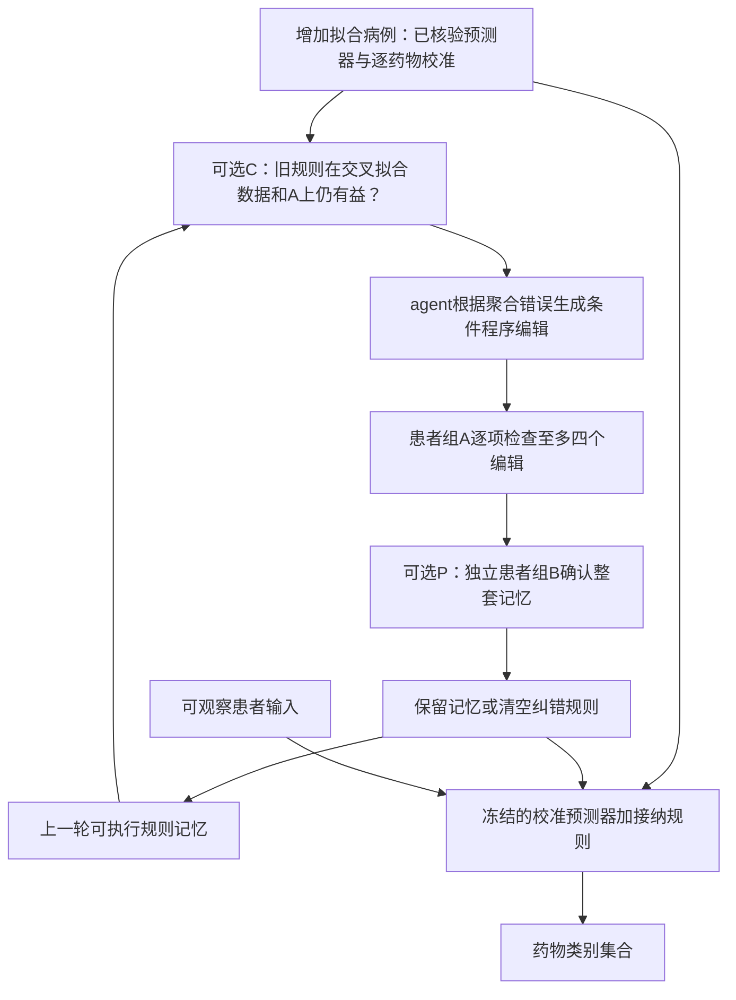
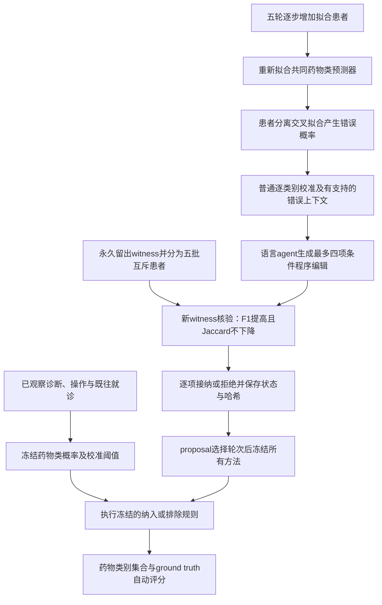
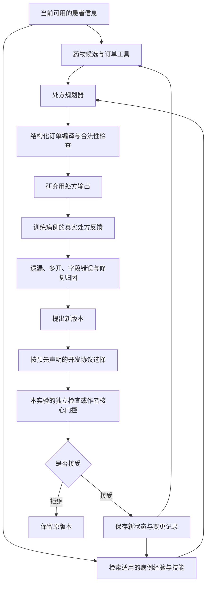
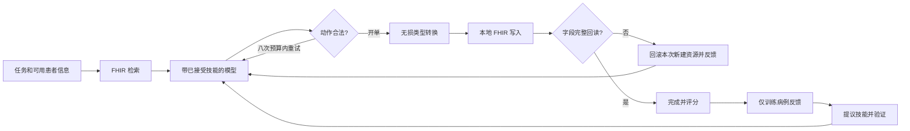

# RxRSIAgent：处方流程与自进化证据

目标会议：ACL 2027。目标是改善处方决策；“超过其他方法”只属于研究目标，不放进患者推理提示。

## 2026-10-15：整体方法与论文主线

**一句话：RxRSIAgent 将“根据病例产生处方输出”和“利用训练病例反馈更新处方能力”连接起来，并记录每次到底更新了什么、是否有效。**

Harness 是承载整个过程的运行框架，负责组织患者输入、候选、选药、订单字段、输出格式、版本选择与评估。Agent 是其中进行决策或提出更新的部分。目前是一套共享设计、不同任务适配的研究系统；四类更新分别在相应实验中验证，尚未组成一个四类状态联合进化并全面胜出的模型。

### 整体流程图

图中是共享逻辑，不同任务执行相应分支。ATC 实验输出药物类别，不执行订单填写；eICU 输出历史订单元组；本地 LLM 选择给定模板；问答输出选项；FHIR 分支实际执行并回读模拟系统状态。测试标签只用于评分，不进入更新循环。开发数据的使用角色按各实验分别规定，并非所有实验都使用同一个“通过才升级”规则。

### 究竟进化哪些东西

| 对象 | 学到的内容与更新方式 | 当前证据 |
|---|---|---|
| 记忆 M | 根据聚合错误生成条件规则，修正接近阈值的纳入／排除决定 | 完整药物空间 F1 0.61260；贪心规则为 0.61267，未证实语言 Agent 独有优势 |
| 订单工具 T | 随病例增加，学习默认订单元组与依赖患者上下文的元组选择器 | 固定选药结果，订单 F1 从 0.02334 到 0.02838；这是当前最明确的组件收益 |
| 技能 K | 保存并修订可复用的文字操作步骤，供后续问答或 FHIR 任务调用 | 有同分布改善，也有跨任务、跨基座退化 |
| 参数 θ | 结构化预测器重新拟合，或更新本地 LLM 的 LoRA 参数 | 普通学习有增长收益；当前 LLM 更新存在空输出与位置依赖 |

“工具进化”在已完成 eICU 实验中指**工具内部学习状态改变**，不是 Agent 自主重写工具代码。病例规则反映观察到的处方关联，目前没有证据证明系统理解了完整的人类临床决策依据。

### 为什么要做这些对照

1. **增加病例但普通训练：**判断收益是否来自数据变多。
2. **自身错误与打乱错误：**判断反馈与病例正确对应是否提供额外价值。
3. **固定选药策略，只替换订单工具：**定位订单收益来自哪里。
4. **保存每轮冻结版本：**检查是否随病例增加改善，保留真实退化。
5. **换患者、医院、任务或模型：**分别检查相应的迁移边界。

按真实处方进行匹配评分可以自动完成，不以新增医生审核为前置条件。记录中的处方是行为标签；匹配它与证明临床最优是两种评价目标。

### Introduction 按六步展开

**1．领域与综述。** 从基于 EHR 的药物推荐讲起，介绍个体化、时间变化和药物相互作用，再引出语言模型对临床文本、外部证据与执行流程的支持。[Ali 等的系统综述](https://doi.org/10.1162/dint_a_00197)提供领域脉络。

**2．Benchmark 分别测什么。** 数据资源、选择题、完整订单任务与工具执行需要分开介绍：

| 资源／benchmark | 核心任务 | 本文关系 |
|---|---|---|
| MIMIC-III／IV | 各论文自行构建队列与药物空间，预测药物集合；原始数据库不是统一固定的 leaderboard | MIMIC-IV 同数据跨方法比较，当前是开发集结果 |
| eICU | 多中心 ICU 数据资源，可构建跨医院的药物／订单任务 | 本文自建固定协议，完成留出医院测试 |
| [RxSafeBench](https://github.com/CAS-SIAT-XinHai/RxSafeBench) | 2,443 个模拟问诊场景，关注禁忌和相互作用风险 | 本文采用声明过的三选一适配，不能等同原始生成式评测 |
| [RxQA](https://github.com/Google-Health/rxqa) | 药品说明书相关推理；公开 OpenFDA 部分为 300 题 | 已测全部公开 300 题；未测非公开 BNF 部分 |
| [RxEval](https://arxiv.org/abs/2605.14543) | 1,547 题、584 位患者；结合时间轨迹选择药物—剂量—途径三元组 | 尚无正式数据包，只作为相关工作引用 |
| [Rx-LLM](https://doi.org/10.64898/2025.12.01.25341004) | 剂型、订单生成、途径、DDI、肾功能剂量和适应证六类任务 | 补充任务覆盖背景，未声称已经执行 |
| [MedAgentBench](https://arxiv.org/abs/2501.14654) | 原始版本包含 300 个任务、100 位患者及 FHIR 环境，评价交互执行 | 本文有实际执行的适配实验，使用自己的已声明划分 |

**3．已有研究解决什么。** [GAMENet](https://arxiv.org/abs/1809.01852)结合病史与药物图；[SafeDrug](https://arxiv.org/abs/2105.02711)利用分子结构和 DDI 目标；[ARMR](https://www.ijcai.org/proceedings/2025/871)处理历史用药复用和变化；[Language-Assisted Medication Recommendation](https://arxiv.org/abs/2503.03687)针对 LLM 过度开药进行对齐；[SafeRx-Agent](https://arxiv.org/abs/2605.29146)引入知识与安全核验。跨任务持续学习还需对照 Reflexion、GRASP 等已有机制，不能宣称前人都不会积累经验。

**4．我们要解决的关键问题：处方 Agent 如何把不断积累的病例反馈转化为可复用的选药和订单填写能力，并明确“改了什么、为什么有效、在新病例上是否仍然有效”？**

现有 benchmark 的单次分数不能单独回答这个问题。本项目观察到：数据变多、订单工具变好、技能更新和参数更新会产生不同结果；因此必须把这些变化拆开验证。问题陈述是研究目标，不能提前写成“已实现持续自我进化”。

**5．如何解决。** 用明确的任务输出协议串起开方流程；对四类状态分别更新并记录来源；按既定开发规则选择版本；用同病例方法比较、逐轮曲线、普通／打乱反馈对照和组件替换验证效果。当前更新算法本身固定，尚未实现算法递归自我改写。

**6．贡献。** 三项可由现有结果支撑的贡献是：处方任务的状态化更新框架；能区分数据增长、反馈价值与组件收益的实验协议；订单工具的正向证据及记忆、技能、参数更新的失败边界。英文 Introduction 已按此顺序重写并加粗核心问题。

研究与实验保持暂停；本次只更新解释、文献和论文表述。以下保留各版本的详细设计记录。

## 已完成的订单工具更新：具体学到了什么

eICU 路径将两件事分开：策略选择药物编码；订单工具根据患者上下文，从训练中见过的元组里选择途径、剂量字符串与频率。病例从 8k 增至 40k 时，工具更新默认元组及条件分类器参数，执行代码不变。这条路径不调用大模型，也不生成历史中没有的新剂量。

真实干预固定已选策略和逐例药物集合，只替换初始／更新工具。三个种子在 8,005 次留出医院住院中分别增加 49、31、48 个完整精确匹配；但输出完整率从 53.67% 降到 51.13%。在缺字段输出也计入分母的测试后敏感性分析中，分数仍从 0.01770 增至 0.02114。工具允许选择带缺失字段的历史元组，完整率和匹配率必须分别评价。自身错误加权整体仍落后于普通更新，不能把这个组件收益当作完整 RSI 胜出。[原主表、全部方法与分母敏感性](../upgrade_v25/RESULTS.zh.md)。

## 当前参数实验：选择药物，而不是记住展示位置

v0.31实际更新本地Qwen3-4B的低秩适配器；骨干、候选生成器和订单模板固定。每轮新增600次住院，模型先预测，再根据可达候选的真实处方计算自身错误；从累积病例中抽400例，训练100步。三个种子各有三轮，比较原排序普通训练、随机位置普通训练、自身错误优先、打乱自身错误权重四种方法。

下一轮训练从最新原始适配器继续，部署候选则由proposal选择；两条轨迹分开报告。早期病例保留当时的更新前错误，不声称每轮重新评分全部旧病例。只有自身错误优先持续优于普通更新与打乱对照，才能支持错误反馈的独特收益；参数哈希改变或训练损失下降本身不够。[真实执行与结果](../upgrade_v31/RESULTS.zh.md)。

## 当前实现：策略变化后重新验证记忆

v0.30复用已独立核验的v0.29基础策略，重新学习规则轨迹。每轮增加病例后，**C** 检查旧规则在当前策略下是否仍有用；新编辑在witness患者组 **A** 上逐项验证；**P** 再用另一组患者 **B** 确认整套记忆。验证失败时清空纠错记忆，继续使用当前校准后的药物策略。

语言生成、贪心搜索、打乱证据均实际运行C/P四种组合，原策略与校准策略单独作对照。C/P是固定验证策略，规则由agent生成和修订。共享v0.29原始拟合，不增加基础模型拟合或测试推断。[全部方法、验证动作与真实成绩](../upgrade_v30/RESULTS.zh.md)。

## 基础机制：隔离witness的条件程序agent

当前v0.29分为两个阶段：离线维护时，语言agent根据聚合错误证据生成可执行条件规则；预测时，冻结的结构化策略、逐类别校准与规则输出药物类别集合。每个种子永久分离5,692位拟合患者和1,423位witness患者，每轮由新的witness批次验证。本实验不会把每位患者的受限记录发送给语言模型，也不生成完整剂量处方。

| 改变的对象 | 如何改变 | 必须比较的对照 |
|---|---|---|
| 结构化策略系数 | 更多训练患者上的普通重新拟合 | 同一策略、不加规则 |
| 逐类别阈值 | 拟合患者交叉预测上的普通校准 | 校准策略、不加记忆 |
| 可执行规则记忆 | agent生成一到两个条件的新增／删除程序 | 贪心穷举、随机程序、打乱证据 |
| 验证策略 | 主方法固定使用 | 相同提议取消witness核验 |
| 语言模型权重与工具代码 | 本实验固定 | 不宣称自主权重／工具进化 |

全部原始轮次均保留；witness患者不参加任何拟合和候选统计，轮内自适应验证仍明确披露。规则关联不能证明临床适应证、剂量正确或人类思维。[当前条件程序实验](../upgrade_v29/RESULTS.zh.md)。先前[v0.27实验](../upgrade_v27/RESULTS.zh.md)设计了记忆／策略替换干预，其witness隔离较弱。六组已核验回放区分旧记忆兼容性和新编辑迁移；上方v0.30据此实现兼容性／独立确认对照，结果按完成种子报告。

独立的v0.28真实FHIR实验修复答案协议和绑定来源的检验值统计，保持已学技能不变。人工写出的修复通过完整因子实验评价，不算自主进化。[执行结果](../upgrade_v28/RESULTS.zh.md)。

## 1. 一次处方如何产生

测试集只做冻结版本的评价，不进入反馈循环。合法性检查只保证输出符合协议，不能自动保证临床安全。

## 2. 到底什么在进化

| 对象 | 如何更新 | 怎样证明 | 当前实验 |
|---|---|---|---|
| 药物选择参数 W | 累积训练病例后重新拟合 | 参数哈希、冻结 W 消融 | v0.7 已完成 |
| 病例记忆 M | 新增训练病例，检索相关经验 | 记忆成员、冻结 M 消融 | v0.7/v0.8 已完成；v0.21 在新时间队列重测 |
| 订单工具 T | 根据上下文学习联合字段模板 | 模板/参数哈希、冻结 T 消融 | v0.7 已完成 |
| 自然语言技能 K | LLM 根据自己的训练错误编辑可复用规则 | 完整前后文本、修复/退化、移除 K 消融 | v0.8 已完成但完整 RxRSI 未接纳更新；v0.10/v0.17 有实际技能编辑 |
| 证据工具配置 | 学习关注词，提取患者原文片段 | 配置差异、移除配置消融 | v0.8 已完成；工具代码固定 |
| 大模型参数 | QLoRA，普通 SFT 对比错误优先采样 | 真实 adapter 哈希、同预算生成评价 | v0.9/v0.15/v0.26已完成；v0.31随机位置四臂三种子训练运行中 |

这些对象分开研究。目前尚未证明把它们全部组合在一起最好。v0.7 的参数学习是普通监督模型更新，不能称为大模型自主进化；v0.8 才直接检验 LLM 生成的持续技能；v0.9 才更新大模型参数。

## 3. 轮次实验怎样回答你的问题

固定测试病例，冻结每轮状态，分别画性能曲线。记录新病例量、接受/拒绝、改变的对象、修复数、退化数，以及总训练/推理预算。再比较同样病例量的普通训练与没有进化的系统。

v0.7 三种子从 8k 增至 40k 的药物和订单 F1 上升；但完整方法均值低于词/字符组合基线，扩大病例记忆也未稳定帮助。因此当前证据支持“病例增加后表现改善”，尚不支持“独有 RSI 机制优于普通学习”。后续版本必须补足这个差别。

## 4. 不依赖医生才能完成的部分

有处方 GT 的药物、途径、剂量和单位直接自动评分。GT 没记录的属性保留未知，不虚构正确值。医生评审可以补充临床可接受替代方案与安全性评价，但不是运行主实验的前置条件。

## 5. 当前输入限制

旧 MIMIC 任务输入是主诉、acuity、家庭用药代理信息，部分来源没有可靠录入时间。v0.21 已重建实际入院6h→随后6h的任务，输入是此前记录的订单、血液检验及人口学信息，并通过双订单时钟与检验存储时间审计；但该队列事后筛选了时间一致且有目标订单的病例，且来源缺少完整字段版本历史。公开选择题测试的是选药决策，不等于自由生成完整处方。正式 RxEval / SafeRx 测试数据暂不可用，继续执行已有数据上的实验。

## 当前已经实现的执行路径

1. **本地订单：**患者代理信息 → 固定候选药物目录 → Qwen 选择 → 展开历史订单模板。v0.9 确实更新 LoRA 权重，但过度选择且输给直接 top-8 工具；v0.15已完成二元监督，v0.26发现展示前缀依赖仍存在。这里没有生成目录之外的新剂量。
2. **公开处方判断：**对话/候选 → 可选说明书证据 → 可选进化技能 → 一次选项决策。v0.17 有三次被接受的技能编辑，最终 501/988；固定证据 499、作者 GRASP 502，RxQA 迁移下降。
3. **记录时间受控的订单预测：**人口学信息＋决策前订单/检验 → 学习的药物选择策略与病例检索 → 条件联合订单工具 → 最多20条结构化订单。v0.21 在新的1,082例测试上比较三种子、五轮和同数据强监督对照。这条路径更新 W/M/T，不使用 LLM。
4. **交互式处方：**当前任务/患者信息 → FHIR 检索 → 条件开单 → 类型化订单转换 → 真实写入 → 完整字段回读 → 完成。非法动作反馈占用原来的八次调用预算。v0.19完整比较已完成：技能提高本次同类计数，却损害未见任务类型。

订单字段转换是人工实现的工程修复，不冒充“工具自动进化”。公开技能试验的模型权重固定。采用 GRASP 核心的试验使用其训练探针/epoch 验证选择，不冒充每轮独立 guard。各种变化的身份、代码和评价协议分别记录。

## 10月15日执行修订

本地二元参数路径最终保留第2轮，第3轮原始模型全零退化。接纳版本保护不等于底层学习单调进步；所选错误优先掩码99%只是候选前缀，需开发集控制实验检验位置偏差。后续本地推理去重请求、保存逐例不可变反馈回执；旧实验10/3,600条反馈重建缺口仍如实保留。

FHIR路径明确分为原参考评分、无损参考格式视图、真实规范化字段回读。固定编译器/评分修复不属于进化对象；该实验只有语言技能文件学习，在开发阶段发现评分问题后从空技能重启。

## 机制核验更新

FHIR确实只改变两个持久语言文件，编译器和权重不进化；原哈希/文本、修复/退化及单技能归因已逐项保留。新技能的一个合理外观解释被原HTTP编码器反证，下一干预需登记并验证真实训练证据。位置诊断同样发现候选打乱后两个适配器仍选展示前缀。对象发生改变，不等于处方能力变好。[FHIR证据](../upgrade_v19/RESULTS.zh.md) · [位置证据](../upgrade_v26/RESULTS.zh.md)。
