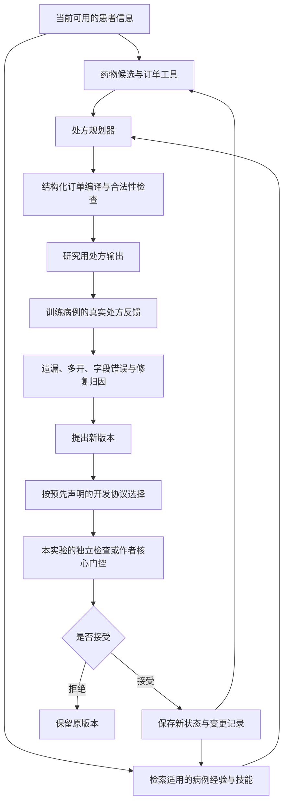
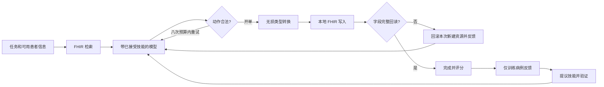

# RxRSIAgent：处方流程与自进化证据

目标会议：ACL 2027。目标是改善处方决策；“超过其他方法”只属于研究目标，不放进患者推理提示。

## 1. 一次处方如何产生

测试集只做冻结版本的评价，不进入反馈循环。合法性检查只保证输出符合协议，不能自动保证临床安全。

## 2. 到底什么在进化

| 对象 | 如何更新 | 怎样证明 | 当前实验 |
|---|---|---|---|
| 药物选择参数 W | 累积训练病例后重新拟合 | 参数哈希、冻结 W 消融 | v0.7 已完成 |
| 病例记忆 M | 新增训练病例，检索相关经验 | 记忆成员、冻结 M 消融 | v0.7/v0.8 已完成；v0.21 在新时间队列重测 |
| 订单工具 T | 根据上下文学习联合字段模板 | 模板/参数哈希、冻结 T 消融 | v0.7 已完成 |
| 自然语言技能 K | LLM 根据自己的训练错误编辑可复用规则 | 完整前后文本、修复/退化、移除 K 消融 | v0.8 已完成但完整 RxRSI 未接纳更新；v0.10/v0.17 有实际技能编辑 |
| 证据工具配置 | 学习关注词，提取患者原文片段 | 配置差异、移除配置消融 | v0.8 已完成；工具代码固定 |
| 大模型参数 | QLoRA，普通 SFT 对比错误优先采样 | 真实 adapter 哈希、同预算生成评价 | v0.9 已完成；v0.15 二元监督运行中 |

这些对象分开研究。目前尚未证明把它们全部组合在一起最好。v0.7 的参数学习是普通监督模型更新，不能称为大模型自主进化；v0.8 才直接检验 LLM 生成的持续技能；v0.9 才更新大模型参数。

## 3. 轮次实验怎样回答你的问题

固定测试病例，冻结每轮状态，分别画性能曲线。记录新病例量、接受/拒绝、改变的对象、修复数、退化数，以及总训练/推理预算。再比较同样病例量的普通训练与没有进化的系统。

v0.7 三种子从 8k 增至 40k 的药物和订单 F1 上升；但完整方法均值低于词/字符组合基线，扩大病例记忆也未稳定帮助。因此当前证据支持“病例增加后表现改善”，尚不支持“独有 RSI 机制优于普通学习”。后续版本必须补足这个差别。

## 4. 不依赖医生才能完成的部分

有处方 GT 的药物、途径、剂量和单位直接自动评分。GT 没记录的属性保留未知，不虚构正确值。医生评审可以补充临床可接受替代方案与安全性评价，但不是运行主实验的前置条件。

## 5. 当前输入限制

旧 MIMIC 任务输入是主诉、acuity、家庭用药代理信息，部分来源没有可靠录入时间。v0.21 已重建实际入院6h→随后6h的任务，输入是此前记录的订单、血液检验及人口学信息，并通过双订单时钟与检验存储时间审计；但该队列事后筛选了时间一致且有目标订单的病例，且来源缺少完整字段版本历史。公开选择题测试的是选药决策，不等于自由生成完整处方。正式 RxEval / SafeRx 测试数据暂不可用，继续执行已有数据上的实验。

## 当前已经实现的执行路径

1. **本地订单：**患者代理信息 → 固定候选药物目录 → Qwen 选择 → 展开历史订单模板。v0.9 确实更新 LoRA 权重，但过度选择且输给直接 top-8 工具；v0.15 正在检验显式二元排除监督。这里没有生成目录之外的新剂量。
2. **公开处方判断：**对话/候选 → 可选说明书证据 → 可选进化技能 → 一次选项决策。v0.17 有三次被接受的技能编辑，最终 501/988；固定证据 499、作者 GRASP 502，RxQA 迁移下降。
3. **记录时间受控的订单预测：**人口学信息＋决策前订单/检验 → 学习的药物选择策略与病例检索 → 条件联合订单工具 → 最多20条结构化订单。v0.21 在新的1,082例测试上比较三种子、五轮和同数据强监督对照。这条路径更新 W/M/T，不使用 LLM。
4. **交互式处方：**当前任务/患者信息 → FHIR 检索 → 条件开单 → 类型化订单转换 → 真实写入 → 完整字段回读 → 完成。非法动作反馈占用原来的八次调用预算。v0.19 将在完整发布切分上比较固定技能与进化技能。

订单字段转换是人工实现的工程修复，不冒充“工具自动进化”。公开技能试验的模型权重固定。采用 GRASP 核心的试验使用其训练探针/epoch 验证选择，不冒充每轮独立 guard。各种变化的身份、代码和评价协议分别记录。

## 10月15日执行修订

本地二元参数路径最终保留第2轮，第3轮原始模型全零退化。接纳版本保护不等于底层学习单调进步；所选错误优先掩码99%只是候选前缀，需开发集控制实验检验位置偏差。后续本地推理去重请求、保存逐例不可变反馈回执；旧实验10/3,600条反馈重建缺口仍如实保留。

FHIR路径明确分为原参考评分、无损参考格式视图、真实规范化字段回读。固定编译器/评分修复不属于进化对象；该实验只有语言技能文件学习，在开发阶段发现评分问题后从空技能重启。
