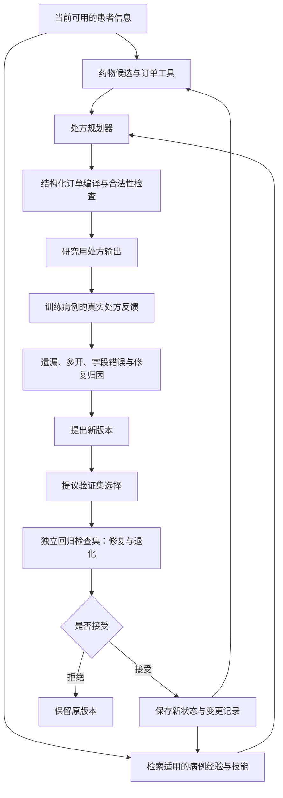

# RxRSIAgent：处方流程与自进化证据

目标会议：ACL 2027。目标是改善处方决策；“超过其他方法”只属于研究目标，不放进患者推理提示。

## 1. 一次处方如何产生

测试集只做冻结版本的评价，不进入反馈循环。合法性检查只保证输出符合协议，不能自动保证临床安全。

## 2. 到底什么在进化

| 对象 | 如何更新 | 怎样证明 | 当前实验 |
|---|---|---|---|
| 药物选择参数 W | 累积训练病例后重新拟合 | 参数哈希、冻结 W 消融 | v0.7 已完成 |
| 病例记忆 M | 新增训练病例，检索相关经验 | 记忆成员、冻结 M 消融 | v0.7 已完成；v0.8 运行中 |
| 订单工具 T | 根据上下文学习联合字段模板 | 模板/参数哈希、冻结 T 消融 | v0.7 已完成 |
| 自然语言技能 K | LLM 根据自己的训练错误编辑可复用规则 | 完整前后文本、修复/退化、移除 K 消融 | v0.8 运行中 |
| 证据工具配置 | 学习关注词，提取患者原文片段 | 配置差异、移除配置消融 | v0.8 运行中；工具代码固定 |
| 大模型参数 | QLoRA，普通 SFT 对比错误优先采样 | 真实 adapter 哈希、同预算生成评价 | v0.9 运行中 |

这些对象分开研究。目前尚未证明把它们全部组合在一起最好。v0.7 的参数学习是普通监督模型更新，不能称为大模型自主进化；v0.8 才直接检验 LLM 生成的持续技能；v0.9 才更新大模型参数。

## 3. 轮次实验怎样回答你的问题

固定测试病例，冻结每轮状态，分别画性能曲线。记录新病例量、接受/拒绝、改变的对象、修复数、退化数，以及总训练/推理预算。再比较同样病例量的普通训练与没有进化的系统。

v0.7 三种子从 8k 增至 40k 的药物和订单 F1 上升；但完整方法均值低于词/字符组合基线，扩大病例记忆也未稳定帮助。因此当前证据支持“病例增加后表现改善”，尚不支持“独有 RSI 机制优于普通学习”。后续版本必须补足这个差别。

## 4. 不依赖医生才能完成的部分

有处方 GT 的药物、途径、剂量和单位直接自动评分。GT 没记录的属性保留未知，不虚构正确值。医生评审可以补充临床可接受替代方案与安全性评价，但不是运行主实验的前置条件。

## 5. 当前输入限制

MIMIC 实验实际输入是主诉、acuity、家庭用药代理信息。部分来源没有可靠录入时间；因此尚不能宣称完整重建医生当时可见信息。公开选择题测试的是选药决策，不等于自由生成完整处方。正式 RxEval / SafeRx 测试数据暂不可用，继续执行已有数据上的实验。
