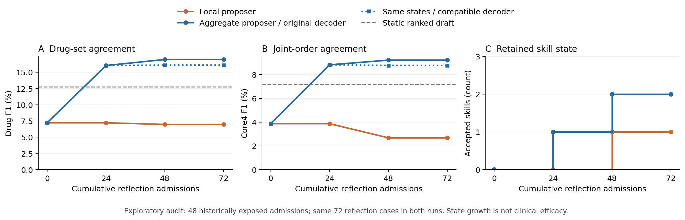

# RxRSIAgent：候选与逐轮更新修复结果

日期：2026-10-20。三轮小规模修复实验已完成；原 1,082 例完整主表继续保留，本表不冒充全量新结果。

## 1. 为什么候选覆盖只有 51.62%？

我方预处理先取最初 8,000 个训练病例中频率最高的 128 个原始规范化药名，再用在 40,000 个训练病例上拟合的分类器为每例取前 24 个。它不是 MIMIC 官方目录，也不是 LLM 自由生成的药物清单。

| 分解 / Component | 实例 / Instances | 占 GT / GT share |
|---|---:|---:|
| 可选 / Reachable | 1961 | 51.62% |
| 128 词表外 / Outside vocabulary | 717 | 18.87% |
| 词表内但被 top-24 排除 / Pruned within vocabulary | 1121 | 29.51% |

分母为 3,799 个病例内去重的 GT 药物实例。名称仅做原始字符串规范化，并非 RxNorm 成分统一；品牌与制剂写法差异仍可能造成额外分裂。扩容改善可选范围，不自动改善最终处方。

在同一48例审计中，原前24候选覆盖为 48.50%，前48为 67.50%，病例检索扩展为 58.00%。这是候选可达率；不能与全量1,082例的51.62%直接比较，也不是最终处方F1。

## 2. 四类修复与边界

1. 开放七类可执行操作：候选扩容、病例检索召回、证据途径筛选、按药物分散证据、扩大事实核验、区分新开/变更/既往订单、调用已有冻结分类器的预测草稿。
2. 先检测实际执行变化，再检测训练输出变化；没有变化就返回具体拒绝原因。
3. 反例中的数字不再被当成剂量指令，排除条件实际执行；仍不允许无来源的药物/剂量指令。
4. 全部已见病例参与累计根因统计，六类代表性轨迹及完整拒绝记录进入下一轮。

第一轮及第二轮提案检查发现：反思器将候选漏失误归因为事实核验不足。已保留中断尝试，并在任何审计推理前补入错误类型—动作兼容性约束、最早错误阶段优先级和训练收益要求。未核验事实计数不再当作处方错误。

另外修复了两处校验器误拒绝：跨阶段解释不再触发文字子串冲突；只有一个候选的JSON包装可被正常读取。该修改依据开发日志；第三轮被错拒的候选随后实际运行，但因训练一致性没有提升而未保留。修改时一次审计推理已开始后中断，未读取或用于选择的审计分数；原始记录保留。

模型权重、联合剂量/途径/频次模板、底层工具代码仍固定。这里只验证由 LLM 产生的程序性技能和工具配置更新，不将人工实现算作自进化，也不声称递归改写工具代码。

另保留本地 Qwen 反思器对照；最终这组轨迹使用 Sonnet 4.6 汇总统计反思器。本地 actor、工具和守门标准相同；不是同一 LLM 自我反思。强反思器不接收患者记录，新增病例仍是同一批 72 例，不能相加成 144 例。两种反思器的输入粒度也不同，因此不是只替换模型的严格消融。

## 3. 真实逐轮结果

Core4要求药物名称、给药途径、剂量数值、剂量单位同时匹配；它不包含频次。以下首先保留原始严格解码协议的分数，后文另列完整数组兼容修复后的统一重放。

72 个对反思器新增的病例，三轮各 24 例；它们此前已属于候选工具的40,000例训练资源，并非整个系统从未见过的监督。24 例提案集、32 例守门集；48 例审计集在全部状态冻结后评估。审计集来自历史已使用的测试集，是探索性复用，不能称为全新独立验证。

| Round | Cases seen | Error-memory cases | Retained skills | Audit drug F1 | Audit Core4 F1 |
|---:|---:|---:|---:|---:|---:|
| 0 | 0 | 0 | 0 | 7.21% | 3.87% |
| 1 | 24 | 24 | 1 | 16.04% | 8.83% |
| 2 | 48 | 48 | 2 | 16.96% | 9.22% |
| 3 | 72 | 72 | 2 | 16.96% | 9.22% |

更新结局 / Update dispositions: `{"no_training_agreement_gain": 3, "accepted": 2, "development_gate": 1}`.

错误记忆增长只表明反馈被积累，不等于处方能力增长；只有实际保留技能与审计收益才能支持后者。

### 保留的技能 / Retained skills

- 调用冻结预测草稿并复核 / ranked_draft; when=all; unless=[]; hash=77f8a842e210

- 扩大模型候选至48 / candidate_wide48; when=all; unless=[]; hash=95fa1638af85

## 4. 固定工程对照与跨模型 / Static control and transfer

| Backbone / method | Drug F1 | Core4 F1 | Invalid output |
|---|---:|---:|---:|
| Qwen 初始agent | 7.21% | 3.87% | 0.00% |
| Qwen 本地反思器更新 | 6.96% | 2.67% | 0.00% |
| Qwen RxRSIAgent三轮后 | 16.96% | 9.22% | 10.42% |
| Qwen 固定全部工具 | 14.25% | 8.13% | 4.17% |
| Qwen 固定预测草稿 | 12.74% | 7.18% | 0.00% |
| 冻结预测器前8项＋订单工具（无LLM） | 17.81% | 10.44% | 0.00% |
| Llama 初始agent | 6.13% | 3.94% | 12.50% |
| Llama 迁移冻结技能 | 10.16% | 7.44% | 2.08% |

Qwen initial→retained: drug Δ 95% patient-bootstrap CI [3.44, 15.58] pp; changed cases=48.

Qwen static-ranked-draft→retained: drug Δ 95% patient-bootstrap CI [0.05, 8.47] pp; changed cases=47.

Llama initial→retained: drug Δ 95% patient-bootstrap CI [-1.55, 9.67] pp; changed cases=39.

相对无需LLM的冻结前8预测工具，最终agent的药物F1差为 -0.84 个百分点。自我基线提升不等于超过已有预测工具。

三次调用及 128/128/96 输出上限相同；候选扩容增加输入长度。固定工程组合由研究者预先指定，不属于自进化。迁移没有重训练或针对 Llama 调参。

### 监督预测工具贡献 / Contribution of the supervised predictive tool

最终预测中 98.79% 来自冻结模型前8项；正确选中药物中 97.37% 位于这份草稿内。新恢复 GT 实例 30 个，其中原候选库外 0 个；同时丢失原先正确实例 4 个。

这些数字用于区分已有监督资源的利用与新能力；不能仅凭 F1 上升声称学会新的药理知识、排除了药名先验或优于静态工具。

### 漏开与多开 / Omissions and extra predictions

| State | Precision | Recall | Missed GT/admission | Extra vs GT/admission |
|---|---:|---:|---:|---:|
| initial | 9.02% | 6.00% | 3.92 | 2.52 |
| retained | 15.32% | 19.00% | 3.38 | 4.38 |

F1提高同时伴随更多相对GT的多开；当前门槛优化F1，不保证多开数量下降。GT外预测不是自动判定为临床不合理，但这种权衡必须披露。最终新增恢复的GT均来自原有候选范围；这次扩容尚未恢复原候选库外的GT，不能把增益直接归因为召回扩展。

### 完整数组解码修复：统一重放 / Complete-array decoder repair: uniform replay

最终检查发现5份Qwen输出是完整的合法药物ID数组，只缺外层order_ids对象。兼容解码器只接收完整且所有ID均在目录内的数组；不补齐截断文本，不生成药物。所有LLM对照及冻结轮次都使用同一规则重放，没有新增调用。原始学习门槛未重新运行，技能状态未改变；这是事后工程修复，不是新增RSI收益。可用order_decoder.run_with_compatible_output运行新的完整推理。

| Method | Recovered outputs | Original drug F1 | Compatible drug F1 | Compatible Core4 F1 |
|---|---:|---:|---:|---:|
| qwen_initial | 0 | 7.21% | 7.21% | 3.87% |
| qwen_retained | 5 | 16.96% | 16.10% | 8.78% |
| qwen_static_bundle | 2 | 14.25% | 14.74% | 7.94% |
| qwen_static_draft | 0 | 12.74% | 12.74% | 7.18% |
| llama_initial | 0 | 6.13% | 6.13% | 3.94% |
| llama_transferred | 0 | 10.16% | 10.16% | 7.44% |

兼容解码后的强反思器逐轮药物F1：7.21% → 16.04% → 16.10% → 16.10%

恢复的5份Qwen处方没有新增GT命中，反而增加24个GT外药物预测，因此最终F1下降。这说明输出失败可能掩盖多开错误；不能靠丢弃这些处方提高指标。原始门槛通过不保证在修复解码器后仍满足同一门槛，下一次学习必须全程采用同一解码规则。

## 5. 按疾病大类进化能否做到？

已实现带记录时点核验的多标签诊断类别路由，多个类别可共同匹配；未来、无时间戳、仅疑似的诊断不会激活技能。它不负责推断诊断或映射 ICD。当前病例没有可验证的实时诊断，实际使用的是肾相关检验、血糖/电解质检验、血液学、肝相关检验、血气检验等可见信息组。它们不代表确诊疾病，也不表示检验异常。不能从药名反推疾病，也不能偷用出院诊断。本次保留的两个技能均为全局规则，还没有保留病种专属技能；疾病类别收益尚未验证。

| Observable group | Cases | Initial drug F1 | Retained drug F1 |
|---|---:|---:|---:|
| renal_labs | 11 | 10.53% | 16.36% |
| glucose_electrolyte_labs | 12 | 9.76% | 15.93% |
| hematology_labs | 15 | 8.85% | 14.86% |
| liver_labs | 7 | 8.33% | 9.68% |
| blood_gas_labs | 4 | 0.00% | 13.95% |

分组重叠、小样本、仅描述；不是按病种独立检验。

## 6. Case studies

三个历史训练病例覆盖库外漏药、库内漏选、药名正确但联合字段不匹配；新试验保留改善与退步案例。患者原文、GT 和生成技能只保存在本地受限目录，未上传 GitHub。

[本地双语病例 / Local bilingual cases](/Users/bytedance/Desktop/MedTreeBench/dataset/restricted/prismatic-v51/cloud/CASE_STUDIES.bilingual.md)

## 7. Cost / 花费

New API cost: USD 0.085203 / USD 10 authorization; 3166 local generation receipts. Local hardware time is unpriced.

## Evidence / 证据

[Protocol](../../upgrade_v51/protocol.json) · [Candidate audit](../../upgrade_v51/results/candidate_origin.json) · [Learning](../../upgrade_v51/results/cloud/learning.json) · [Trajectory](../../upgrade_v51/results/cloud/trajectory.json) · [Controls and transfer](../../upgrade_v51/results/cloud/controls_transfer.json) · [Module growth](../../upgrade_v51/results/module_growth.json) · [Reproduction](../../upgrade_v51/README.md)
