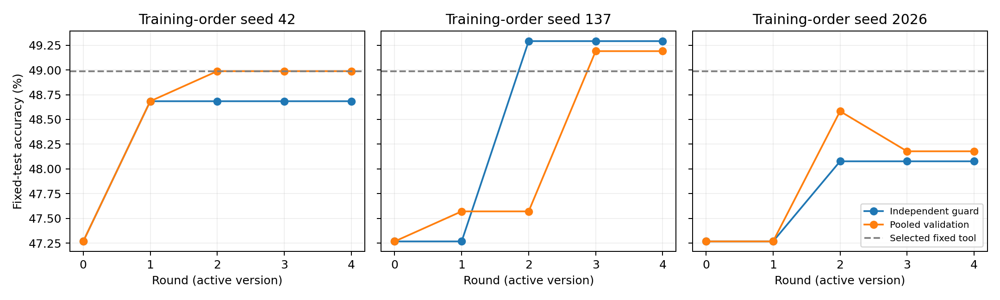

# v0.12：更换更新门控后，RSI 是否有效？

## 摘要

用已真实执行且完整收到回答的公开模型轨迹，隔离比较更新门控与动作空间。三个训练顺序、四轮更新确实改变了路由参数，但两个门控的平均准确率都没有超过开发集选出的固定工具。某些被接受更新在测试集退化。本版是探索性开发延伸，不是新的独立确认实验。

## 数据与控制协议

RxSafeBench 衍生选药题：625 训练 / 190 候选选择 / 197 退化检查 / 988 测试，场景组不交叉。固定 DeepSeek-V4.1-Flash，每次最多 512 输出 token。三个动作共用同一个 CoT 初稿：保留初稿、结合均衡说明书证据复核、结合安全证据复核。推理需一至两次模型调用。适应证动作有 153 个请求因 HTTP 402 未收到回答，因此排除；没有根据其已观察分数决定排除。两个门控均使用相同剩余动作及相同 387 个开发标签。

四轮依次暴露 156/312/468/625 个训练病例。固定文本哈希特征编码问题、候选药物和初稿，Ridge 参数学习各证据动作相对 CoT 的正确性变化。3 个正则系数 × 3 个阈值，分别通过“190 题选择 + 197 题独立检查”或“合并 387 题选择”决定。合并方案减少开发数据碎片化，但没有独立退化检查。此脚本先冻结全部选择再计算测试分数；此前版本已观察过该测试集，因此不称为全新确认。

## 同任务方法主表

| Method | Accuracy (%) | Seed SD (pp) | Mean model calls |
|---|---:|---:|---:|
| Frozen CoT | 47.27 | — | 1 |
| Validation-selected fixed evidence review | 48.99 | — | 2 |
| Fixed safety evidence review | 49.29 | — | 2 |
| Evolving router: independent guard | 48.68 | 0.61 | 1.710 |
| Evolving router: joint validation | 48.79 | 0.54 | 1.490 |

固定工具为开发集选出的 balanced。safety 是预设固定对照，不按测试分数选赢家。SD 表示三种训练顺序的敏感性。表内只含完整返回的回答，收到但格式错误的回答计错。此次重放没有新增模型请求；开发阶段为同一病例生成多个动作的反事实回答有额外成本，不能视为免费反馈。

## 究竟进化了什么

变化对象只有工具路由的系数、截距和阈值；模型权重、说明书库、检索代码、特征变换固定。版本文件保存参数哈希、已见病例数、候选及检查集修复/退化。这证明路由参数更新，不等同于工具源代码进化或发现新医学知识。

| Gate / seed | Round | Seen cases | Promoted | Active training cases | Correct / 988 | Fixes / regressions vs previous |
|---|---:|---:|---|---:|---:|---:|
| independent_guard_seed_42 | 1 | 156 | True | 156 | 481 | 116 / 102 |
| independent_guard_seed_42 | 2 | 312 | False | 156 | 481 | 0 / 0 |
| independent_guard_seed_42 | 3 | 468 | False | 156 | 481 | 0 / 0 |
| independent_guard_seed_42 | 4 | 625 | False | 156 | 481 | 0 / 0 |
| joint_validation_seed_42 | 1 | 156 | True | 156 | 481 | 116 / 102 |
| joint_validation_seed_42 | 2 | 312 | True | 312 | 484 | 66 / 63 |
| joint_validation_seed_42 | 3 | 468 | False | 312 | 484 | 0 / 0 |
| joint_validation_seed_42 | 4 | 625 | False | 312 | 484 | 0 / 0 |
| independent_guard_seed_137 | 1 | 156 | False | 0 | 467 | 0 / 0 |
| independent_guard_seed_137 | 2 | 312 | True | 312 | 487 | 108 / 88 |
| independent_guard_seed_137 | 3 | 468 | False | 312 | 487 | 0 / 0 |
| independent_guard_seed_137 | 4 | 625 | False | 312 | 487 | 0 / 0 |
| joint_validation_seed_137 | 1 | 156 | True | 156 | 470 | 24 / 21 |
| joint_validation_seed_137 | 2 | 312 | False | 156 | 470 | 0 / 0 |
| joint_validation_seed_137 | 3 | 468 | True | 468 | 486 | 56 / 40 |
| joint_validation_seed_137 | 4 | 625 | False | 468 | 486 | 0 / 0 |
| independent_guard_seed_2026 | 1 | 156 | False | 0 | 467 | 0 / 0 |
| independent_guard_seed_2026 | 2 | 312 | True | 312 | 475 | 16 / 8 |
| independent_guard_seed_2026 | 3 | 468 | False | 312 | 475 | 0 / 0 |
| independent_guard_seed_2026 | 4 | 625 | False | 312 | 475 | 0 / 0 |
| joint_validation_seed_2026 | 1 | 156 | False | 0 | 467 | 0 / 0 |
| joint_validation_seed_2026 | 2 | 312 | True | 312 | 480 | 31 / 18 |
| joint_validation_seed_2026 | 3 | 468 | True | 468 | 476 | 24 / 28 |
| joint_validation_seed_2026 | 4 | 625 | False | 468 | 476 | 0 / 0 |

## 解释与下一步

seed 2026 的合并选择方案在接受更新后，从 480 题正确降至 476 题，说明开发集改善不保证测试改善。seed 42 在平均 1.538 次调用下达到 484 题，与固定工具相同，但其他种子未确立稳定准确率优势。独立重算与场景聚类配对区间见 `results/summary.json`。训练量较小、仅文本路由信号较弱仍是可能原因。下一版应加入结果核验器，并配套同数据普通监督与固定策略对照；最终需在未使用的数据或切分上确认冻结设计，不能反复使用本测试集来证明最终领先。
