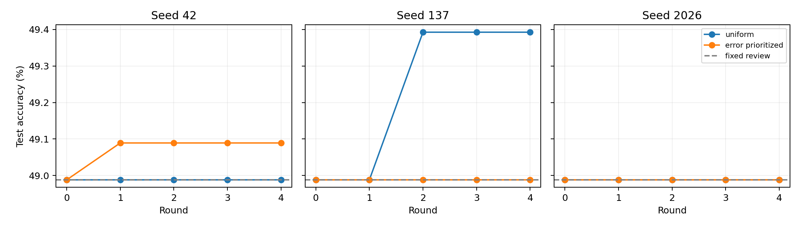

# v0.13：看到复核结果之后再决定是否采用

## 动机与已执行机制

v0.12 在看到工具结果之前选择动作。本版改为：核验器同时看初稿和已完成的证据复核，学习保留初稿还是接受修改。共用完整 CoT/balanced 轨迹与 625 训练 / 190 候选选择 / 197 退化检查 / 988 测试。核验器每例均消耗两次模型调用，返回初稿也不会抹掉复核成本。缓存重放没有新增网络请求。

特征包括答案中候选药名、否定词和正面词的关系，以及可选的问题/初稿/复核三个独立文本哈希；Ridge 学习修改是否提高正确率。四轮暴露 156/312/468/625 例。普通与错误优先两臂共用全部已见病例，每轮同为 18 个候选设置。错误权重在更新前计算，仅针对两答案中存在正确答案但当前选错的可修复问题；旧病例保留原始更新前权重。190 题选择配置，197 题要求净修复为正。另设全量普通监督核验器对照。全部选择先冻结再计算本版测试分数；该测试集此前已经用于开发观察。

## 同任务方法结果

| Method | Accuracy (%) | Seed SD (pp) | Calls |
|---|---:|---:|---:|
| CoT | 47.27 | — | 1 |
| Fixed balanced review | 48.99 | — | 2 |
| Full-data ordinary verifier | 47.87 | — | 2 |
| Incremental uniform verifier | 49.12 | 0.23 | 2 |
| Incremental error_prioritized verifier | 49.02 | 0.06 | 2 |
| Author GRASP core + task adapter (v0.10) | 50.81 | — | 1 |

共用公开衍生选药任务和 DeepSeek-V4.1-Flash 轨迹。GRASP 行为此前已完成的未修改作者核心加任务适配，开发机制/预算不同；它仍是本表最强实测行。普通增量核验的点估计略高于固定复核，但错误优先更新没有优于普通更新。

## 进化对象与逐轮轨迹

仅核验器系数/截距/阈值和训练反馈权重变化；基座模型参数、工具代码、证据库固定。发布参数与权重哈希，保留全部接受/拒绝记录。

| Arm / seed | Correct across rounds 0→4 | Promoted rounds |
|---|---|---|
| uniform / 42 | 484 → 484 → 484 → 484 → 484 | none |
| uniform / 137 | 484 → 484 → 488 → 488 → 488 | 2 |
| uniform / 2026 | 484 → 484 → 484 → 484 → 484 | none |
| error_prioritized / 42 | 484 → 485 → 485 → 485 → 485 | 1 |
| error_prioritized / 137 | 484 → 484 → 484 → 484 → 484 | none |
| error_prioritized / 2026 | 484 → 484 → 484 → 484 → 484 | none |

两个答案的并集中，586/988 例至少有一个正确答案。这是依赖测试标签的诊断上界，绝不作为已实现 agent 的成绩。它说明存在选择空间，不说明现有特征能够识别。

## 核验与限制

已独立核对病例对齐、计数、每轮修复/退化和完整两次调用成本。场景聚类配对区间见 `results/summary.json`，为未作多重比较校正的描述性区间。三个泄漏/计费契约测试通过。150 次拟合出现 225 次数值后端矩阵乘法警告；系数、截距、所有已评分预测均有限，独立逐元素重算加权截距的最大误差为 1.12e-16，审计记录保留。

小规模且被反复观察的开发测试尚不能证明 RSI 独有优势。继续在此调试必须标明探索性质，最终需要冻结设计和未使用数据确认。正在运行的本地 QLoRA 将单独检验真实语言模型参数更新。
