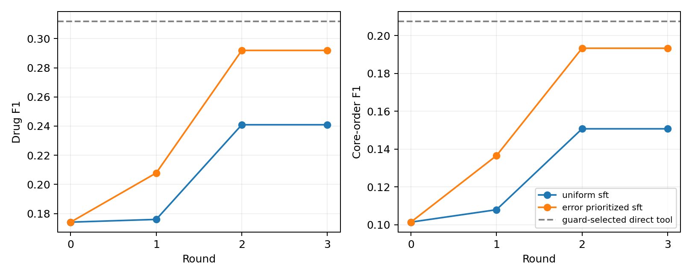
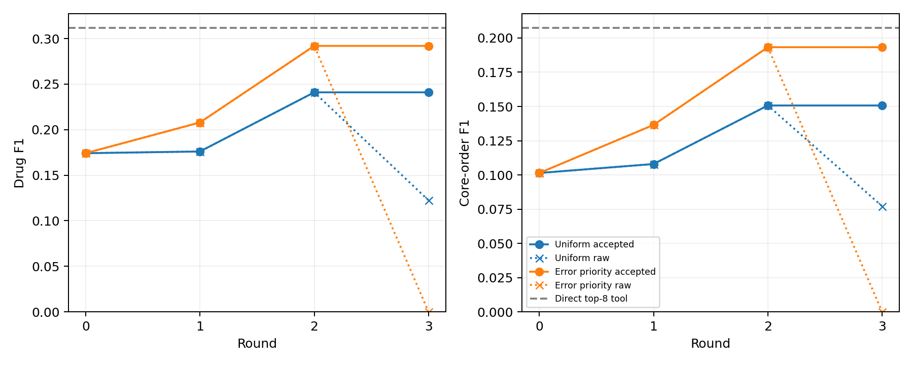

# v0.15 — Actual local QLoRA parameter evolution

## Protocol

Qwen3-4B 4-bit, last eight layers with 3.670M trainable adapter parameters. Three patient-disjoint 600-case feedback blocks; uniform and pre-update-error-prioritized sampling train on 400 cases for 100 steps each round. Both arms share the frozen initial-8k candidate/order tools, loss validation (100), guard (200), and new test (500 admissions / 494 patients). All selections were frozen before test evaluation. Optimizers reset per round while the latest adapter continues training. The chosen inference adapter is the best guard checkpoint. Model weights, feedback and patient data remain local.

## Matched method results

| Method | Drug F1 | Core-order F1 | Mean predicted drugs |
|---|---:|---:|---:|
| base | 0.17414 | 0.10141 | 3.83 |
| uniform_sft | 0.24094 | 0.15072 | 3.09 |
| error_prioritized_sft | 0.29192 | 0.19329 | 6.75 |
| all_20_candidate_tools | 0.28390 | 0.19181 | 20.00 |
| guard_selected_top_k_tools | 0.31169 | 0.20739 | 8.00 |

## Round trajectories / 逐轮轨迹

| Arm | Round | Selected checkpoint | Drug F1 | Order F1 | Cases improved / regressed |
|---|---:|---:|---:|---:|---:|
| uniform_sft | 0 | 0 | 0.17414 | 0.10141 | 0 / 0 |
| uniform_sft | 1 | 1 | 0.17600 | 0.10796 | 168 / 127 |
| uniform_sft | 2 | 2 | 0.24094 | 0.15072 | 160 / 108 |
| uniform_sft | 3 | 2 | 0.24094 | 0.15072 | 0 / 0 |
| error_prioritized_sft | 0 | 0 | 0.17414 | 0.10141 | 0 / 0 |
| error_prioritized_sft | 1 | 1 | 0.20786 | 0.13653 | 96 / 176 |
| error_prioritized_sft | 2 | 2 | 0.29192 | 0.19329 | 264 / 61 |
| error_prioritized_sft | 3 | 2 | 0.29192 | 0.19329 | 0 / 0 |

## What evolves and what it means

Adapter files and sampling membership hashes change at each round. Candidate retrieval and joint-order templates are fixed. The model selects recorded templates; it does not learn novel dose generation. Clinical indication, DDI and renal safety are not established by agreement with historical orders. Ground truth supports automatic scoring without requiring new clinician review.

Strict versus normalized validity is retained: only an empty Qwen reasoning envelope is stripped. The pre-test parser/cache repair preserves raw outputs. Test predictions were independently recounted using drug sets and complete drug/route/dose/unit tuples, with patient-cluster paired intervals. Unknown fields remain unscored. A higher score than the initial model alone is insufficient evidence of an RSI benefit; error-prioritized updates must be compared with ordinary updates and direct use of the same tools.

## Predeclared intervention

The output is an exact 20-position inclusion mask, adding explicit negative supervision. Both arms restart the original backbone. Patient membership, candidate tools and step/example budgets match v0.9; target-token counts differ. Protocol was frozen before v0.9 test scoring. The direct tool controls are reused only after exact test case, GT and catalogue equality checks.

## Completed findings and failure diagnosis

Both arms select round 2 before testing. Error prioritization improves over uniform updating by 0.05098 drug F1 and 0.04257 order F1, with positive descriptive patient-cluster intervals. It still trails direct top-8 tools by 0.01977/0.01410, with negative intervals. This is one learning seed, not a robust superiority result. Equal sample/step budgets do not equal target-token budgets across the ID and binary representations.

The raw priority checkpoint in round 1 emits either all-zero or all-one masks (70.8%/29.2%). Round 2 has 16 distinct masks, with 99% consisting of an initial run of ones followed only by zeros; only 34% of GT masks have that pattern. Round 3 emits all zeros on both guard and test and is rejected on guard. Its zero is valid parsed model output, not a transport or parser failure. The accepted curve is flat after round 2 because selection protects it; the underlying model has not improved monotonically. Candidate-order/cardinality bias is a post-hoc diagnosis, not an isolated causal explanation.

Independent auditing confirms six actual adapter hashes, all six 100-step logs, the 400 selected training rows per round, target masks, selection decisions and all saved test predictions. However, 10 of 3,600 pre-update feedback records cannot be reconstructed exactly from the current input-keyed cache: duplicate-input generations could overwrite each other. The original recorded weights and resulting sampled memberships are preserved and verified; the missing individual feedback generations are not invented. This limits complete training-trace reproducibility, without changing the independently recounted test scores. Fresh runs must deduplicate identical generation requests and preserve immutable case-bound feedback receipts.

| Contrast | Drug Δ (95% CI) | Order Δ (95% CI) |
|---|---:|---:|
| error_prioritized_sft__minus__uniform_sft | +0.05098 [+0.03495, +0.06641] | +0.04257 [+0.02972, +0.05428] |
| error_prioritized_sft__minus__guard_selected_top_k_tools | -0.01977 [-0.03265, -0.00787] | -0.01410 [-0.02381, -0.00520] |

Audit: `results/learning_audit.json`. No test-based checkpoint reselection was performed.

## Post-study cache repair

The future runner now deduplicates identical model requests before generation, saves immutable case/catalogue-bound receipts and snapshots the exact pre-update feedback outputs. A regression test verifies duplicate prompts with different catalogues, replay without extra generation and rejection of a corrupted receipt. Completed v0.15 cannot be accidentally rerun; `results/executed_source_manifest.json` pins its original executed code. This repair does not retroactively recover the10 missing individual outputs or alter the reported study.
