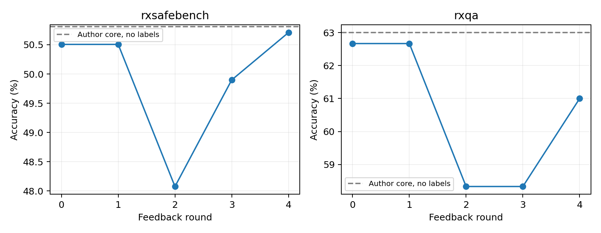

# v0.17 — Grounded skill evolution and matched component controls

## Design and main result

The unchanged GRASP core (pin `9d7d125a`) learns skill files over the fixed openFDA excerpt tool. Both evidence/no-evidence and skill/no-skill controls use the same actor prompt, DeepSeek-V4.1-Flash and one 512-token call. 625 training cases are exposed in four batches; the original core uses balanced training probes and end-of-epoch validation on 387 cases. LLM weights, retrieval code and label snapshot stay fixed. This is a grounded task harness with a credited optimizer, not a novel optimizer claim.

### Same 988 derived RxSafeBench questions

| Method | Correct | Accuracy (%) | Calls / case |
|---|---:|---:|---:|
| CoT | 467/988 | 47.27 | 1 |
| Author GRASP core | 502/988 | 50.81 | 1 |
| Fixed grounded harness | 499/988 | 50.51 | 1 |
| Grounded skill evolution | 501/988 | 50.71 | 1 |

### Separate 300-question RxQA transfer

| Method | Correct | Accuracy (%) | Calls / case |
|---|---:|---:|---:|
| CoT | 193/300 | 64.33 | 1 |
| Author GRASP core | 189/300 | 63.00 | 1 |
| Fixed grounded harness | 188/300 | 62.67 | 1 |
| Grounded skill evolution | 183/300 | 61.00 | 1 |

Combining the components yields only two additional correct test answers over fixed grounded inference and one fewer than author-core GRASP without evidence. Transfer declines by five answers versus the fixed grounded control. The validation gain (49.1% to 53.2%) does not establish a test or transfer benefit. The paired factorial interaction is also reported; it tests whether the combined gain exceeds the sum of separate component gains. Negative results are retained.

## What changed and when?

Round 1 accepts no skill. Round 2 adds `label_indication_and_caution_parsing`; rounds 3 and 4 modify it. Exact generated text and SHA-256 hashes are released under `artifacts/` and `results/round_artifacts.json`. The artifacts contain model-generated decision guidance and are not clinical authority. Test and transfer labels never select the skill state. Intermediate evaluations are descriptive process evidence on an already observed development benchmark.

| Dataset | Round | Seen cases | Correct | Fixes / regressions |
|---|---:|---:|---:|---:|
| rxsafebench | 0 | 0 | 499/988 | 0 / 0 |
| rxsafebench | 1 | 157 | 499/988 | 0 / 0 |
| rxsafebench | 2 | 314 | 475/988 | 70 / 94 |
| rxsafebench | 3 | 471 | 493/988 | 74 / 56 |
| rxsafebench | 4 | 625 | 501/988 | 76 / 68 |
| rxqa | 0 | 0 | 188/300 | 0 / 0 |
| rxqa | 1 | 157 | 188/300 | 0 / 0 |
| rxqa | 2 | 314 | 175/300 | 19 / 32 |
| rxqa | 3 | 471 | 175/300 | 17 / 17 |
| rxqa | 4 | 625 | 183/300 | 22 / 14 |

All final predictions are independently recounted and case-aligned; paired scenario/item intervals and repairs/regressions are in `results/summary.json`. Test-time costs are logical cached-or-new usage; actual charged calls remain in the local shared ledger. No restricted patient data is used.

