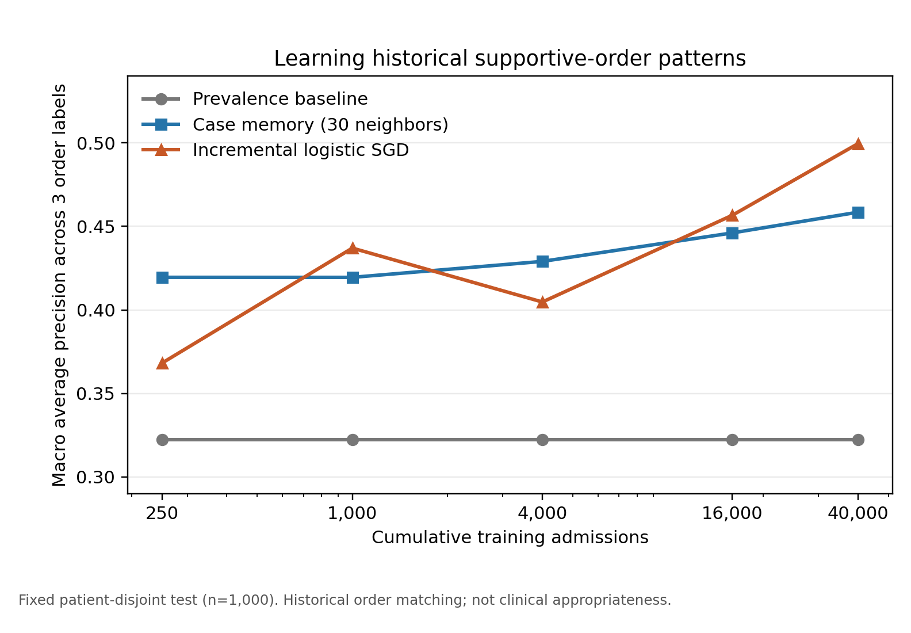

# PRISMATIC 2：病例增长、辅助医嘱与安全复核——研究升级及初步结果

**日期：2026-10-14。性质：研究原型，不用于真实处方。** 代码在本目录，机器可读结果在 [`results/`](results/)；本报告的英文对应版为 [`REPORT_EN.md`](REPORT_EN.md)。

## 1. 新论文要回答什么

2025 版 PRISMATIC 将多代理处方生成、风险检查以及 DSWA/DFCM 反馈更新放在同一叙事中。升级版把它们分成三个可独立验证的问题：

1. **历史行为学习：**病例从 250 增至 40,000 时，系统是否更能预测临床医生会开哪些辅助医嘱，包括静脉 0.9% 氯化钠、昂丹司琼、番泻叶/多库酯？
2. **临床适宜性：**历史上开过的药物是否真的适合该患者？需要药师或医生独立标注，不能由医嘱重合率推断。
3. **安全复核：**对医生拟开处方给出可追溯的风险证据、局部修改或缺失信息请求，是否降低严重遗漏，同时控制误报和无意改动？

拟议的核心架构是：**时间戳冻结的病历快照 → 主治疗/辅助治疗双候选头 → 相似病例记忆与证据检索 → 独立规则/模型复核 → 有界修改或弃权 → 临床反馈 → 离线版本门控**。每次更新只使用训练期的新病例；固定测试集绝不回流。病例记忆应储存“情境、医嘱、临床审核结论、理由、证据版本”，而非只存一个药名。当前实验只有前三项中的历史医嘱标签，尚不能声称学到了医生的真实思路。

## 2. 与近期研究及其数据集的关系

| 工作 | 任务/数据 | 与 PRISMATIC 2 的关系 | 本轮状态 |
| --- | --- | --- | --- |
| [SafeRx-Agent, 2026](https://arxiv.org/abs/2605.29146) | MIMIC-III/IV；ATC 四级药物集合；专科专家、**常驻辅助治疗专家**和安全验证器 | “辅助用药代理”已经存在，不能单独当作创新点；应在相同 ATC 四级预处理上复现其 GAMENet、SafeDrug、直接提示及代理对照 | 当前 GSN/入院后 6 小时任务不同，**不直接比较分数** |
| [RxEval, 2026](https://arxiv.org/abs/2605.14543) | 584 位患者的 1,547 道处方级题目；药物、剂量、给药途径三元组 | 下一阶段补剂量/途径和时间轨迹评价 | 论文页未给出可核实的公开数据下载链接，本轮未跑 |
| [RxSafeBench, BIBM 2025](https://github.com/CAS-SIAT-XinHai/RxSafeBench) | 2,443 个公开模拟会诊场景；禁忌和相互作用三选一 | 同一公开数据上比较近期 OpenRouter 模型的用药安全推理 | 本轮各类抽样 30 题，共 60 题 |
| [RxQA / AMIE, Nature 2026](https://github.com/Google-Health/rxqa) | 公开的 300 道 OpenFDA 药学四选一题；药师修订；BNF 部分因许可未公开 | 检验药学知识与推理，但不代表真实处方制定 | 本轮固定哈希抽样 100 题 |
| [MedAgentBench, 2025](https://github.com/stanfordmlgroup/MedAgentBench) | 300 个 FHIR 虚拟 EHR 任务；需服务环境和官方参考评测脚本 | 下一阶段验证工具调用、医嘱工作流和状态修改 | 环境与官方评分未建立，本轮未跑 |
| [HealthFlow, 2026](https://github.com/yhzhu99/HealthFlow) | 公开 EHR 工作流基准及可复用经验记忆 | 可对照“反思后写回经验”的机制；任务是 EHR 分析而非处方 | 方法对照，未跑其基准 |

上表反映截至本日期核实的论文/官方仓库。**跨论文原始分数不构成直接对比**：输入时间、药物编码、候选空间、病例数、提示词和评价指标均不同。真正的方法对照需要统一数据、切分、药物编码和推理预算。

## 3. 本地病例增长实验

数据为本机受限目录中的 MIMIC-IV v3.1 医院处方与 MIMIC-IV-ED v2.2。决策点定在医院入院时间；输入仅用急诊主诉、分诊紧急程度及入院前已记录的家庭药物。标签取入院后六小时内的医嘱。该初步队列复用了“六小时内至少有一条口服 GSN 医嘱”的 125,853 次入院、71,736 位患者，因此结果只适用于这一条件化人群。构建时检测到的时间越界和重复入院均为 0。

辅助医嘱标签为静脉等渗盐水（精确药名匹配并排除显式冲管/载体名称）、昂丹司琼、番泻叶/多库酯；阳性入院次数分别为 **36,454（28.97%）**、**25,804（20.50%）**、**58,483（46.47%）**。盐水仍可能包含未显式命名的药物载体；本轮没有审核给药量、速度、适应证或是否恰当。

患者不交叉的训练/验证/测试哈希切分后，固定 1,000 例测试。逐步累积 250、1,000、4,000、16,000、40,000 例训练病例；比较只预测患病率的基线、相似病例记忆（前 30 个余弦邻居）和增量式 SGD 逻辑模型。所有模型只看决策点以前的文本特征，测试标签不进入更新。平均精确率 AP 是排序指标，越高越好。

| 已见训练病例 | 患病率基线：三类宏 AP | 病例记忆：三类宏 AP | 增量模型：三类宏 AP |
| ---: | ---: | ---: | ---: |
| 250 | 0.3223 | 0.4195 | 0.3683 |
| 1,000 | 0.3223 | 0.4195 | 0.4370 |
| 4,000 | 0.3223 | 0.4290 | 0.4047 |
| 16,000 | 0.3223 | 0.4461 | 0.4567 |
| 40,000 | 0.3223 | **0.4585** | **0.4995** |

40,000 与 250 例的宏 AP 差，按患者重采样的 95% 区间：病例记忆 **+0.0114 至 +0.0664**；增量模型 **+0.0985 至 +0.1600**。曲线中间有回落，不能说每新增一批病例必然变好。40,000 例时增量模型的 AP 分别为盐水 **0.4638**、昂丹司琼 **0.4538**、肠道辅助用药 **0.5808**；这只是对历史医嘱的预测。完整 AUROC、Brier 分数和各阶段阳性数见 [`evolution_curve.json`](results/evolution_curve.json)。

旧版口服药任务的补充结果：6 小时目标、4,000 例测试、每例预测 5 个 GSN 码时，热门药基线宏 Recall@5 **0.2995**，TF-IDF+SGD **0.3547**；24 小时灵敏度任务分别为 **0.2352** 和 **0.2990**。本地 Qwen3-4B 的 32 例接口测试为 **0.2256**，仅验证接口，不代表模型排名。详见 [`baseline_results_6h.json`](results/baseline_results_6h.json) 与 [`llm_pilot_comparison.json`](results/llm_pilot_comparison.json)。

## 4. OpenRouter 公共基准初步结果

脚本使用 `provider.zdr=true` 和 `provider.data_collection=deny`，温度 0，每题单次回答。三个模型为 `openai/gpt-6.1-sol`、`google/gemini-3.8-flash`、`deepseek/deepseek-v4.1-flash`。RxSafeBench 对重复会诊按“对话＋正确药物”去重后抽样，并平衡正确答案 A/B/C；RxQA 保留原始选项顺序。结果文件记录精确源提交、样本规则、成功率、token 与费用。

| 模型 | RxSafeBench 禁忌/相互作用 60 题 | RxQA OpenFDA 100 题 | 两项正式运行报告费用 |
| --- | ---: | ---: | ---: |
| GPT-6.1 Sol | 35/60，58.3%；有效字母 58/60 | **79/100，79%**；有效字母 96/100 | US$0.1779 |
| Gemini 3.8 Flash | 35/60，58.3%；有效字母 59/60 | **77/100，77%**；有效字母 100/100 | US$0.1120 |
| DeepSeek V4.1 Flash | 29/60，48.3%；有效字母 60/60 | **64/100，64%**；有效字母 100/100 | US$0.0081 |

RxSafeBench 的 60 题中有 2 题在对话里直接出现了正确药名；这是潜在提示线索。GPT-6.1 Sol 与 Gemini 的配对准确率差为 0，95% bootstrap 区间 **−10.0 至 +10.0 个百分点**；二者各自对 DeepSeek 的 +10.0 点差异，其区间都跨越 0。此样本无法确认模型间的优劣。RxQA 原选项分布不均，100 题中 46 题正确答案为 C，**恒选 C 基线为 46%**；GPT 与 Gemini 的 2 点差异区间为 **−4 至 +8 点**，而 GPT、Gemini 相对 DeepSeek 的配对差异分别为 **+15 点 [6,24]**、**+13 点 [5,22]**。DeepSeek 请求显式关闭推理，其他模型用默认推理设置；不同推理设置也是结果的限制。原始汇总、逐题预测与配对区间见 [`RxSafeBench 结果`](results/openrouter_rxsafe_pilot.json)、[`RxQA 结果`](results/openrouter_rxqa_pilot.json)、[`配对比较`](results/public_paired_comparison.json)。两项公共测试分别说明模拟安全选择与药学问答能力，不能证明完整、适宜的处方生成，更不能与 MIMIC 的 AP/Recall 相减作提升率。

## 5. 论文升级的下一轮实验清单

1. **临床理由标注：**从盐水、止吐、肠道管理及未开辅助医嘱的病例中分层抽样至少 200 例，由两位药师/临床医生盲评“有指征、无指征、信息不足”，分别记录盐水的维持/复苏/载体/冲管用途、剂量、速度、过量风险和遗漏原因。
2. **统一对照任务：**将 MIMIC-IV 和可用的 eICU 医嘱映射至一致的 RxNorm/ATC 四级空间；在相同患者切分上重跑 GAMENet、SafeDrug、SafeRx-Agent 可复现部分以及同一底座模型的直接提示、RAG 和完整 harness。若原作者的映射或权重不可得，明确列为“独立复现”，不借用其论文分数。
3. **处方级评测：**增加药物、剂量、途径、频次、给药时点；若 RxEval 数据公开，按原协议跑；否则构建独立标注的处方级测试集。对药物相互作用、禁忌、肾功能调整和无理由辅助药分别报告敏感度、误报和新增伤害。
4. **进化消融：**固定基础模型与 token 预算，比较无记忆、只加病例、加审核理由、加证据、加安全门控；五个病例规模至少跑 3 个种子，并在固定未见患者上报告患者级置信区间。引入负反馈和撤销/回滚，拒绝使严重安全指标恶化的版本。
5. **真实工作流：**用 MedAgentBench/FHIR 测试医嘱读取、状态更新和工具错误恢复；对人类复核时间、弃权和错误定位作盲评。所有真实处方仍由临床人员决定。

## 6. 隐私、复现与结论边界

所有逐例 MIMIC 队列、模型、提示和预测均留在受限数据目录。按 [PhysioNet 的 2025 年指引](https://physionet.org/news/post/llm-responsible-use/)，第三方 LLM 服务的零保留、非训练和无人工审阅要求须逐项核实；本轮因此只向 OpenRouter 发送公开的 RxSafeBench/RxQA 内容。密钥由进程环境变量读取，没有写入代码或 Git。

可复现实验入口见 [`README.md`](README.md)，逐步计划见 [`EXPERIMENT_PLAN.md`](EXPERIMENT_PLAN.md)。当前证据支持“更多历史病例能够改善一部分辅助医嘱的排序预测”，**不支持**“系统已经学会医生的临床决策依据”或“处方已更安全”。这两个更强结论是下一轮标注与安全实验的预注册目标。
