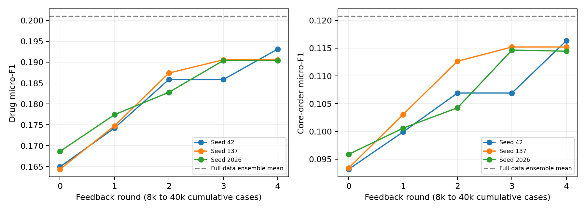

# v0.21 — Recorded-availability-controlled order comparison

## Task and cohort

The decision is actual hospital admission plus6h; targets are new/changed orders during the next6h. Provider and pharmacy entry clocks must both lie in the target window with exact patient/admission/POE linkage and pharmacy verification by its end. Cases with inconsistent potential targets are excluded. Inputs contain demographics, previously recorded orders and blood tests available by the decision; untimed triage, discharge diagnoses and future results are omitted.

Of201,750 source admissions,54,959 meet the coherent-time, nonempty-target and complete-followup criteria. Sampling and previous-test exclusions yield40,000 training,2,000 proposal,2,000 guard and1,082 test admissions (1,024 test patients). All splits are patient-disjoint, and old v6/v7/v9 test patients are excluded from this test. An independent source/serialization audit passes all12 clock/identity/finiteness checks. The cohort remains retrospectively selected and released tables lack full field-version history.

## Matched methods

All rows share inputs, initial8k-frozen128-name vocabulary, an at-most20-order output cap, and drug/core-order scoring. Gold names outside the vocabulary remain in recall. This repeats the frozen artifact-learning method family under a repaired time protocol; it is not a GAMENet/SafeDrug reproduction or new LLM architecture. Full-data models control for accumulated supervision. Hyperparameters use proposal labels; evolving states additionally pass the independent guard. Three seeds were registered before training.

| Method | Drug F1 mean ± SD | Core-order F1 mean ± SD | Mean drugs | Empty (%) |
|---|---:|---:|---:|---:|
| Word policy + global templates | 0.19325 ± 0.00130 | 0.10895 ± 0.00118 | 5.66 | 1.88 |
| Word policy + conditional tool | 0.19325 ± 0.00130 | 0.11650 ± 0.00028 | 5.66 | 1.88 |
| Case retrieval + global templates | 0.15592 ± 0.00000 | 0.08795 ± 0.00000 | 3.28 | 16.82 |
| Case retrieval + conditional tool | 0.15592 ± 0.00000 | 0.09518 ± 0.00077 | 3.28 | 16.82 |
| Tuned word policy + tool | 0.19832 ± 0.00498 | 0.11939 ± 0.00327 | 5.00 | 3.70 |
| Tuned character policy + tool | 0.19552 ± 0.00223 | 0.11671 ± 0.00137 | 4.53 | 4.65 |
| Word/character ensemble + tool | 0.20096 ± 0.00255 | 0.12071 ± 0.00283 | 4.71 | 4.10 |
| Naive Bayes + tool | 0.15229 ± 0.00000 | 0.09246 ± 0.00084 | 5.06 | 31.79 |
| RxRSI selected artifact state | 0.19136 ± 0.00154 | 0.11533 ± 0.00094 | 5.35 | 2.74 |
| Freeze initial policy | 0.16238 ± 0.00095 | 0.09817 ± 0.00124 | 6.09 | 2.00 |
| Freeze initial tool | 0.19136 ± 0.00154 | 0.11425 ± 0.00043 | 5.35 | 2.74 |
| Freeze initial memory | 0.19555 ± 0.00250 | 0.11832 ± 0.00109 | 5.19 | 2.90 |
| Training prevalence | 0.12679 ± 0.00000 | 0.07471 ± 0.00000 | 12.00 | 0.00 |
| Reuse recorded prior orders | 0.09508 ± 0.00000 | 0.05564 ± 0.00000 | 6.25 | 5.64 |

## Main finding

Mean drug/core-order F1 rises from0.16597/0.09415 at8k cases to0.19136/0.11533 at40k, but trails the equal-data ensemble at0.20096/0.12071. The paired drug-F1 interval against that control is below zero in each seed. Freezing initial memory improves the final mean to0.19555/0.11832, so expanding this retrieval memory does not help. The conditional-tool point contribution is modest; parameter updates explain the larger case-growth gain. Some accepted individual-seed order updates regress even though the mean curve rises. The final empty-output rate is2.74% on this protocol; it is not a matched comparison to earlier empty-output pilots.

Development-only diagnostics cover80.80% of gold drug names and75.36% of complete joint tuples with the fixed vocabulary/tool library. Only16.05% of target drugs occur in the prior-order context. Perfect-selection support ceilings are diagnostic upper bounds, not method results. [Capacity audit](results/development_capacity_audit.json). The separately declared [v0.22 representation pilot](../upgrade_v22/RESULTS.en.md) investigates numerical state without using these test labels for selection.

## Fixed-test trajectories / 固定测试逐轮轨迹

| Seed | Round | Training cases | Drug F1 | Order F1 | Improved / regressed |
|---|---:|---:|---:|---:|---:|
| 42 | 0 | 8000 | 0.16493 | 0.09319 | 0 / 0 |
| 42 | 1 | 16000 | 0.17422 | 0.09990 | 250 / 207 |
| 42 | 2 | 24000 | 0.18584 | 0.10692 | 243 / 193 |
| 42 | 3 | 32000 | 0.18584 | 0.10692 | 0 / 0 |
| 42 | 4 | 40000 | 0.19314 | 0.11633 | 231 / 196 |
| 137 | 0 | 8000 | 0.16435 | 0.09340 | 0 / 0 |
| 137 | 1 | 16000 | 0.17473 | 0.10305 | 271 / 204 |
| 137 | 2 | 24000 | 0.18739 | 0.11264 | 264 / 195 |
| 137 | 3 | 32000 | 0.19057 | 0.11520 | 225 / 181 |
| 137 | 4 | 40000 | 0.19057 | 0.11520 | 0 / 0 |
| 2026 | 0 | 8000 | 0.16864 | 0.09587 | 0 / 0 |
| 2026 | 1 | 16000 | 0.17742 | 0.10059 | 252 / 210 |
| 2026 | 2 | 24000 | 0.18278 | 0.10425 | 219 / 202 |
| 2026 | 3 | 32000 | 0.19039 | 0.11465 | 230 / 202 |
| 2026 | 4 | 40000 | 0.19039 | 0.11445 | 20 / 19 |

## Evolution scope and limits / 进化范围与边界

Persistent selection parameters, training memory and conditional order-tool parameters change. LLM weights and executable code do not change in this experiment. Parameter, memory and tool hashes, promotion decisions and paired intervals are in `results/summary.json`. Freeze-one-object ablations retain the other final settings and are not separately optimized. The same-data full-data control is necessary: improvement over an8k initial checkpoint alone is not an RSI advantage.

Every saved method/checkpoint prediction has been independently recounted. Historical order agreement does not establish clinical indication, DDI or renal safety; missing clinical fields remain unknown. This table belongs to its own recorded-availability task and must not be numerically merged with the earlier start-time task or author-reported paper scores. Restricted cases, features, predictions and models stay local.
