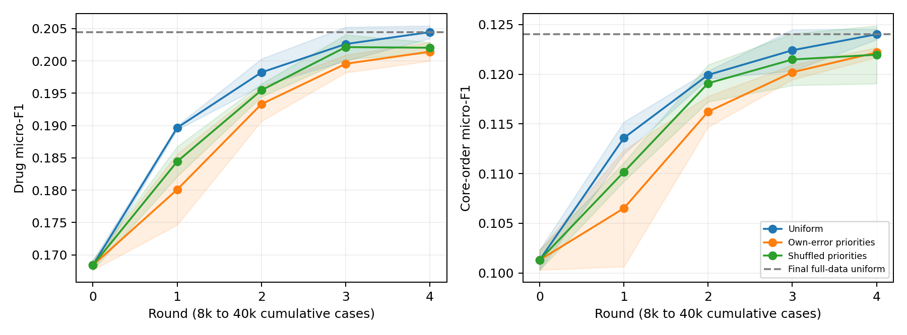

# v0.23：按自身错误更新，是否真的优于普通学习？

## 问题与公平对照

接续v0.22表示改进，冻结词＋数值特征和128药名词表。三个种子各跑五轮8k/16k/24k/32k/40k病例，比较普通更新、按当前已接纳策略的错误给新病例加权、将同批权重随机打乱。错误权重为1+3×可达药物F1错误；进入累计训练时归一化为均值1。后两臂的权重分布相同，只有分配到病例的方式不同。

三臂每轮都训练128个药物分类器，每个恰好60轮，没有提前停止；训练病例、曝光次序和更新次数在种子内相同。初始8k模型共享。订单工具只在当轮已见病例上拟合，种子/轮次内共享；被拒绝的版本保留旧策略与工具。七个阈值只用候选验证选择，再通过独立检查集决定接纳。三个种子、全部臂都冻结后才统一测试。

本轮确实更新选择参数、持久病例反馈权重及订单工具参数；不更新LLM或可执行代码。它检验监督式反馈更新，不把新增病例或更好的表示单独称为RSI。轮次是事后病例块，并非真实时间部署，训练患者可能跨轮次出现。

## 完整方法结果

同一1,082次测试住院、1,024位患者。**v0.21测试此前已经观察，本轮是明确标注的探索性复用，仍需要新的确认数据。** v0.21词/字符行使用不同的早停/调参预算，只作上下文参考；严格相同步数的因果比较是当前三臂。

| Method / 方法 | Drug F1 mean ± SD | Core-order F1 mean ± SD | Empty (%) |
|---|---:|---:|---:|
| 初始8k状态 | 0.16840 ± 0.00076 | 0.10130 ± 0.00101 | 1.26 |
| 全量普通监督版本 | 0.20446 ± 0.00098 | 0.12403 ± 0.00054 | 1.85 |
| 普通逐轮更新 | 0.20446 ± 0.00098 | 0.12403 ± 0.00054 | 1.85 |
| 自身错误优先更新 | 0.20143 ± 0.00143 | 0.12219 ± 0.00050 | 2.53 |
| 同分布随机权重对照 | 0.20204 ± 0.00083 | 0.12197 ± 0.00291 | 1.51 |
| 错误优先＋冻结初始订单工具 | 0.20143 ± 0.00143 | 0.11909 ± 0.00177 | 2.53 |
| v0.21词/字符参考（优化预算不同） | 0.20096 ± 0.00255 | 0.12071 ± 0.00283 | 4.10 |

## 结论

普通更新为0.20446/0.12403，自身错误加权为0.20143/0.12219，打乱权重为0.20204/0.12197。错误加权没有优于普通更新；三个种子的药物与订单差异区间均含零，因此也不宣称已经证明其劣势。与随机分配的比较没有一致优势。普通更新的数值高于旧词/字符参考，但二者优化预算不同，不能单独归因于数值表示。

错误加权的逐轮均值从0.16840/0.10130升至0.20143/0.12219，但个别种子/指标仍有下降。冻结初始工具后订单F1为0.11909；工具更新的平均差异为+0.00311，只有一个种子的配对区间不含零。这些证据支持实际参数/工具变化，尚不支持独特RSI收益或稳定的工具因果优势。全量普通监督行与普通逐轮最终状态相同，因为各种子均接纳了最后检查点。

## Fixed-test trajectories / 固定测试轨迹

| Round | Cumulative cases | Uniform drug/order F1 | Own-error drug/order F1 | Shuffled drug/order F1 |
|---|---:|---:|---:|---:|
| 0 | 8,000 | 0.16840/0.10130 | 0.16840/0.10130 | 0.16840/0.10130 |
| 1 | 16,000 | 0.18966/0.11359 | 0.18009/0.10651 | 0.18443/0.11016 |
| 2 | 24,000 | 0.19823/0.11994 | 0.19332/0.11624 | 0.19547/0.11910 |
| 3 | 32,000 | 0.20261/0.12242 | 0.19956/0.12021 | 0.20214/0.12149 |
| 4 | 40,000 | 0.20446/0.12403 | 0.20143/0.12219 | 0.20204/0.12197 |

## Paired causal controls / 配对机制对照

| Seed | Contrast | Drug Δ | Order Δ | Drug95% interval | Order95% interval |
|---|---|---:|---:|---:|---:|
| 42 | Error priority − uniform | -0.00236 | -0.00123 | [-0.00705,+0.00205] | [-0.00466,+0.00214] |
| 42 | Error priority − permuted_priority | +0.00190 | +0.00341 | [-0.00191,+0.00554] | [+0.00072,+0.00600] |
| 42 | Error priority − full_data_uniform | -0.00236 | -0.00123 | [-0.00705,+0.00205] | [-0.00466,+0.00214] |
| 137 | Error priority − uniform | -0.00229 | -0.00177 | [-0.00654,+0.00174] | [-0.00532,+0.00154] |
| 137 | Error priority − permuted_priority | -0.00123 | -0.00180 | [-0.00524,+0.00254] | [-0.00489,+0.00121] |
| 137 | Error priority − full_data_uniform | -0.00229 | -0.00177 | [-0.00654,+0.00174] | [-0.00532,+0.00154] |
| 2026 | Error priority − uniform | -0.00444 | -0.00252 | [-0.00931,+0.00043] | [-0.00641,+0.00138] |
| 2026 | Error priority − permuted_priority | -0.00249 | -0.00096 | [-0.00674,+0.00139] | [-0.00425,+0.00217] |
| 2026 | Error priority − full_data_uniform | -0.00444 | -0.00252 | [-0.00931,+0.00043] | [-0.00641,+0.00138] |

## 独立核验与解释边界

已从旧接纳检查点重新推理每批反馈，独立按药物集合重算错误权重；核对打乱后的分布、全部分类器60轮预算、工具训练成员、状态冻结和所有测试预测。逐病例改善/退化、接纳/拒绝及参数/工具/权重哈希见 `results/summary.json` 与逐轮日志。冻结初始工具消融没有重新调参，测量的是最终状态中的条件依赖。

曲线阴影是三个种子的标准差；患者聚类配对区间为2000次重采样的描述性区间，没有多重比较校正。错误优先必须同时比较普通更新和随机权重对照，不能只凭超过初始模型宣称独特收益。所有病例、权重和预测保留本地。
