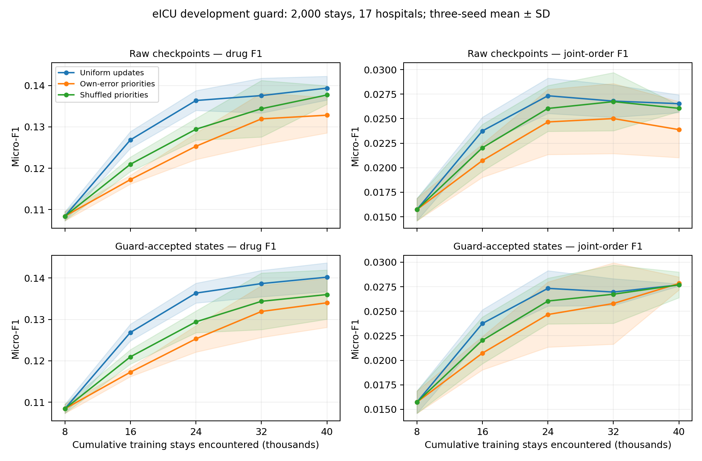

# eICU：独立复算的开发集学习曲线

## 数据与解释范围

本项事后分析重新执行已完成的 45 个状态：三个种子 × 三种反馈方法 × 五轮。只打开开发数据包。guard 含 2,000 次住院、1,912 位患者、17 家医院，其中 1,001 次住院没有目标药物。另有 8,005 次住院的测试集，仍遵循原全部版本选择冻结后的开放规则。

逐项核对原始参数哈希、60 轮训练记录、工具的已见病例成员、七个 proposal 阈值及全部 guard 接纳／拒绝决定。重新运行保存的策略和工具，使用独立集合计数复算指标。这里没有独立重新训练优化器，也没有重写订单工具；反馈权重和测试预测仍由原登记的最终审计核验。

## 病例增长曲线

阴影是三个种子的样本标准差，不是置信区间。横轴表示已遇到的病例数；拒绝更新时，实际使用的策略和工具仍来自较早轮次。接纳曲线在负责选择它们的同一 guard 上评价，不能证明泛化。

### 每轮原始状态

| 轮次 | 累计住院病例 | 普通更新：药物／订单 | 自身错误优先：药物／订单 | 打乱权重：药物／订单 |
|---|---:|---:|---:|---:|
| 0 | 8,000 | 0.10840 ± 0.00111 / 0.01573 ± 0.00114 | 0.10840 ± 0.00111 / 0.01573 ± 0.00114 | 0.10840 ± 0.00111 / 0.01573 ± 0.00114 |
| 1 | 16,000 | 0.12684 ± 0.00203 / 0.02375 ± 0.00141 | 0.11725 ± 0.00107 / 0.02073 ± 0.00170 | 0.12095 ± 0.00176 / 0.02204 ± 0.00238 |
| 2 | 24,000 | 0.13636 ± 0.00240 / 0.02734 ± 0.00180 | 0.12530 ± 0.00319 / 0.02467 ± 0.00332 | 0.12941 ± 0.00263 / 0.02604 ± 0.00234 |
| 3 | 32,000 | 0.13755 ± 0.00421 / 0.02679 ± 0.00165 | 0.13192 ± 0.00627 / 0.02501 ± 0.00357 | 0.13438 ± 0.00684 / 0.02674 ± 0.00296 |
| 4 | 40,000 | 0.13936 ± 0.00287 / 0.02653 ± 0.00090 | 0.13281 ± 0.00429 / 0.02388 ± 0.00285 | 0.13770 ± 0.00223 / 0.02606 ± 0.00032 |

### guard 接纳状态

| 轮次 | 累计住院病例 | 普通更新：药物／订单 | 自身错误优先：药物／订单 | 打乱权重：药物／订单 |
|---|---:|---:|---:|---:|
| 0 | 8,000 | 0.10840 ± 0.00111 / 0.01573 ± 0.00114 | 0.10840 ± 0.00111 / 0.01573 ± 0.00114 | 0.10840 ± 0.00111 / 0.01573 ± 0.00114 |
| 1 | 16,000 | 0.12684 ± 0.00203 / 0.02375 ± 0.00141 | 0.11725 ± 0.00107 / 0.02073 ± 0.00170 | 0.12095 ± 0.00176 / 0.02204 ± 0.00238 |
| 2 | 24,000 | 0.13636 ± 0.00240 / 0.02734 ± 0.00180 | 0.12530 ± 0.00319 / 0.02467 ± 0.00332 | 0.12941 ± 0.00263 / 0.02604 ± 0.00234 |
| 3 | 32,000 | 0.13866 ± 0.00319 / 0.02696 ± 0.00136 | 0.13192 ± 0.00627 / 0.02579 ± 0.00415 | 0.13438 ± 0.00684 / 0.02674 ± 0.00296 |
| 4 | 40,000 | 0.14021 ± 0.00347 / 0.02769 ± 0.00011 | 0.13402 ± 0.00594 / 0.02784 ± 0.00066 | 0.13601 ± 0.00594 / 0.02769 ± 0.00131 |

## 末轮配对差异

| 状态 | 自身错误优先减去 | 药物 F1 差值 | 完整订单 F1 差值 |
|---|---|---:|---:|
| 原始末轮 | 普通更新 | -0.00655 | -0.00264 |
| 原始末轮 | 打乱错误权重 | -0.00488 | -0.00217 |
| 最终接纳 | 普通更新 | -0.00619 | +0.00015 |
| 最终接纳 | 打乱错误权重 | -0.00199 | +0.00014 |

**实际发现：** 末轮原始状态中，自身错误优先减普通更新的药物／订单 F1 为 -0.00655/-0.00264；guard 接纳状态中为 -0.00619/+0.00015。病例增长的收益不能单独证明自身错误分配机制有效。订单上的小幅正差，需要结合药物差值及 guard 选择效应一起判断。

差值在相同种子、病例、轮次预算和输出协议下配对，再平均三个种子的差值。JSON 保留逐种子结果。这是描述性开发集比较，不作显著性声明。

## 原始退化与末轮保留状态

| 方法 | 药物指标退化次数／12 | 订单指标退化次数／12 | 最终保留轮次：种子 42／137／2026 |
|---|---:|---:|---|
| 普通更新 | 2 | 4 | 4 / 3 / 3 |
| 自身错误优先 | 1 | 4 | 4 / 3 / 2 |
| 打乱错误权重 | 1 | 4 | 4 / 3 / 3 |

## 最终接纳状态的输出行为

| 方法 | 药物精确率 | 药物召回率 | 空输出率（%） | 平均预测药物编码数 |
|---|---:|---:|---:|---:|
| 普通更新 | 0.16113 | 0.12420 | 44.55 | 1.142 |
| 自身错误优先 | 0.14413 | 0.12544 | 36.13 | 1.294 |
| 打乱错误权重 | 0.15386 | 0.12195 | 42.95 | 1.174 |

## 结论边界

相对初始 8k 状态的改善，与自身错误反馈相对普通／打乱训练的收益，是两个不同问题。guard 接纳规则存在选择效应，原始模型也可能逐轮退化。本研究不使用语言模型或 API。原生 HICL／途径／剂量字符串／频率字符串结果衡量与记录订单的一致性，不能证明临床安全或超过 ATC 基准。静态对照和留出医院测试在原登记执行及审计完成后报告。

[源文件与完整复算结果](results/development_curves.json) · [完整研究说明](RESULTS.zh.md)
