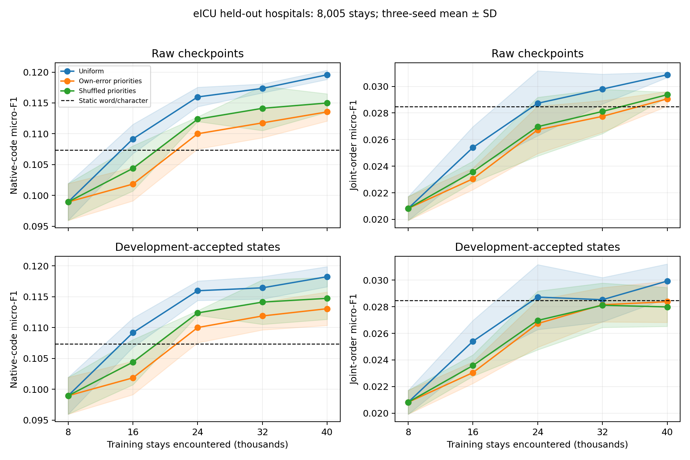

# v0.25 — Native-code eICU methods, held-out hospitals and feedback controls

## Question and cohort

Evaluate prescription methods and feedback mechanisms on the external eICU dataset. Keep the v0.24 hospital partitions and cross-partition patient exclusions: no hospital or patient crosses partitions. Models train within eICU and test on unseen hospitals; this is not zero-shot transfer of a MIMIC model.

The decision is ICU admission plus six hours, predicting newly documented orders in the next six hours. Labels are native HICL codes, without claiming RxNorm, ATC or ingredient equivalence. Exclude an entire stay if any target lacks a valid HICL code; retain zero-target stays. From 142,485 parent-cohort stays, 8,003 fail target-identity completeness, leaving 134,482 before fixed hash sampling. This retrospective label/documentation selection does not represent all clinical stays.

| Split | Stays | Patients | Hospitals | Zero-target stays | Complete / all joint targets |
|---|---:|---:|---:|---:|---:|
| train | 40,000 | 35,249 | 124 | 19,105 | 52,637 / 70,277 |
| proposal | 2,000 | 1,914 | 13 | 820 | 3,105 / 4,523 |
| guard | 2,000 | 1,912 | 17 | 1,001 | 2,564 / 3,398 |
| test | 8,005 | 6,227 | 16 | 3,842 | 11,853 / 15,594 |

## Inputs, order protocol and methods

Inputs contain age decade/gender, the latest 24 early medication records and 32 distinct finite lab-name/unit measurements. Lab draw and revision timestamps must precede the decision. Hospital/patient IDs, future orders, cancellation/discharge status and untimed diagnoses are excluded. Medication storage times and full field histories are absent, so actual prospective availability is not proven.

The complete order tuple is HICL, route, dosage string and frequency string. Normalize case/whitespace only, without inferring dose units. Missing values remain null. Drug recall includes out-of-vocabulary GT; joint-order metrics score complete observed labels with coverage reported separately.

Three seeds run five rounds of 8k/16k/24k/32k/40k stays. Vocabulary (512 codes) and word/character/numerical maps freeze on the initial 8k. The three feedback arms have identical cases, order and exactly 60 epochs per classifier. Compare uniform learning, priorities from the prior accepted policy's own errors, and the exact same weights shuffled among the new cases. Tools fit only currently seen orders. Proposal selects thresholds; a separate guard promotes states. Rejected versions retain the previous policy/tool bundle. Every seed and static selection freezes before test-feature inference.

Changing artifacts are policy parameters, persistent feedback weights and order-tool parameters. No LLM/API is used; this is supervised artifact evolution. Static controls include prevalence, prior-order reuse, 30-neighbor retrieval, word models, word/character ensembles and full-data uniform learning. Extra ensemble fit/search budgets are disclosed; matched-arm contrasts isolate priority assignment. Component ablations do not retune other components.

## Completed development trajectory replay

All 45 policy/tool states are reexecuted, with independent checks of proposal thresholds, guard metrics and acceptance decisions. Raw and accepted curves are separate; these cases participate in development selection and are not a held-out test result.

[Development curves and every feedback control](DEVELOPMENT_CURVES.en.md)

## Main findings

Own-error priorities minus matched uniform updates change drug/order F1 by **-0.00519/-0.00155**. With the selected own-error policy held fixed, updating its order tool instead of retaining the initial tool changes joint-order F1 by **+0.00504**; 6/6 per-seed patient/hospital intervals have a positive lower bound. These unadjusted descriptive intervals support evaluating the tool update separately from feedback assignment. The full table below includes the stronger ordinary controls.

## Completed eICU method comparison / eICU 跨方法测试表

| Method | Drug F1 mean ± SD | Joint-order F1 mean ± SD | Empty (%) | Complete predicted tuples (%) |
|---|---:|---:|---:|---:|
| Initial 8k state | 0.09894 ± 0.00299 | 0.02082 ± 0.00090 | 30.12 | 58.01 |
| Training prevalence + global orders | 0.07082 ± 0.00000 | 0.00000 ± 0.00000 | 0.00 | 0.00 |
| Reuse prior orders | 0.06108 ± 0.00000 | 0.01544 ± 0.00000 | 7.81 | 78.58 |
| 30-neighbor retrieval + conditional tool | 0.09501 ± 0.00000 | 0.02460 ± 0.00034 | 18.88 | 54.90 |
| Word policy + global orders | 0.10668 ± 0.00092 | 0.00934 ± 0.00046 | 31.99 | 57.48 |
| Word policy + conditional tool | 0.10668 ± 0.00092 | 0.02826 ± 0.00039 | 31.99 | 48.57 |
| Word/character ensemble + conditional tool | 0.10736 ± 0.00063 | 0.02847 ± 0.00014 | 32.48 | 48.19 |
| Full-data uniform policy | 0.11956 ± 0.00075 | 0.03087 ± 0.00020 | 33.13 | 49.59 |
| Uniform round updates | 0.11825 ± 0.00163 | 0.02993 ± 0.00129 | 32.40 | 50.81 |
| Own-error-prioritized updates | 0.11306 ± 0.00271 | 0.02838 ± 0.00155 | 26.13 | 51.13 |
| Same-distribution shuffled priorities | 0.11474 ± 0.00340 | 0.02799 ± 0.00146 | 32.05 | 50.85 |
| Error priorities + initial tool frozen | 0.11306 ± 0.00271 | 0.02334 ± 0.00043 | 26.13 | 53.67 |
| Initial policy + final tool | 0.09894 ± 0.00299 | 0.02491 ± 0.00092 | 30.12 | 55.60 |

## Round trajectories / 逐轮轨迹

### Raw checkpoints / 原始检查点

| Round | Stays encountered | Uniform drug/order | Own-error drug/order | Shuffled drug/order |
|---|---:|---:|---:|---:|
| 0 | 8,000 | 0.09894/0.02082 | 0.09894/0.02082 | 0.09894/0.02082 |
| 1 | 16,000 | 0.10916/0.02540 | 0.10184/0.02305 | 0.10438/0.02358 |
| 2 | 24,000 | 0.11597/0.02873 | 0.11000/0.02673 | 0.11237/0.02697 |
| 3 | 32,000 | 0.11736/0.02980 | 0.11177/0.02774 | 0.11413/0.02811 |
| 4 | 40,000 | 0.11956/0.03087 | 0.11355/0.02906 | 0.11499/0.02937 |

### Development-accepted states / 开发集接纳状态

| Round | Stays encountered | Uniform drug/order | Own-error drug/order | Shuffled drug/order |
|---|---:|---:|---:|---:|
| 0 | 8,000 | 0.09894/0.02082 | 0.09894/0.02082 | 0.09894/0.02082 |
| 1 | 16,000 | 0.10916/0.02540 | 0.10184/0.02305 | 0.10438/0.02358 |
| 2 | 24,000 | 0.11597/0.02873 | 0.11000/0.02673 | 0.11237/0.02697 |
| 3 | 32,000 | 0.11644/0.02853 | 0.11188/0.02815 | 0.11413/0.02811 |
| 4 | 40,000 | 0.11825/0.02993 | 0.11306/0.02838 | 0.11474/0.02799 |

The test evaluates every frozen state. The horizontal axis counts cases encountered, while a rejected update retains an earlier bundle. Test curves need not improve monotonically, including accepted-state curves: acceptance used development data only.

## Paired contrasts / 配对差异

| Seed | Contrast | Drug/order Δ | Hospital 95% CI drug; order | Patient 95% CI drug; order |
|---|---|---:|---|---|
| 42 | error_prioritized__minus__uniform | -0.00508/-0.00137 | [-0.00790, -0.00235]; [-0.00227, -0.00049] | [-0.00760, -0.00276]; [-0.00277, +0.00001] |
| 42 | error_prioritized__minus__permuted_priority | +0.00031/+0.00013 | [-0.00218, +0.00222]; [-0.00136, +0.00150] | [-0.00224, +0.00281]; [-0.00120, +0.00156] |
| 42 | error_prioritized__minus__word_char_ensemble | +0.00725/+0.00109 | [+0.00152, +0.01708]; [-0.00064, +0.00403] | [+0.00326, +0.01100]; [-0.00109, +0.00331] |
| 42 | error_prioritized__minus__error_priority_initial_tool | +0.00000/+0.00586 | [+0.00000, +0.00000]; [+0.00091, +0.01624] | [+0.00000, +0.00000]; [+0.00391, +0.00789] |
| 42 | uniform__minus__initial_state | +0.02445/+0.01118 | [+0.01205, +0.03802]; [+0.00184, +0.02610] | [+0.01987, +0.02961]; [+0.00828, +0.01440] |
| 42 | uniform__minus__word_char_ensemble | +0.01233/+0.00246 | [+0.00709, +0.02052]; [+0.00020, +0.00615] | [+0.00880, +0.01600]; [+0.00045, +0.00452] |
| 137 | error_prioritized__minus__uniform | -0.00375/-0.00186 | [-0.00749, +0.00125]; [-0.00440, +0.00023] | [-0.00642, -0.00099]; [-0.00338, -0.00034] |
| 137 | error_prioritized__minus__permuted_priority | -0.00386/-0.00001 | [-0.00690, +0.00009]; [-0.00121, +0.00137] | [-0.00648, -0.00124]; [-0.00146, +0.00140] |
| 137 | error_prioritized__minus__word_char_ensemble | +0.00655/-0.00180 | [-0.00060, +0.01839]; [-0.00695, +0.00295] | [+0.00247, +0.01051]; [-0.00423, +0.00073] |
| 137 | error_prioritized__minus__error_priority_initial_tool | +0.00000/+0.00360 | [+0.00000, +0.00000]; [+0.00069, +0.00932] | [+0.00000, +0.00000]; [+0.00199, +0.00520] |
| 137 | uniform__minus__initial_state | +0.01771/+0.00686 | [+0.00711, +0.02960]; [-0.00066, +0.01800] | [+0.01345, +0.02232]; [+0.00410, +0.00982] |
| 137 | uniform__minus__word_char_ensemble | +0.01031/+0.00006 | [+0.00543, +0.01880]; [-0.00430, +0.00564] | [+0.00657, +0.01397]; [-0.00241, +0.00257] |
| 2026 | error_prioritized__minus__uniform | -0.00675/-0.00142 | [-0.01310, -0.00169]; [-0.00781, +0.00264] | [-0.01034, -0.00296]; [-0.00374, +0.00083] |
| 2026 | error_prioritized__minus__permuted_priority | -0.00148/+0.00105 | [-0.00787, +0.00330]; [-0.00579, +0.00603] | [-0.00505, +0.00207]; [-0.00125, +0.00341] |
| 2026 | error_prioritized__minus__word_char_ensemble | +0.00330/+0.00044 | [-0.00236, +0.01235]; [-0.00526, +0.00607] | [-0.00089, +0.00738]; [-0.00223, +0.00303] |
| 2026 | error_prioritized__minus__error_priority_initial_tool | +0.00000/+0.00564 | [+0.00000, +0.00000]; [+0.00176, +0.01270] | [+0.00000, +0.00000]; [+0.00373, +0.00757] |
| 2026 | uniform__minus__initial_state | +0.01578/+0.00929 | [+0.00412, +0.02904]; [+0.00142, +0.02290] | [+0.01113, +0.02039]; [+0.00638, +0.01231] |
| 2026 | uniform__minus__word_char_ensemble | +0.01004/+0.00186 | [+0.00315, +0.01985]; [+0.00053, +0.00426] | [+0.00621, +0.01389]; [-0.00040, +0.00425] |

## Zero-target stratum / 无新订单亚组

| Method | False nonempty (%) | Mean predicted codes | Nonempty-stratum drug/order F1 |
|---|---:|---:|---:|
| Initial 8k state | 62.89 | 1.315 | 0.12137/0.02445 |
| Training prevalence + global orders | 100.00 | 1.000 | 0.08581/0.00000 |
| Reuse prior orders | 90.68 | 10.678 | 0.10177/0.02562 |
| 30-neighbor retrieval + conditional tool | 75.25 | 2.482 | 0.12802/0.03120 |
| Word policy + global orders | 59.60 | 1.094 | 0.12806/0.01067 |
| Word policy + conditional tool | 59.60 | 1.094 | 0.12806/0.03190 |
| Word/character ensemble + conditional tool | 59.08 | 1.068 | 0.12846/0.03204 |
| Full-data uniform policy | 57.37 | 1.071 | 0.14267/0.03476 |
| Uniform round updates | 58.42 | 1.111 | 0.14174/0.03391 |
| Own-error-prioritized updates | 66.53 | 1.295 | 0.13856/0.03279 |
| Same-distribution shuffled priorities | 59.18 | 1.144 | 0.13813/0.03186 |
| Error priorities + initial tool frozen | 66.53 | 1.295 | 0.13856/0.02718 |
| Initial policy + final tool | 62.89 | 1.315 | 0.12137/0.02903 |

## Output behavior / 输出行为

| Method | Drug precision | Drug recall | Mean predicted codes |
|---|---:|---:|---:|
| Initial 8k state | 0.10140 | 0.09664 | 1.666 |
| Training prevalence + global orders | 0.09731 | 0.05567 | 1.000 |
| Reuse prior orders | 0.03536 | 0.22388 | 11.068 |
| 30-neighbor retrieval + conditional tool | 0.07642 | 0.12555 | 2.872 |
| Word policy + global orders | 0.12014 | 0.09599 | 1.398 |
| Word policy + conditional tool | 0.12014 | 0.09599 | 1.398 |
| Word/character ensemble + conditional tool | 0.12257 | 0.09568 | 1.368 |
| Full-data uniform policy | 0.13313 | 0.10855 | 1.426 |
| Uniform round updates | 0.12960 | 0.10881 | 1.469 |
| Own-error-prioritized updates | 0.11788 | 0.10888 | 1.621 |
| Same-distribution shuffled priorities | 0.12454 | 0.10647 | 1.495 |
| Error priorities + initial tool frozen | 0.11788 | 0.10888 | 1.621 |
| Initial policy + final tool | 0.10140 | 0.09664 | 1.666 |

## Recorded fitting budgets

| Seed | Policy | Logical case × classifier × epoch exposures | Recorded fitting minutes |
|---|---|---:|---:|
| 42 | uniform | 3,686,400,000 | 77.15 |
| 42 | error_prioritized | 3,686,400,000 | 77.09 |
| 42 | permuted_priority | 3,686,400,000 | 79.68 |
| 42 | static_word | 1,228,800,000 | 26.25 |
| 42 | static_char | 1,228,800,000 | 102.16 |
| 137 | uniform | 3,686,400,000 | 77.58 |
| 137 | error_prioritized | 3,686,400,000 | 77.29 |
| 137 | permuted_priority | 3,686,400,000 | 80.28 |
| 137 | static_word | 1,228,800,000 | 26.34 |
| 137 | static_char | 1,228,800,000 | 102.69 |
| 2026 | uniform | 3,686,400,000 | 76.99 |
| 2026 | error_prioritized | 3,686,400,000 | 77.17 |
| 2026 | permuted_priority | 3,686,400,000 | 79.96 |
| 2026 | static_word | 1,228,800,000 | 26.29 |
| 2026 | static_char | 1,228,800,000 | 102.78 |

Logical feedback-arm exposure includes the shared initial fit in each arm; its physical fitting time is counted only under uniform. Full-data uniform reuses its final raw checkpoint. Word/character fits are shared by the static selectors; the ensemble searches five mixing weights and seven thresholds. Order-tool fitting, retrieval and evaluation time are outside this timing table. Concurrent fitting times are not an inference-speed benchmark, and different feature maps/search budgets are not equal FLOPs. The matched feedback arms share cases, features and epochs.

All final/checkpoint predictions are independently rescored. Actual parameter hashes, pre-update feedback and weights, 60-epoch exposures and seen-only tool members are also checked. This audit does not independently rerun every test forward pass or optimizer trajectory. Curve shading is seed SD. Intervals use 2,000 paired hospital/patient-cluster draws without multiplicity correction. Test scores did not select models. Growth over the initial state alone does not demonstrate a unique RSI advantage.

A floating-matmul warning triggered an additional integer-accumulation audit: all 36 cluster contrasts and 144 interval bounds match exactly, and original results are finite. No score or choice was changed. [Numerical recount evidence](results/interval_numeric_audit.json).

## Reproducibility and scope

`protocol.json`, `results/cohort_manifest.json`, `results/cohort_audit.json` and round journals record the protocol, membership counts and transitions. Restricted cases, predictions and weights remain local. Agreement with recorded GT does not establish clinical safety. This native-code/field protocol cannot be ranked directly against published ATC scores.
