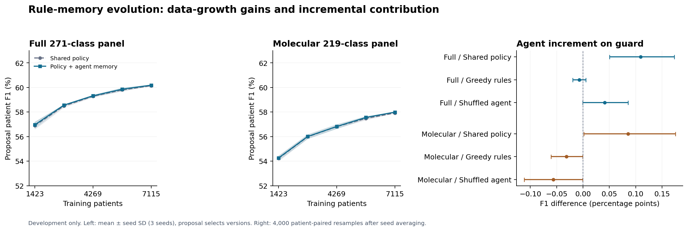

# v0.27 — 标准处方方法兼容性审计

## 1. 已构建的真实队列

独立历史就诊任务：MIMIC-IV 3.1成人、住院含ICU、诊断/操作/已映射药物各至少一项，每人至少两次合格就诊。输入整次就诊的诊断/操作及既往就诊，不能称为入院时点或六小时新订单预测。

| Panel | Seed | Completed rounds /5 | Own-error retained rules | Status |
|---|---:|---:|---:|---|
| full | 137 | 5 | 8 | selection_frozen |
| full | 2026 | 5 | 17 | selection_frozen |
| full | 42 | 5 | 8 | selection_frozen |
| molecular | 137 | 5 | 9 | selection_frozen |
| molecular | 2026 | 5 | 12 | selection_frozen |
| molecular | 42 | 5 | 10 | selection_frozen |

仅训练集建立词表：10,726个诊断、5,330个操作、271个真正五字符ATC-L4类。测试集词表外标签继续计入召回分母。跨划分患者交集为零。旧公开NDC表仅覆盖所选2,734,635条处方行的 **27.23%**；标签是已映射子集，不是完整处方ground truth。

## 2. 独立核对已通过

从原始文件逐项重建23,177次就诊的诊断、操作、药物集合，检查成人ICU资格、就诊排序、患者划分及训练词表。完整母队列筛选流程来自构建器，没有在本审计中独立再扫描。测试患者与此前v0.9/v0.21已观察测试的交集分别为20/50人，本表将标为探索性实验。

## 3. 分子资源与代码已实际运行

**746/746**个公开CID均取得结构并通过RDKit验证，覆盖399个ATC-L4类；对应本队列训练类的 **219/271**，覆盖测试24,391/30,004个标签。52个未覆盖类别全部列明，没有补造分子。

ARMR-2025、GAMENet、SafeDrug固定作者核心均已通过合成输入的前向/反向执行探针；GAMENet对隐藏的当前药物标签变化不敏感。SafeDrug探针采用真实公开分子和明确标注的合成单位子结构矩阵，仅验证依赖与执行，不是训练结果。后续已构建正式资源：627个真实分子图、863个BRICS片段、326种指纹，投影无缺失行；合成探针矩阵不会用于训练。

## 4. 已登记并启动真实方法训练

完整271类与共同分子219类两表保留相同患者/就诊；分子表明确排除5,613个测试标签，保留3次空目标就诊，不能和完整表混算。每种神经架构训练50整轮，种子42/137/2026；ARMR与GAMENet跑两种空间，SafeDrug跑分子空间。proposal按患者平均Jaccard选择轮次/阈值，guard只报告；相同病例曝光不等于相同步数/FLOPs。全部基线和之后登记的RxRSI状态冻结前，不推断测试集。

SafeDrug稀疏图、固定分子嵌入的检查点保存，以及ARMR的CPU/GPU执行都通过数值/梯度/恢复探针。当前公开SafeDrug脚本的`min`与论文式19的`max`冲突，本独立适配复现采用论文公式并披露差异。[原论文](https://arxiv.org/pdf/2105.02711)。不冒充原文精确复现成绩。

| Panel | Method | Seed | Finished epochs / 50 | Status |
|---|---|---:|---:|---|
| full | ARMR | 137 | 50 | selection_frozen |
| full | ARMR | 2026 | 50 | selection_frozen |
| full | ARMR | 42 | 50 | selection_frozen |
| full | GAMENet | 137 | 50 | selection_frozen |
| full | GAMENet | 2026 | 50 | selection_frozen |
| full | GAMENet | 42 | 50 | selection_frozen |
| molecular | ARMR | 42 | 22 | training |
| molecular | GAMENet | 137 | 50 | selection_frozen |
| molecular | GAMENet | 2026 | 50 | selection_frozen |
| molecular | GAMENet | 42 | 50 | selection_frozen |
| molecular | SafeDrug | 137 | 50 | selection_frozen |
| molecular | SafeDrug | 2026 | 50 | selection_frozen |
| molecular | SafeDrug | 42 | 50 | selection_frozen |

Queued seeds/panels are not counted as completed. Snapshot of saved epoch receipts; no provisional neural test score.

## 5. 已完成的传统方法比较：仅开发guard

以下是真实拟合后的方法比较：1,231次开发就诊／467人。四种方法均由另一proposal集选定；从原就诊源独立重建特征、保存预测、集合指标，核查通过。这还不是最终测试主表。

| Panel | Method | Patient-average F1 | Patient-average Jaccard | Mean medications |
|---|---|---:|---:|---:|
| full | prevalence | 0.45794 | 0.30680 | 11.00 |
| full | last_visit | 0.30154 | 0.21585 | 7.26 |
| full | cosine_knn | 0.55081 | 0.39614 | 13.10 |
| full | structured_logistic | 0.61151 | 0.45742 | 12.48 |
| molecular | prevalence | 0.42555 | 0.28089 | 15.00 |
| molecular | last_visit | 0.28971 | 0.20613 | 5.81 |
| molecular | cosine_knn | 0.51751 | 0.36710 | 10.43 |
| molecular | structured_logistic | 0.58113 | 0.42971 | 9.86 |

## 6. 可执行规则记忆RSI已经运行

五轮依次使用20/40/60/80/100%的训练患者。共同监督策略重新拟合，用患者独立交叉拟合产生错误证据；语言agent只看聚合候选规则，最多选择4项编辑。另一20%训练患者作验证证据，只接纳有益编辑，验证/测试不向候选生成提供反馈。运行时规则只读已观察特征和模型概率。对照含普通策略、贪心规则、随机规则、自身错误agent、打乱证据agent和取消验证。普通系数拟合不冒充自主权重进化，实际进化对象是类型化规则记忆；本任务只预测药物类，不生成完整剂量。

代码、真实提议、接纳/拒绝及状态哈希已保存。原始交叉拟合概率有保留，但当时未保存折模型权重；另行从原始就诊数据重拟合各折，明确标注为重建，并核对概率和决策。数值库告警通过标量患者评分重算核验，不把告警当成模型错误。临时开发收益不能证明优于其他方法。

| Panel | Seed | Completed rounds /5 | Own-error retained rules | Status |
|---|---:|---:|---:|---|
| full | 137 | 5 | 8 | selection_frozen |
| full | 2026 | 5 | 17 | selection_frozen |
| full | 42 | 5 | 8 | selection_frozen |
| molecular | 137 | 5 | 9 | selection_frozen |
| molecular | 2026 | 5 | 12 | selection_frozen |
| molecular | 42 | 5 | 10 | selection_frozen |

[Registered mechanism and controls / 机制与对照登记](rsi_addendum.json) · [Scalar decision audit / 标量决定核验](results/rule_decision_audit.json)

自身错误agent实际改变的记忆如下（统计已接纳操作，包含之后删除的规则）：

| Panel | Seed | Accepted ADD | Accepted DELETE | Retained rules by round |
|---|---:|---:|---:|---|
| full | 137 | 8 | 0 | 3 → 5 → 5 → 7 → 8 |
| full | 2026 | 17 | 0 | 4 → 7 → 10 → 14 → 17 |
| full | 42 | 9 | 1 | 1 → 5 → 6 → 6 → 8 |
| molecular | 137 | 9 | 0 | 3 → 5 → 5 → 9 → 9 |
| molecular | 2026 | 12 | 0 | 2 → 5 → 8 → 10 → 12 |
| molecular | 42 | 11 | 1 | 2 → 5 → 7 → 8 → 10 |

例如，一条真实保留规则使用既往药物类`N02BE`，在同类预测概率略低于共同阈值时将其纳入；其他候选使用诊断或既往药类特征。日志记录精确条件、药物编码、witness分数变化与规则哈希。这是可核查的统计关联，不是处方指南。

## 7. 已核验的作者模型开发结果

这里只列完成50轮、重新加载所选检查点并独立重算通过的运行。以下仍是guard开发结果，未完成种子不补零。

| Panel | Method | Seed | Guard F1 | Guard Jaccard |
|---|---|---:|---:|---:|
| full | ARMR | 137 | 0.61000 | 0.45439 |
| full | ARMR | 2026 | 0.60853 | 0.45330 |
| full | ARMR | 42 | 0.60738 | 0.45214 |
| full | GAMENet | 137 | 0.52597 | 0.36979 |
| full | GAMENet | 2026 | 0.53420 | 0.37777 |
| full | GAMENet | 42 | 0.52107 | 0.36505 |
| molecular | GAMENet | 137 | 0.50362 | 0.35044 |
| molecular | GAMENet | 2026 | 0.50787 | 0.35419 |
| molecular | GAMENet | 42 | 0.51055 | 0.35689 |
| molecular | SafeDrug | 137 | 0.53467 | 0.38234 |
| molecular | SafeDrug | 2026 | 0.53651 | 0.38390 |
| molecular | SafeDrug | 42 | 0.53950 | 0.38673 |

## 8. 已核验的规则记忆对照与病例增长曲线

同一1,231次guard就诊／467位患者，模型和轮次只由proposal选择。纳入种子均已通过原始特征重建、重新交叉拟合、候选实际收益和保存预测核验。三种子标准差与患者配对区间分开：区间先平均已有种子，不估计新种子的变化。这仍是开发证据。

验证规则的witness患者不参与候选归纳，但其标签会参与其他折策略的拟合；共同C参数由全部已见患者拟合后的proposal表现选择。因此交叉拟合排除了本例标签对本例预测器的直接拟合，不是完全隔离的嵌套验证。重复使用的witness关口属于训练验证，不是独立临床确认。

| Panel | Method | Audited seeds | Guard F1 ± seed SD | Guard Jaccard ± seed SD |
|---|---|---:|---:|---:|
| full | uniform_policy | 3 | 0.61151 ± 0.00000 | 0.45742 ± 0.00000 |
| full | greedy_error_rules | 3 | 0.61267 ± 0.00066 | 0.45863 ± 0.00064 |
| full | random_candidate_rules | 3 | 0.61205 ± 0.00031 | 0.45791 ± 0.00027 |
| full | own_error_rule_agent | 3 | 0.61260 ± 0.00057 | 0.45856 ± 0.00057 |
| full | shuffled_evidence_rule_agent | 3 | 0.61219 ± 0.00038 | 0.45811 ± 0.00044 |
| full | matched_proposals_without_witness_gate | 3 | 0.61251 ± 0.00087 | 0.45840 ± 0.00102 |
| molecular | uniform_policy | 3 | 0.58113 ± 0.00000 | 0.42971 ± 0.00000 |
| molecular | greedy_error_rules | 3 | 0.58230 ± 0.00042 | 0.43084 ± 0.00039 |
| molecular | random_candidate_rules | 3 | 0.58220 ± 0.00055 | 0.43078 ± 0.00058 |
| molecular | own_error_rule_agent | 3 | 0.58198 ± 0.00014 | 0.43049 ± 0.00014 |
| molecular | shuffled_evidence_rule_agent | 3 | 0.58255 ± 0.00029 | 0.43105 ± 0.00027 |
| molecular | matched_proposals_without_witness_gate | 3 | 0.58202 ± 0.00067 | 0.43050 ± 0.00070 |

| Panel | Own agent minus control | F1 difference (pp) | Patient interval (pp) |
|---|---|---:|---:|
| full | uniform_policy | +0.109 | [+0.050, +0.173] |
| full | greedy_error_rules | -0.007 | [-0.020, +0.006] |
| full | random_candidate_rules | +0.055 | [+0.020, +0.094] |
| full | shuffled_evidence_rule_agent | +0.041 | [-0.000, +0.086] |
| full | matched_proposals_without_witness_gate | +0.009 | [-0.038, +0.057] |
| molecular | uniform_policy | +0.086 | [+0.002, +0.175] |
| molecular | greedy_error_rules | -0.031 | [-0.061, -0.000] |
| molecular | random_candidate_rules | -0.022 | [-0.085, +0.045] |
| molecular | shuffled_evidence_rule_agent | -0.056 | [-0.112, -0.001] |
| molecular | matched_proposals_without_witness_gate | -0.003 | [-0.056, +0.046] |

| Panel | Round | Training patients | Shared policy proposal F1 | Own-agent proposal F1 | Own retained rules by seed |
|---|---:|---:|---:|---:|---|
| full | 1 | 1423 | 0.56896 | 0.56958 | 1, 3, 4 |
| full | 2 | 2846 | 0.58492 | 0.58562 | 5, 5, 7 |
| full | 3 | 4269 | 0.59287 | 0.59323 | 6, 5, 10 |
| full | 4 | 5692 | 0.59804 | 0.59863 | 6, 7, 14 |
| full | 5 | 7115 | 0.60142 | 0.60190 | 8, 8, 17 |
| molecular | 1 | 1423 | 0.54232 | 0.54262 | 2, 3, 2 |
| molecular | 2 | 2846 | 0.55987 | 0.56008 | 5, 5, 5 |
| molecular | 3 | 4269 | 0.56816 | 0.56824 | 7, 5, 8 |
| molecular | 4 | 5692 | 0.57481 | 0.57559 | 8, 9, 10 |
| molecular | 5 | 7115 | 0.57926 | 0.57996 | 10, 9, 12 |

病例增长首先改善共同监督预测器；记忆的微小额外效果必须对照贪心和打乱证据，才能讨论语言agent进化的贡献。这些规则是统计关联，不是已验证的处方适应证。

[Editable vector figure](../paper/figures/rule_memory_development.svg)

历史元数据说明：滚动导出复用了嵌套`round.best`字典，旧条目可能显示之后的选择。不可变逐轮回执、各方法`best_round`、所有分数与最终选择均已核验；[历史选择修正](../paper/round_selection_metadata_audit.json)单独公开，保持冻结结果哈希不变。

## Artifacts / 交付文件

- [Registered protocol](protocol.json) and [training addendum](training_addendum.json)
- [Implementation details](implementation_notes.json)
- [Cohort manifest](results/cohort_manifest.json)
- [Independent audit and missing classes](results/cohort_audit.json)
- [Public molecule receipts](results/molecular_resource_audit.json)
- [Actual molecular/graph resources](results/model_resource_manifest.json)
- [Author-core execution probe](results/author_core_probe.json) and [training runtime equivalence](results/training_runtime_probe.json)
- [Independent control audit](results/control_audit.json)
- [Recent-method source audit](../paper/LATEST_METHODS.zh.md)

Restricted cases, fitted artifacts and patient-level outputs remain local. Public reports contain aggregates and hashes.
