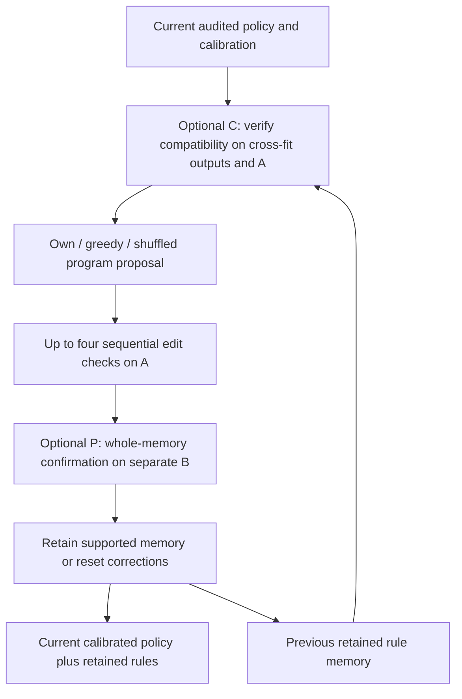

# v0.30 — Revalidate old memory and confirm the whole update

## 1. Executed design

The v0.29 replay found both stale-memory effects and negative transfer of individually accepted edits. This registered intervention reuses the exact independently audited v0.29 policies/calibration and changes the memory-maintenance trajectory. It fits no new predictor and performs no test inference.

Each fresh witness batch is divided by patient into edit group **A** and confirmation group **B**. **C** revalidates the old memory on cross-fitted fitting patients and A before proposing new rules. **P** confirms the entire edited memory on B. Failed gates reset the correction memory; the current calibrated prescribing policy still produces its medication set. Resetting memory does not force an empty prescription.

Greedy enumeration, own-error language synthesis and shuffled numeric evidence each run all four C/P combinations. Raw and calibrated policies add two controls, for **14 arms × five rounds × three seeds × two medication spaces**. All C/P conditions edit on A and compute identical shadow checks; only the gate's effect on retained state changes. C0P0 therefore differs from the preceding v0.29 full-batch verifier. Identical prompts across gate variants reuse the same exact response; divergent memories generate new prompts.

The language agent evolves executable rule memory. C/P policies and tools are fixed engineering choices, and coefficient/threshold updates are inherited ordinary supervised learning. No autonomous tool-code or language-weight improvement is claimed. These are reused development patients; B is disjoint from A within a round, not a new external confirmation cohort.

## 2. Actual execution status

| Panel | Seed | Completed rounds /5 | Status |
|---|---:|---:|---|
| full | 42 | 5 | selection_frozen |
| full | 137 | 3 | training |
| full | 2026 | 0 | no_completed_round |
| molecular | 42 | 5 | selection_frozen |
| molecular | 137 | 1 | training |
| molecular | 2026 | 0 | no_completed_round |

Nine synthetic checks passed before the first run, including a correction that helps A but harms B, stale-memory resets, low-support rejection and patient isolation. These are execution checks, not clinical scores.

## 3. Proposal-selected guard

| Panel | Arm | Audited seeds | Patient F1 ± SD | Patient Jaccard ± SD |
|---|---|---:|---:|---:|
| full | raw_policy | 1 | 0.60594 (one seed) | 0.45161 (one seed) |
| full | calibrated_policy | 1 | 0.60719 (one seed) | 0.45324 (one seed) |
| full | greedy_C0P0 | 1 | 0.60747 (one seed) | 0.45342 (one seed) |
| full | greedy_C0P1 | 1 | 0.60719 (one seed) | 0.45324 (one seed) |
| full | greedy_C1P0 | 1 | 0.60777 (one seed) | 0.45380 (one seed) |
| full | greedy_C1P1 | 1 | 0.60719 (one seed) | 0.45324 (one seed) |
| full | own_C0P0 | 1 | 0.60694 (one seed) | 0.45303 (one seed) |
| full | own_C0P1 | 1 | 0.60706 (one seed) | 0.45315 (one seed) |
| full | own_C1P0 | 1 | 0.60706 (one seed) | 0.45315 (one seed) |
| full | own_C1P1 | 1 | 0.60706 (one seed) | 0.45315 (one seed) |
| full | shuffled_C0P0 | 1 | 0.60761 (one seed) | 0.45367 (one seed) |
| full | shuffled_C0P1 | 1 | 0.60719 (one seed) | 0.45324 (one seed) |
| full | shuffled_C1P0 | 1 | 0.60719 (one seed) | 0.45324 (one seed) |
| full | shuffled_C1P1 | 1 | 0.60719 (one seed) | 0.45324 (one seed) |
| molecular | raw_policy | 1 | 0.57623 (one seed) | 0.42480 (one seed) |
| molecular | calibrated_policy | 1 | 0.57911 (one seed) | 0.42750 (one seed) |
| molecular | greedy_C0P0 | 1 | 0.57960 (one seed) | 0.42789 (one seed) |
| molecular | greedy_C0P1 | 1 | 0.57911 (one seed) | 0.42750 (one seed) |
| molecular | greedy_C1P0 | 1 | 0.57972 (one seed) | 0.42799 (one seed) |
| molecular | greedy_C1P1 | 1 | 0.57972 (one seed) | 0.42799 (one seed) |
| molecular | own_C0P0 | 1 | 0.57874 (one seed) | 0.42666 (one seed) |
| molecular | own_C0P1 | 1 | 0.57911 (one seed) | 0.42750 (one seed) |
| molecular | own_C1P0 | 1 | 0.57935 (one seed) | 0.42774 (one seed) |
| molecular | own_C1P1 | 1 | 0.57911 (one seed) | 0.42750 (one seed) |
| molecular | shuffled_C0P0 | 1 | 0.57911 (one seed) | 0.42750 (one seed) |
| molecular | shuffled_C0P1 | 1 | 0.57911 (one seed) | 0.42750 (one seed) |
| molecular | shuffled_C1P0 | 1 | 0.57911 (one seed) | 0.42750 (one seed) |
| molecular | shuffled_C1P1 | 1 | 0.57911 (one seed) | 0.42750 (one seed) |

| Panel | Registered contrast | F1 difference (pp) | Patient interval (pp) |
|---|---|---:|---:|
| full | greedy_compatibility_main | +0.015 | [-0.018, +0.047] |
| full | greedy_confirmation_main | -0.043 | [-0.101, +0.011] |
| full | greedy_interaction | -0.030 | [-0.094, +0.037] |
| full | greedy_full_gates_minus_no_gates | -0.029 | [-0.109, +0.050] |
| full | own_compatibility_main | +0.006 | [-0.019, +0.031] |
| full | own_confirmation_main | +0.006 | [-0.019, +0.031] |
| full | own_interaction | -0.012 | [-0.062, +0.038] |
| full | own_full_gates_minus_no_gates | +0.012 | [-0.038, +0.062] |
| full | shuffled_compatibility_main | -0.021 | [-0.044, -0.004] |
| full | shuffled_confirmation_main | -0.021 | [-0.044, -0.004] |
| full | shuffled_interaction | +0.043 | [+0.007, +0.088] |
| full | shuffled_full_gates_minus_no_gates | -0.043 | [-0.088, -0.007] |
| full | own_minus_greedy_C0P0 | -0.053 | [-0.144, +0.033] |
| full | own_minus_shuffled_C0P0 | -0.068 | [-0.143, +0.004] |
| full | own_minus_greedy_C0P1 | -0.012 | [-0.046, +0.019] |
| full | own_minus_shuffled_C0P1 | -0.012 | [-0.046, +0.019] |
| full | own_minus_greedy_C1P0 | -0.070 | [-0.129, -0.018] |
| full | own_minus_shuffled_C1P0 | -0.012 | [-0.046, +0.019] |
| full | own_minus_greedy_C1P1 | -0.012 | [-0.046, +0.019] |
| full | own_minus_shuffled_C1P1 | -0.012 | [-0.046, +0.019] |
| full | own_full_gates_minus_calibration | -0.012 | [-0.046, +0.019] |
| molecular | greedy_compatibility_main | +0.036 | [-0.007, +0.078] |
| molecular | greedy_confirmation_main | -0.024 | [-0.075, +0.022] |
| molecular | greedy_interaction | +0.049 | [-0.045, +0.150] |
| molecular | greedy_full_gates_minus_no_gates | +0.011 | [-0.043, +0.062] |
| molecular | own_compatibility_main | +0.031 | [-0.041, +0.103] |
| molecular | own_confirmation_main | +0.007 | [-0.077, +0.085] |
| molecular | own_interaction | -0.061 | [-0.206, +0.081] |
| molecular | own_full_gates_minus_no_gates | +0.038 | [-0.106, +0.177] |
| molecular | shuffled_compatibility_main | +0.000 | [+0.000, +0.000] |
| molecular | shuffled_confirmation_main | +0.000 | [+0.000, +0.000] |
| molecular | shuffled_interaction | +0.000 | [+0.000, +0.000] |
| molecular | shuffled_full_gates_minus_no_gates | +0.000 | [+0.000, +0.000] |
| molecular | own_minus_greedy_C0P0 | -0.086 | [-0.199, +0.023] |
| molecular | own_minus_shuffled_C0P0 | -0.038 | [-0.177, +0.106] |
| molecular | own_minus_greedy_C0P1 | +0.000 | [+0.000, +0.000] |
| molecular | own_minus_shuffled_C0P1 | +0.000 | [+0.000, +0.000] |
| molecular | own_minus_greedy_C1P0 | -0.036 | [-0.128, +0.058] |
| molecular | own_minus_shuffled_C1P0 | +0.024 | [-0.035, +0.089] |
| molecular | own_minus_greedy_C1P1 | -0.060 | [-0.138, +0.011] |
| molecular | own_minus_shuffled_C1P1 | +0.000 | [+0.000, +0.000] |
| molecular | own_full_gates_minus_calibration | +0.000 | [+0.000, +0.000] |

## 4. Raw round5 guard

| Panel | Arm | Audited seeds | Patient F1 ± SD | Patient Jaccard ± SD |
|---|---|---:|---:|---:|
| full | raw_policy | 1 | 0.60594 (one seed) | 0.45161 (one seed) |
| full | calibrated_policy | 1 | 0.60719 (one seed) | 0.45324 (one seed) |
| full | greedy_C0P0 | 1 | 0.60747 (one seed) | 0.45342 (one seed) |
| full | greedy_C0P1 | 1 | 0.60719 (one seed) | 0.45324 (one seed) |
| full | greedy_C1P0 | 1 | 0.60777 (one seed) | 0.45380 (one seed) |
| full | greedy_C1P1 | 1 | 0.60719 (one seed) | 0.45324 (one seed) |
| full | own_C0P0 | 1 | 0.60694 (one seed) | 0.45303 (one seed) |
| full | own_C0P1 | 1 | 0.60706 (one seed) | 0.45315 (one seed) |
| full | own_C1P0 | 1 | 0.60706 (one seed) | 0.45315 (one seed) |
| full | own_C1P1 | 1 | 0.60706 (one seed) | 0.45315 (one seed) |
| full | shuffled_C0P0 | 1 | 0.60761 (one seed) | 0.45367 (one seed) |
| full | shuffled_C0P1 | 1 | 0.60719 (one seed) | 0.45324 (one seed) |
| full | shuffled_C1P0 | 1 | 0.60719 (one seed) | 0.45324 (one seed) |
| full | shuffled_C1P1 | 1 | 0.60719 (one seed) | 0.45324 (one seed) |
| molecular | raw_policy | 1 | 0.57623 (one seed) | 0.42480 (one seed) |
| molecular | calibrated_policy | 1 | 0.57911 (one seed) | 0.42750 (one seed) |
| molecular | greedy_C0P0 | 1 | 0.57960 (one seed) | 0.42789 (one seed) |
| molecular | greedy_C0P1 | 1 | 0.57911 (one seed) | 0.42750 (one seed) |
| molecular | greedy_C1P0 | 1 | 0.57972 (one seed) | 0.42799 (one seed) |
| molecular | greedy_C1P1 | 1 | 0.57972 (one seed) | 0.42799 (one seed) |
| molecular | own_C0P0 | 1 | 0.57874 (one seed) | 0.42666 (one seed) |
| molecular | own_C0P1 | 1 | 0.57911 (one seed) | 0.42750 (one seed) |
| molecular | own_C1P0 | 1 | 0.57935 (one seed) | 0.42774 (one seed) |
| molecular | own_C1P1 | 1 | 0.57911 (one seed) | 0.42750 (one seed) |
| molecular | shuffled_C0P0 | 1 | 0.57911 (one seed) | 0.42750 (one seed) |
| molecular | shuffled_C0P1 | 1 | 0.57911 (one seed) | 0.42750 (one seed) |
| molecular | shuffled_C1P0 | 1 | 0.57911 (one seed) | 0.42750 (one seed) |
| molecular | shuffled_C1P1 | 1 | 0.57911 (one seed) | 0.42750 (one seed) |

| Panel | Registered contrast | F1 difference (pp) | Patient interval (pp) |
|---|---|---:|---:|
| full | greedy_compatibility_main | +0.015 | [-0.018, +0.047] |
| full | greedy_confirmation_main | -0.043 | [-0.101, +0.011] |
| full | greedy_interaction | -0.030 | [-0.094, +0.037] |
| full | greedy_full_gates_minus_no_gates | -0.029 | [-0.109, +0.050] |
| full | own_compatibility_main | +0.006 | [-0.019, +0.031] |
| full | own_confirmation_main | +0.006 | [-0.019, +0.031] |
| full | own_interaction | -0.012 | [-0.062, +0.038] |
| full | own_full_gates_minus_no_gates | +0.012 | [-0.038, +0.062] |
| full | shuffled_compatibility_main | -0.021 | [-0.044, -0.004] |
| full | shuffled_confirmation_main | -0.021 | [-0.044, -0.004] |
| full | shuffled_interaction | +0.043 | [+0.007, +0.088] |
| full | shuffled_full_gates_minus_no_gates | -0.043 | [-0.088, -0.007] |
| full | own_minus_greedy_C0P0 | -0.053 | [-0.144, +0.033] |
| full | own_minus_shuffled_C0P0 | -0.068 | [-0.143, +0.004] |
| full | own_minus_greedy_C0P1 | -0.012 | [-0.046, +0.019] |
| full | own_minus_shuffled_C0P1 | -0.012 | [-0.046, +0.019] |
| full | own_minus_greedy_C1P0 | -0.070 | [-0.129, -0.018] |
| full | own_minus_shuffled_C1P0 | -0.012 | [-0.046, +0.019] |
| full | own_minus_greedy_C1P1 | -0.012 | [-0.046, +0.019] |
| full | own_minus_shuffled_C1P1 | -0.012 | [-0.046, +0.019] |
| full | own_full_gates_minus_calibration | -0.012 | [-0.046, +0.019] |
| molecular | greedy_compatibility_main | +0.036 | [-0.007, +0.078] |
| molecular | greedy_confirmation_main | -0.024 | [-0.075, +0.022] |
| molecular | greedy_interaction | +0.049 | [-0.045, +0.150] |
| molecular | greedy_full_gates_minus_no_gates | +0.011 | [-0.043, +0.062] |
| molecular | own_compatibility_main | +0.031 | [-0.041, +0.103] |
| molecular | own_confirmation_main | +0.007 | [-0.077, +0.085] |
| molecular | own_interaction | -0.061 | [-0.206, +0.081] |
| molecular | own_full_gates_minus_no_gates | +0.038 | [-0.106, +0.177] |
| molecular | shuffled_compatibility_main | +0.000 | [+0.000, +0.000] |
| molecular | shuffled_confirmation_main | +0.000 | [+0.000, +0.000] |
| molecular | shuffled_interaction | +0.000 | [+0.000, +0.000] |
| molecular | shuffled_full_gates_minus_no_gates | +0.000 | [+0.000, +0.000] |
| molecular | own_minus_greedy_C0P0 | -0.086 | [-0.199, +0.023] |
| molecular | own_minus_shuffled_C0P0 | -0.038 | [-0.177, +0.106] |
| molecular | own_minus_greedy_C0P1 | +0.000 | [+0.000, +0.000] |
| molecular | own_minus_shuffled_C0P1 | +0.000 | [+0.000, +0.000] |
| molecular | own_minus_greedy_C1P0 | -0.036 | [-0.128, +0.058] |
| molecular | own_minus_shuffled_C1P0 | +0.024 | [-0.035, +0.089] |
| molecular | own_minus_greedy_C1P1 | -0.060 | [-0.138, +0.011] |
| molecular | own_minus_shuffled_C1P1 | +0.000 | [+0.000, +0.000] |
| molecular | own_full_gates_minus_calibration | +0.000 | [+0.000, +0.000] |

## 5. Raw proposal rounds and actual gate actions

| Panel | Round | Calibration F1 | Own C0P0 F1 | Own C1P1 F1 | Greedy C1P1 F1 | Own C1P1 rules by seed |
|---|---:|---:|---:|---:|---:|---|
| full | 1 | 0.56919 | 0.56926 | 0.56919 | 0.56919 | [0] |
| full | 2 | 0.58630 | 0.58611 | 0.58630 | 0.58630 | [0] |
| full | 3 | 0.59365 | 0.59282 | 0.59365 | 0.59365 | [0] |
| full | 4 | 0.59920 | 0.59844 | 0.59896 | 0.59920 | [1] |
| full | 5 | 0.60234 | 0.60121 | 0.60205 | 0.60234 | [1] |
| molecular | 1 | 0.54199 | 0.54256 | 0.54256 | 0.54199 | [2] |
| molecular | 2 | 0.55621 | 0.55810 | 0.55621 | 0.55650 | [0] |
| molecular | 3 | 0.57210 | 0.57260 | 0.57246 | 0.57246 | [1] |
| molecular | 4 | 0.57732 | 0.57803 | 0.57732 | 0.57732 | [0] |
| molecular | 5 | 0.58171 | 0.58174 | 0.58171 | 0.58188 | [0] |

| Panel | Arm | C resets | P resets | Accepted edits before P | Logical model calls | Logical response USD |
|---|---|---:|---:|---:|---:|---:|
| full | raw_policy | 0 | 0 | 0 | 0 | 0.00000 |
| full | calibrated_policy | 0 | 0 | 0 | 0 | 0.00000 |
| full | greedy_C0P0 | 0 | 0 | 4 | 0 | 0.00000 |
| full | greedy_C0P1 | 0 | 4 | 4 | 0 | 0.00000 |
| full | greedy_C1P0 | 3 | 0 | 4 | 0 | 0.00000 |
| full | greedy_C1P1 | 0 | 4 | 4 | 0 | 0.00000 |
| full | own_C0P0 | 0 | 0 | 4 | 5 | 0.00782 |
| full | own_C0P1 | 0 | 2 | 4 | 5 | 0.00623 |
| full | own_C1P0 | 2 | 0 | 4 | 5 | 0.00623 |
| full | own_C1P1 | 0 | 2 | 4 | 5 | 0.00623 |
| full | shuffled_C0P0 | 0 | 0 | 2 | 5 | 0.00616 |
| full | shuffled_C0P1 | 0 | 1 | 1 | 5 | 0.00589 |
| full | shuffled_C1P0 | 1 | 0 | 1 | 5 | 0.00589 |
| full | shuffled_C1P1 | 0 | 1 | 1 | 5 | 0.00589 |
| molecular | raw_policy | 0 | 0 | 0 | 0 | 0.00000 |
| molecular | calibrated_policy | 0 | 0 | 0 | 0 | 0.00000 |
| molecular | greedy_C0P0 | 0 | 0 | 3 | 0 | 0.00000 |
| molecular | greedy_C0P1 | 0 | 2 | 4 | 0 | 0.00000 |
| molecular | greedy_C1P0 | 2 | 0 | 4 | 0 | 0.00000 |
| molecular | greedy_C1P1 | 2 | 1 | 4 | 0 | 0.00000 |
| molecular | own_C0P0 | 0 | 0 | 7 | 5 | 0.00934 |
| molecular | own_C0P1 | 0 | 2 | 8 | 5 | 0.00934 |
| molecular | own_C1P0 | 2 | 0 | 6 | 5 | 0.00877 |
| molecular | own_C1P1 | 1 | 3 | 7 | 5 | 0.00881 |
| molecular | shuffled_C0P0 | 0 | 0 | 2 | 5 | 0.00831 |
| molecular | shuffled_C0P1 | 0 | 1 | 1 | 5 | 0.00836 |
| molecular | shuffled_C1P0 | 1 | 0 | 1 | 5 | 0.00827 |
| molecular | shuffled_C1P1 | 1 | 0 | 1 | 5 | 0.00827 |

full: 16 unique request hashes, USD 0.02406 in corresponding responses.

molecular: 18 unique request hashes, USD 0.02928 in corresponding responses.

All scores use the same 1,231 guard visits/467 patients. Intervals average observed seeds before patient resampling and are descriptive without multiplicity correction. Positive results on reused development cases do not establish final-test superiority. Exact shared responses reduce irrelevant generation noise; response costs are not fresh physical-spend estimates. Independent audit reconstructs source probabilities, patient roles, induction effects, every gate and final outputs; it does not rerun the full greedy candidate ranking.

## Artifacts / 交付

- [Registered protocol](protocol.json)
- [Pre-execution checks](results/runtime_probe.json)
- [Audit-gated summary](results/summary.json)
- [Preceding diagnosis](../upgrade_v29/results/memory_diagnostic.json)
