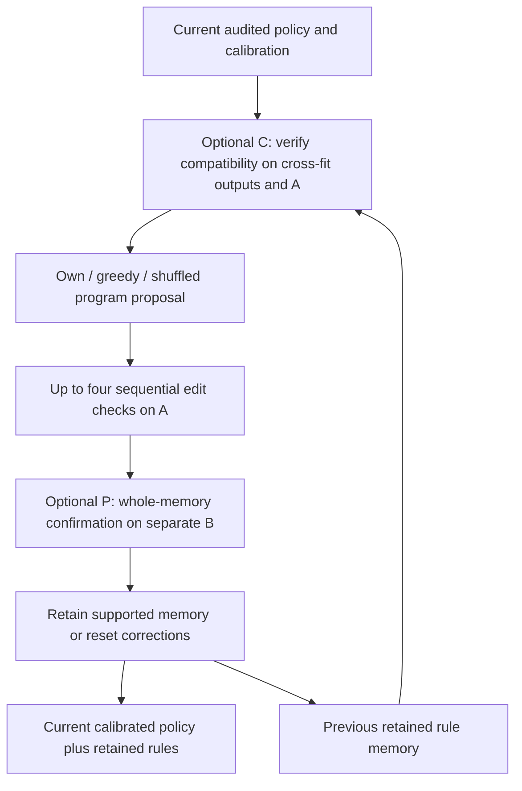

# v0.30：重新核验旧记忆，独立确认整套更新

## 1. 已执行设计

v0.29回放发现旧记忆失效和已接纳编辑的负迁移。本登记干预复用v0.29已经独立核验的原策略／校准，真正重新运行记忆维护轨迹；不重新拟合基础预测器，不运行测试集。

每轮新witness按患者分为编辑组 **A** 和确认组 **B**。**C** 在提议规则前，用拟合患者的交叉拟合预测及A重新核验旧记忆；**P** 用B确认整套编辑后的记忆。验证失败时清空的是纠错记忆，当前校准后的处方策略仍输出药物集合，不会因此强制输出空处方。

贪心穷举、自身错误驱动语言生成、打乱数值证据三种方法各运行C/P四种组合，再加原策略和校准策略，共 **14种方法状态×五轮×三个种子×两种药物空间**。所有C/P组合只在A上编辑，计算相同的影子检查，仅改变验证结果是否影响保留状态。因此C0P0与上版使用整批witness编辑的设置不同。不同验证组合如果提示完全相同，会共享同一条真实模型响应；记忆分化后会生成新提示。

语言agent实际进化的是可执行规则记忆。C/P验证策略及工具由研究者固定；系数和阈值更新沿用普通监督学习，不称为自主工具代码／语言权重进化。患者来自已使用的开发数据；B在当前轮内与A隔离，不是新的外部确认队列。

## 2. 真实运行状态

**API中断：** 新HTTP402后，未完成模型调用等待补充额度；已完成状态和独立核验保留。

| Panel | Seed | Completed rounds /5 | Status |
|---|---:|---:|---|
| full | 42 | 5 | selection_frozen |
| full | 137 | 0 | no_completed_round |
| full | 2026 | 0 | no_completed_round |
| molecular | 42 | 4 | training |
| molecular | 137 | 0 | no_completed_round |
| molecular | 2026 | 0 | no_completed_round |

首轮前通过九项合成检查，包括A上改善而B上有害的编辑、旧记忆清除、低支持度拒绝和患者隔离；这些是执行检查，不是临床分数。

## 3. Proposal-selected guard

| Panel | Arm | Audited seeds | Patient F1 ± SD | Patient Jaccard ± SD |
|---|---|---:|---:|---:|
| full | raw_policy | 1 | 0.60594 (one seed) | 0.45161 (one seed) |
| full | calibrated_policy | 1 | 0.60719 (one seed) | 0.45324 (one seed) |
| full | greedy_C0P0 | 1 | 0.60747 (one seed) | 0.45342 (one seed) |
| full | greedy_C0P1 | 1 | 0.60719 (one seed) | 0.45324 (one seed) |
| full | greedy_C1P0 | 1 | 0.60777 (one seed) | 0.45380 (one seed) |
| full | greedy_C1P1 | 1 | 0.60719 (one seed) | 0.45324 (one seed) |
| full | own_C0P0 | 1 | 0.60694 (one seed) | 0.45303 (one seed) |
| full | own_C0P1 | 1 | 0.60706 (one seed) | 0.45315 (one seed) |
| full | own_C1P0 | 1 | 0.60706 (one seed) | 0.45315 (one seed) |
| full | own_C1P1 | 1 | 0.60706 (one seed) | 0.45315 (one seed) |
| full | shuffled_C0P0 | 1 | 0.60761 (one seed) | 0.45367 (one seed) |
| full | shuffled_C0P1 | 1 | 0.60719 (one seed) | 0.45324 (one seed) |
| full | shuffled_C1P0 | 1 | 0.60719 (one seed) | 0.45324 (one seed) |
| full | shuffled_C1P1 | 1 | 0.60719 (one seed) | 0.45324 (one seed) |

| Panel | Registered contrast | F1 difference (pp) | Patient interval (pp) |
|---|---|---:|---:|
| full | greedy_compatibility_main | +0.015 | [-0.018, +0.047] |
| full | greedy_confirmation_main | -0.043 | [-0.101, +0.011] |
| full | greedy_interaction | -0.030 | [-0.094, +0.037] |
| full | greedy_full_gates_minus_no_gates | -0.029 | [-0.109, +0.050] |
| full | own_compatibility_main | +0.006 | [-0.019, +0.031] |
| full | own_confirmation_main | +0.006 | [-0.019, +0.031] |
| full | own_interaction | -0.012 | [-0.062, +0.038] |
| full | own_full_gates_minus_no_gates | +0.012 | [-0.038, +0.062] |
| full | shuffled_compatibility_main | -0.021 | [-0.044, -0.004] |
| full | shuffled_confirmation_main | -0.021 | [-0.044, -0.004] |
| full | shuffled_interaction | +0.043 | [+0.007, +0.088] |
| full | shuffled_full_gates_minus_no_gates | -0.043 | [-0.088, -0.007] |
| full | own_minus_greedy_C0P0 | -0.053 | [-0.144, +0.033] |
| full | own_minus_shuffled_C0P0 | -0.068 | [-0.143, +0.004] |
| full | own_minus_greedy_C0P1 | -0.012 | [-0.046, +0.019] |
| full | own_minus_shuffled_C0P1 | -0.012 | [-0.046, +0.019] |
| full | own_minus_greedy_C1P0 | -0.070 | [-0.129, -0.018] |
| full | own_minus_shuffled_C1P0 | -0.012 | [-0.046, +0.019] |
| full | own_minus_greedy_C1P1 | -0.012 | [-0.046, +0.019] |
| full | own_minus_shuffled_C1P1 | -0.012 | [-0.046, +0.019] |
| full | own_full_gates_minus_calibration | -0.012 | [-0.046, +0.019] |

## 4. Raw round5 guard

| Panel | Arm | Audited seeds | Patient F1 ± SD | Patient Jaccard ± SD |
|---|---|---:|---:|---:|
| full | raw_policy | 1 | 0.60594 (one seed) | 0.45161 (one seed) |
| full | calibrated_policy | 1 | 0.60719 (one seed) | 0.45324 (one seed) |
| full | greedy_C0P0 | 1 | 0.60747 (one seed) | 0.45342 (one seed) |
| full | greedy_C0P1 | 1 | 0.60719 (one seed) | 0.45324 (one seed) |
| full | greedy_C1P0 | 1 | 0.60777 (one seed) | 0.45380 (one seed) |
| full | greedy_C1P1 | 1 | 0.60719 (one seed) | 0.45324 (one seed) |
| full | own_C0P0 | 1 | 0.60694 (one seed) | 0.45303 (one seed) |
| full | own_C0P1 | 1 | 0.60706 (one seed) | 0.45315 (one seed) |
| full | own_C1P0 | 1 | 0.60706 (one seed) | 0.45315 (one seed) |
| full | own_C1P1 | 1 | 0.60706 (one seed) | 0.45315 (one seed) |
| full | shuffled_C0P0 | 1 | 0.60761 (one seed) | 0.45367 (one seed) |
| full | shuffled_C0P1 | 1 | 0.60719 (one seed) | 0.45324 (one seed) |
| full | shuffled_C1P0 | 1 | 0.60719 (one seed) | 0.45324 (one seed) |
| full | shuffled_C1P1 | 1 | 0.60719 (one seed) | 0.45324 (one seed) |

| Panel | Registered contrast | F1 difference (pp) | Patient interval (pp) |
|---|---|---:|---:|
| full | greedy_compatibility_main | +0.015 | [-0.018, +0.047] |
| full | greedy_confirmation_main | -0.043 | [-0.101, +0.011] |
| full | greedy_interaction | -0.030 | [-0.094, +0.037] |
| full | greedy_full_gates_minus_no_gates | -0.029 | [-0.109, +0.050] |
| full | own_compatibility_main | +0.006 | [-0.019, +0.031] |
| full | own_confirmation_main | +0.006 | [-0.019, +0.031] |
| full | own_interaction | -0.012 | [-0.062, +0.038] |
| full | own_full_gates_minus_no_gates | +0.012 | [-0.038, +0.062] |
| full | shuffled_compatibility_main | -0.021 | [-0.044, -0.004] |
| full | shuffled_confirmation_main | -0.021 | [-0.044, -0.004] |
| full | shuffled_interaction | +0.043 | [+0.007, +0.088] |
| full | shuffled_full_gates_minus_no_gates | -0.043 | [-0.088, -0.007] |
| full | own_minus_greedy_C0P0 | -0.053 | [-0.144, +0.033] |
| full | own_minus_shuffled_C0P0 | -0.068 | [-0.143, +0.004] |
| full | own_minus_greedy_C0P1 | -0.012 | [-0.046, +0.019] |
| full | own_minus_shuffled_C0P1 | -0.012 | [-0.046, +0.019] |
| full | own_minus_greedy_C1P0 | -0.070 | [-0.129, -0.018] |
| full | own_minus_shuffled_C1P0 | -0.012 | [-0.046, +0.019] |
| full | own_minus_greedy_C1P1 | -0.012 | [-0.046, +0.019] |
| full | own_minus_shuffled_C1P1 | -0.012 | [-0.046, +0.019] |
| full | own_full_gates_minus_calibration | -0.012 | [-0.046, +0.019] |

## 5. Raw proposal rounds and actual gate actions

| Panel | Round | Calibration F1 | Own C0P0 F1 | Own C1P1 F1 | Greedy C1P1 F1 | Own C1P1 rules by seed |
|---|---:|---:|---:|---:|---:|---|
| full | 1 | 0.56919 | 0.56926 | 0.56919 | 0.56919 | [0] |
| full | 2 | 0.58630 | 0.58611 | 0.58630 | 0.58630 | [0] |
| full | 3 | 0.59365 | 0.59282 | 0.59365 | 0.59365 | [0] |
| full | 4 | 0.59920 | 0.59844 | 0.59896 | 0.59920 | [1] |
| full | 5 | 0.60234 | 0.60121 | 0.60205 | 0.60234 | [1] |

| Panel | Arm | C resets | P resets | Accepted edits before P | Logical model calls | Logical response USD |
|---|---|---:|---:|---:|---:|---:|
| full | raw_policy | 0 | 0 | 0 | 0 | 0.00000 |
| full | calibrated_policy | 0 | 0 | 0 | 0 | 0.00000 |
| full | greedy_C0P0 | 0 | 0 | 4 | 0 | 0.00000 |
| full | greedy_C0P1 | 0 | 4 | 4 | 0 | 0.00000 |
| full | greedy_C1P0 | 3 | 0 | 4 | 0 | 0.00000 |
| full | greedy_C1P1 | 0 | 4 | 4 | 0 | 0.00000 |
| full | own_C0P0 | 0 | 0 | 4 | 5 | 0.00782 |
| full | own_C0P1 | 0 | 2 | 4 | 5 | 0.00623 |
| full | own_C1P0 | 2 | 0 | 4 | 5 | 0.00623 |
| full | own_C1P1 | 0 | 2 | 4 | 5 | 0.00623 |
| full | shuffled_C0P0 | 0 | 0 | 2 | 5 | 0.00616 |
| full | shuffled_C0P1 | 0 | 1 | 1 | 5 | 0.00589 |
| full | shuffled_C1P0 | 1 | 0 | 1 | 5 | 0.00589 |
| full | shuffled_C1P1 | 0 | 1 | 1 | 5 | 0.00589 |

full: 16 unique request hashes, USD 0.02406 in corresponding responses.

全部分数使用相同1,231次guard就诊／467人。区间先平均已有种子再按患者重采样，未作多重比较校正。已使用开发病例上的改善不等于最终测试领先。共享完全相同的响应减少无关生成噪声；响应成本不是本次新增实际扣款。独立核验重建源概率、患者角色、归纳效应、全部验证与最终输出，不重新穷举整个贪心候选排名。

## Artifacts / 交付

- [Registered protocol](protocol.json)
- [Pre-execution checks](results/runtime_probe.json)
- [Audit-gated summary](results/summary.json)
- [Preceding diagnosis](../upgrade_v29/results/memory_diagnostic.json)
