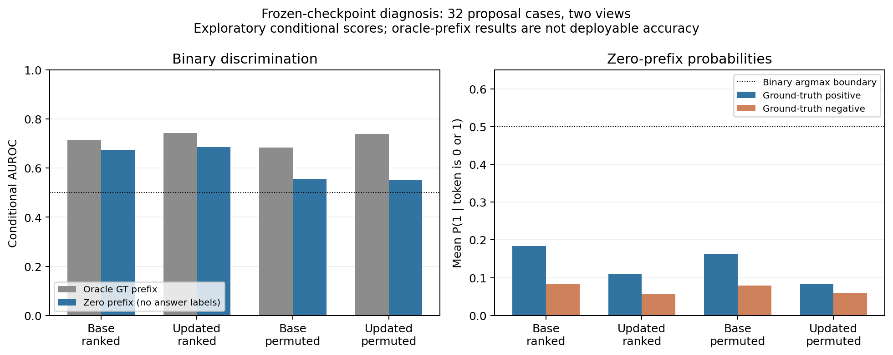

# v0.31：首个新适配器为何全部输出空处方

## 直接观察到的失败

seed42随机位置普通更新完成100个优化步骤后，100例proposal在原排序与打乱排序下都生成同一条合法全零选择列表：**200/200条空处方，药物／订单micro-F1=0**。删除空的思考标签不会改变选择结果。这是预测内容失败，不是JSON解析失败。升级规则已拒绝该适配器，保留基础模型。

真实400条训练序列中，仅 **1604/8000个位置为正例（20.05%）**，其中122/400条没有候选集合内的真值药物。69个回答token中只有20个为二元决策，其余为语法和模板；因此总体语言模型损失较低仍可能对应恒定选择。这些观察支持检查类别不平衡，但单凭比例不能证明原因。

## 冻结模型后的概率诊断

追加推理前固定前32条训练样本及前32例proposal的两种排序，对比基础模型与失败适配器。在20个决策位置分别测量P(1｜token属于0或1)。**全零前缀**在先前位置填0，不使用真值；**真值前缀**输入先前位置的真实选择，仅是oracle诊断，不是可部署准确率。没有选择新阈值、重新训练模型或生成guard／测试预测。

| State | Cases/view | Prefix | Conditional BCE ↓ | AUROC ↑ | Mean P(1), positive / negative | P(1) ≥ 0.5 (%) |
|---|---|---|---:|---:|---:|---:|
| frozen_base | train_permuted | GT | 0.8595 | 0.7259 | 0.2732 / 0.1305 | 13.12 |
| frozen_base | train_permuted | zero | 1.4946 | 0.5749 | 0.1319 / 0.0838 | 8.59 |
| frozen_base | proposal_ranked | GT | 1.0704 | 0.7154 | 0.4177 / 0.1841 | 22.97 |
| frozen_base | proposal_ranked | zero | 1.8241 | 0.6724 | 0.1832 / 0.0833 | 10.16 |
| frozen_base | proposal_permuted | GT | 1.1614 | 0.6844 | 0.3583 / 0.1636 | 19.69 |
| frozen_base | proposal_permuted | zero | 2.3327 | 0.5555 | 0.1614 / 0.0791 | 9.84 |
| permuted_uniform_seed42_round1 | train_permuted | GT | 0.2883 | 0.8284 | 0.2842 / 0.1300 | 0.62 |
| permuted_uniform_seed42_round1 | train_permuted | zero | 0.4258 | 0.5854 | 0.0828 / 0.0566 | 0.00 |
| permuted_uniform_seed42_round1 | proposal_ranked | GT | 0.4470 | 0.7424 | 0.3229 / 0.1987 | 3.44 |
| permuted_uniform_seed42_round1 | proposal_ranked | zero | 0.6380 | 0.6855 | 0.1096 / 0.0566 | 0.00 |
| permuted_uniform_seed42_round1 | proposal_permuted | GT | 0.4492 | 0.7385 | 0.2973 / 0.1810 | 2.34 |
| permuted_uniform_seed42_round1 | proposal_permuted | zero | 0.7465 | 0.5503 | 0.0832 / 0.0580 | 0.00 |

**实际模式：** 更新模型在打乱排序下，真值前缀AUROC为0.7385，全零前缀降为0.5503；全零前缀下正／负位置平均P(1)分别为0.0832／0.0580，没有位置达到0.5。原排序全零前缀AUROC为0.6855，排序敏感性也仍存在。这支持分别检验前缀暴露与校准问题，不足以认定唯一原因。

## 解释与下一项修复

需要分别看决策区分能力、概率校准和贪心生成：即便概率排序有信号，所有正例概率偏低也会使生成结果全零；如果AUROC接近随机，则说明当前诊断中缺少有用的条件区分能力。两者都不能证明已学会人类处方思路或RSI具有独特收益。

下一项修复应明确监督药物决策，将语法token和决策损失分开，并把概率校准与原贪心解码直接对照；保持无反馈、普通更新和打乱反馈的同预算控制。任何新增干预都应先登记后拟合，保留失败检查点，在开发集选定设置并冻结后再评估泛化。本诊断不替换原v31结果。

## 证据与局限

独立核验重建了源标签，并用另一套实现复算保存概率的全部指标；没有独立重跑神经网络前向计算。样本较小、按文件顺序确定，问题也来自已观察到的失败，因此属于机制诊断，不是新测试成绩。

[Registered diagnostic](collapse_diagnostic_protocol.json) · [Aggregate results](results/collapse_diagnostic.json) · [Independent recount](results/collapse_diagnostic_audit.json)

[Registered controlled decision-supervision repair](../upgrade_v32/README.zh.md)
