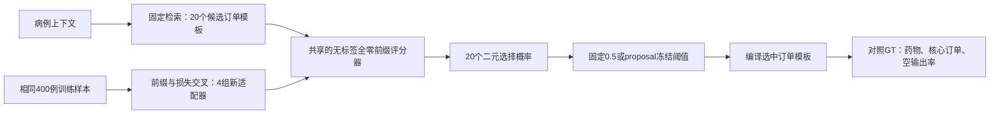

# v0.32：二元处方决策的受控修复

**持续更新入口：**[真实执行进度与核验结果](RESULTS.zh.md)。完成队列等待四组原始训练结束，核验训练回执，对全部状态评分并独立复算，再等待 guard 前置条件。不完整的实验明确显示待完成；guard 不用于重新调阈值。

这张图描述修复后的处方生成流程。本轮改变的是适配器权重；检索、订单模板和编译器保持固定。它是后续多轮进化实验的受控前置试验。

## 为什么做这一项

[已完成的v31诊断](../upgrade_v31/COLLAPSE.zh.md)发现：空输出是合法全零选择；正例选择概率偏低，并依赖先前位置的真实答案。诊断没有认定唯一原因。本试验先分离两种可能原因，再决定如何把修复后的架构用于RSI轮次。

## 已执行的数据准备与正在运行的训练

协议在准备、推理、拟合前提交。源数据重建核验了与失败更新完全相同的400条训练样本（393人）和100例proposal（另97人），患者无交叉、目标无截断。每例20个二元药物决策；仅由训练标签计算的正例权重为6396/1604=3.98753。

四个Qwen3-4B QLoRA模型均从原始权重重新开始，交叉比较：

| 方法 | 训练时先前决策位置的输入 | 二元损失 |
|---|---|---|
| teacher_uniform | 真实答案前缀 | 所有位置等权 |
| zero_uniform | 与标签无关的全零前缀 | 所有位置等权 |
| teacher_balanced | 真实答案前缀 | 平衡正负例 |
| zero_balanced | 与标签无关的全零前缀 | 平衡正负例 |

每组完全相同：400例、100步、batch4、学习率、适配器大小和seed42。只监督20个药物决策，不把语法token计入损失；推理统一使用全零前缀。不强制非空，也不回填药物。

实现仅将所需决策位置的隐藏状态送入原词表输出层。基础模型和失败适配器上的四项合成前向比较，与完整前向计算的概率差均为0；九项合成检查覆盖标签对齐、输入不含目标、提示不变、梯度、padding和决策计数。这些是实现检查，不是处方质量提升。

[真实训练进度](results/training_progress.json)由保存的优化完成回执更新。性能评估仍待完成，不宣称已有提升。

## 评价前已固定的评分与对照

对每种状态分别报告固定0.5阈值和普通proposal校准结果，包括冻结基础模型与原失败适配器。全局阈值在0.01至0.99中选择，两种proposal排序共用一个值；最大化药物／订单micro-F1平均目标，并列时选择较高阈值。另比较原检索排序前8个与全部20个候选工具。保留四组全部结果，以及仅校准带来的变化。

所有试验状态／阈值冻结，且v31 seed42原有选择全部冻结后，才评价复用的200例guard。不读取旧测试集，不用guard选获胜方法。候选药物身份、途径和记录剂量模板保持不变；模型评分候选，编译器构建输出。

## 结论边界

这是一种子、一轮监督学习的机制修复，还不能证明自进化、临床安全或超越现有方法。可行修复仍需进入普通更新／自身错误／打乱错误的匹配多轮实验。正在运行的v31继续保留原代码、轨迹和失败结果。

[登记协议](protocol.json) · [真实数据核验](results/data_audit.json) · [运行检查](results/runtime_probe.json) · [训练实现](run_training.py)
