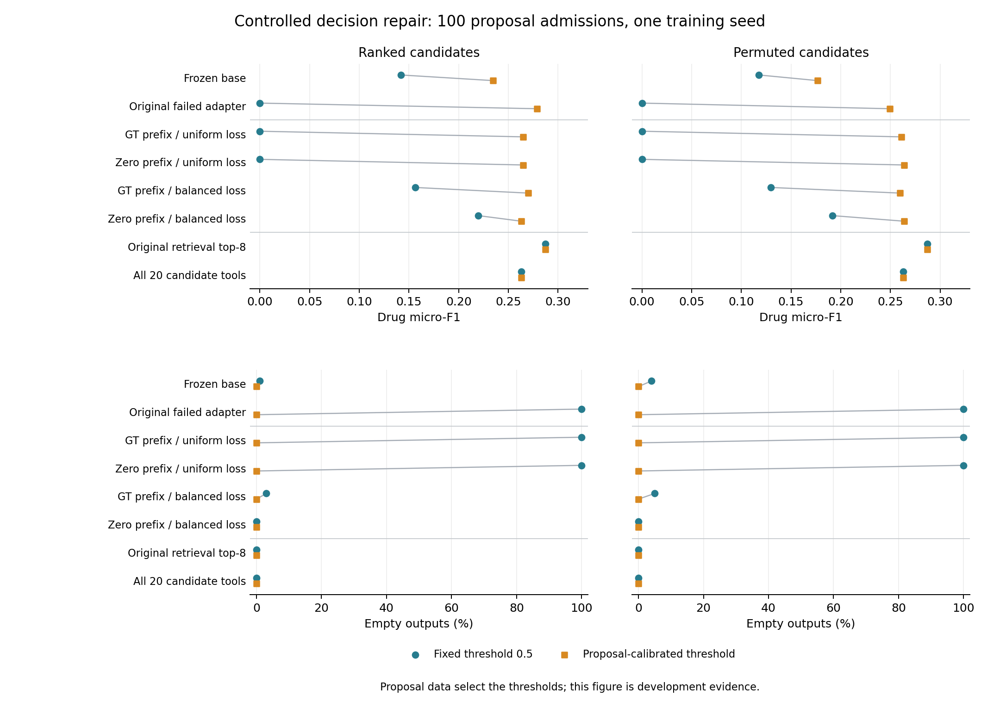

# v0.32 — Controlled binary-decision repair: execution and results

## 1. What this experiment tests

The failed first v31 update emits valid all-zero prescriptions. This four-arm pilot tests training-prefix exposure and class imbalance with the same 400 training examples and 100 optimizer steps per arm. All four new adapters, the frozen backbone and the failed adapter use the same label-free zero-prefix scorer. Original retrieval top-8 and all-20 candidates are direct controls.

A fixed 0.5 threshold measures the uncalibrated decision behavior. A second endpoint calibrates one global threshold on the 100 proposal admissions, shared across ranked and permuted views. It applies the same calibration to every neural state. Calibration-only gains are reported separately from weight-update contrasts. Both endpoints retain drug precision, recall and mean prescription size alongside F1 and empty outputs, so selecting more medications cannot be mistaken for an unqualified improvement.

## 2. Actual completion

- Completed fits: **4/4**
- Independently audited score panels: **proposal**
- API requests: **0**

| Arm | Steps | Fit seconds | Adapter SHA-256 (prefix) |
|---|---:|---:|---|
| teacher_uniform | 100 | 1739.2 | 03e345d3b72d |
| zero_uniform | 100 | 1505.8 | 200340a805f8 |
| teacher_balanced | 100 | 1569.2 | a852a5c31571 |
| zero_balanced | 100 | 1579.0 | d1e56ac1bd2c |

Fit completion is checked against the saved original adapter hash. A separate audit reconstructs all 8,000 binary labels and checks all four training receipts before proposal inference. The scoring preflight passed 120 synthetic case/probability bindings, all threshold choices, source recounting and byte-identical resume; these synthetic checks are not clinical results.

**Training audit passed for all four arms.** It reconstructed the 8,000 targets (1,604 positives), checked the 100-step training logs, verified 3,670,016 finite adapter parameters and a nonzero LoRA update per arm, and confirmed no patient overlap between the 400 training examples and 100 proposal cases. Optimizer trajectories were not independently replayed. Proposal inference is now permitted; completed training is not evidence of improved prescribing.

[Training audit](results/training_audit.json)

## 3. proposal

100 admissions / 97 patients. Proposal is used to select thresholds; the reused guard is report-only development data. This is not an untouched test.

**Main finding:** every new repair has lower drug and core-order F1 point estimates than direct retrieval top-8 in every reported view, both at threshold 0.5 and after the registered calibration. Reduced empty outputs do not establish a winning repair. All registered paired intervals are reported in the tables below.

**Over-selection after calibration:** zero-prefix/balanced selects nearly every candidate (ranked: 20.00 / 20, precision 0.17700; permuted: 19.91 / 20, precision 0.17780). Its high nonempty position agreement can therefore reflect nearly full candidate sets, not improved discrimination. The all-20 control makes this behavior visible.

**Calibration boundary:** frozen_base, original_failed_adapter, teacher_uniform select an endpoint of the fixed 0.01–0.99 grid. These are the registered grid results, not evidence of a globally optimal threshold or exhaustive ordinary calibration. The grid and selected values remain frozen.

Points show the same frozen model before/after ordinary threshold calibration. All controls remain visible; uncertainty and precision/recall are reported in the tables below.

### fixed_half

| View | Method | Threshold | Drug micro-F1 | Core-order micro-F1 | Empty % | Binary AUROC |
|---|---|---:|---:|---:|---:|---:|
| ranked | frozen_base | 0.50000 | 0.14173 | 0.08898 | 1.0 | 0.65109 |
| ranked | original_failed_adapter | 0.50000 | 0.00000 | 0.00000 | 100.0 | 0.67394 |
| ranked | teacher_uniform | 0.50000 | 0.00000 | 0.00000 | 100.0 | 0.66827 |
| ranked | zero_uniform | 0.50000 | 0.00000 | 0.00000 | 100.0 | 0.57545 |
| ranked | teacher_balanced | 0.50000 | 0.15629 | 0.09382 | 3.0 | 0.66331 |
| ranked | zero_balanced | 0.50000 | 0.21957 | 0.14327 | 0.0 | 0.52779 |
| ranked | original_retrieval_top8 | N/A | 0.28706 | 0.20181 | 0.0 | N/A |
| ranked | all20_candidate_tools | N/A | 0.26310 | 0.18427 | 0.0 | N/A |
| permuted | frozen_base | 0.50000 | 0.11765 | 0.06816 | 4.0 | 0.54749 |
| permuted | original_failed_adapter | 0.50000 | 0.00000 | 0.00000 | 100.0 | 0.55061 |
| permuted | teacher_uniform | 0.50000 | 0.00000 | 0.00000 | 100.0 | 0.53469 |
| permuted | zero_uniform | 0.50000 | 0.00000 | 0.00000 | 100.0 | 0.55301 |
| permuted | teacher_balanced | 0.50000 | 0.12978 | 0.07407 | 5.0 | 0.55895 |
| permuted | zero_balanced | 0.50000 | 0.19153 | 0.13539 | 0.0 | 0.48469 |
| permuted | original_retrieval_top8 | N/A | 0.28706 | 0.20181 | 0.0 | N/A |
| permuted | all20_candidate_tools | N/A | 0.26310 | 0.18427 | 0.0 | N/A |

#### Missed and extra recorded medications

| View | Method | Drug precision | Drug recall | Mean predicted drugs |
|---|---|---:|---:|---:|
| ranked | frozen_base | 0.31818 | 0.09117 | 1.98 |
| ranked | original_failed_adapter | 0.00000 | 0.00000 | 0.00 |
| ranked | teacher_uniform | 0.00000 | 0.00000 | 0.00 |
| ranked | zero_uniform | 0.00000 | 0.00000 | 0.00 |
| ranked | teacher_balanced | 0.35938 | 0.09986 | 1.92 |
| ranked | zero_balanced | 0.18680 | 0.26628 | 9.85 |
| ranked | original_retrieval_top8 | 0.26750 | 0.30970 | 8.00 |
| ranked | all20_candidate_tools | 0.17700 | 0.51230 | 20.00 |
| permuted | frozen_base | 0.26943 | 0.07525 | 1.93 |
| permuted | original_failed_adapter | 0.00000 | 0.00000 | 0.00 |
| permuted | teacher_uniform | 0.00000 | 0.00000 | 0.00 |
| permuted | zero_uniform | 0.00000 | 0.00000 | 0.00 |
| permuted | teacher_balanced | 0.32558 | 0.08104 | 1.72 |
| permuted | zero_balanced | 0.16631 | 0.22576 | 9.38 |
| permuted | original_retrieval_top8 | 0.26750 | 0.30970 | 8.00 |
| permuted | all20_candidate_tools | 0.17700 | 0.51230 | 20.00 |

Precision and recall use the recorded medication set, including ground-truth medications outside the candidate list. Mean prescription size makes over-selection visible alongside the empty-output rate. An extra medication relative to this reference is not by itself a clinical adjudication of inappropriate prescribing. These are existing independently recounted metrics; they do not change threshold or model selection.

Core-order matching requires drug, route, dose value and dose unit. The compiler copies supplied order templates; it does not generate novel doses. Binary AUROC covers the 20 candidate decisions; drug/order F1 retains unreachable ground-truth medications.

#### All registered contrasts

| View | Contrast | Drug Δ [95% CI] | Core-order Δ [95% CI] |
|---|---|---:|---:|
| ranked | zero_uniform_minus_teacher_uniform | +0.00000 [+0.00000, +0.00000] | +0.00000 [+0.00000, +0.00000] |
| ranked | zero_balanced_minus_teacher_balanced | +0.06329 [+0.02389, +0.10091] | +0.04945 [+0.01916, +0.07765] |
| ranked | zero_balanced_minus_zero_uniform | +0.21957 [+0.18714, +0.25144] | +0.14327 [+0.11543, +0.17046] |
| ranked | teacher_balanced_minus_teacher_uniform | +0.15629 [+0.12485, +0.18719] | +0.09382 [+0.06673, +0.12390] |
| ranked | prefix_by_balance_interaction | +0.06329 [+0.02389, +0.10091] | +0.04945 [+0.01916, +0.07765] |
| ranked | teacher_uniform_minus_frozen_base | -0.14173 [-0.17087, -0.11414] | -0.08898 [-0.11439, -0.06557] |
| ranked | teacher_uniform_minus_original_failed_adapter | +0.00000 [+0.00000, +0.00000] | +0.00000 [+0.00000, +0.00000] |
| ranked | teacher_uniform_minus_original_retrieval_top8 | -0.28706 [-0.32553, -0.24658] | -0.20181 [-0.23686, -0.16678] |
| ranked | teacher_uniform_minus_all20_candidate_tools | -0.26310 [-0.29905, -0.22367] | -0.18427 [-0.21295, -0.15462] |
| ranked | zero_uniform_minus_frozen_base | -0.14173 [-0.17087, -0.11414] | -0.08898 [-0.11439, -0.06557] |
| ranked | zero_uniform_minus_original_failed_adapter | +0.00000 [+0.00000, +0.00000] | +0.00000 [+0.00000, +0.00000] |
| ranked | zero_uniform_minus_original_retrieval_top8 | -0.28706 [-0.32553, -0.24658] | -0.20181 [-0.23686, -0.16678] |
| ranked | zero_uniform_minus_all20_candidate_tools | -0.26310 [-0.29905, -0.22367] | -0.18427 [-0.21295, -0.15462] |
| ranked | teacher_balanced_minus_frozen_base | +0.01455 [-0.00876, +0.03872] | +0.00483 [-0.01274, +0.02299] |
| ranked | teacher_balanced_minus_original_failed_adapter | +0.15629 [+0.12485, +0.18719] | +0.09382 [+0.06673, +0.12390] |
| ranked | teacher_balanced_minus_original_retrieval_top8 | -0.13077 [-0.17645, -0.08429] | -0.10799 [-0.14141, -0.07264] |
| ranked | teacher_balanced_minus_all20_candidate_tools | -0.10681 [-0.15301, -0.05865] | -0.09045 [-0.12462, -0.05433] |
| ranked | zero_balanced_minus_frozen_base | +0.07784 [+0.03741, +0.11498] | +0.05429 [+0.02263, +0.08357] |
| ranked | zero_balanced_minus_original_failed_adapter | +0.21957 [+0.18714, +0.25144] | +0.14327 [+0.11543, +0.17046] |
| ranked | zero_balanced_minus_original_retrieval_top8 | -0.06749 [-0.09636, -0.03973] | -0.05854 [-0.08645, -0.03008] |
| ranked | zero_balanced_minus_all20_candidate_tools | -0.04353 [-0.06687, -0.02102] | -0.04100 [-0.06109, -0.02104] |
| permuted | zero_uniform_minus_teacher_uniform | +0.00000 [+0.00000, +0.00000] | +0.00000 [+0.00000, +0.00000] |
| permuted | zero_balanced_minus_teacher_balanced | +0.06175 [+0.02071, +0.10222] | +0.06132 [+0.03059, +0.09099] |
| permuted | zero_balanced_minus_zero_uniform | +0.19153 [+0.15886, +0.22338] | +0.13539 [+0.10832, +0.16245] |
| permuted | teacher_balanced_minus_teacher_uniform | +0.12978 [+0.10585, +0.15385] | +0.07407 [+0.05549, +0.09469] |
| permuted | prefix_by_balance_interaction | +0.06175 [+0.02071, +0.10222] | +0.06132 [+0.03059, +0.09099] |
| permuted | teacher_uniform_minus_frozen_base | -0.11765 [-0.14146, -0.09480] | -0.06816 [-0.08912, -0.04883] |
| permuted | teacher_uniform_minus_original_failed_adapter | +0.00000 [+0.00000, +0.00000] | +0.00000 [+0.00000, +0.00000] |
| permuted | teacher_uniform_minus_original_retrieval_top8 | -0.28706 [-0.32553, -0.24658] | -0.20181 [-0.23686, -0.16678] |
| permuted | teacher_uniform_minus_all20_candidate_tools | -0.26310 [-0.29905, -0.22367] | -0.18427 [-0.21295, -0.15462] |
| permuted | zero_uniform_minus_frozen_base | -0.11765 [-0.14146, -0.09480] | -0.06816 [-0.08912, -0.04883] |
| permuted | zero_uniform_minus_original_failed_adapter | +0.00000 [+0.00000, +0.00000] | +0.00000 [+0.00000, +0.00000] |
| permuted | zero_uniform_minus_original_retrieval_top8 | -0.28706 [-0.32553, -0.24658] | -0.20181 [-0.23686, -0.16678] |
| permuted | zero_uniform_minus_all20_candidate_tools | -0.26310 [-0.29905, -0.22367] | -0.18427 [-0.21295, -0.15462] |
| permuted | teacher_balanced_minus_frozen_base | +0.01213 [-0.00401, +0.02805] | +0.00592 [-0.00573, +0.01789] |
| permuted | teacher_balanced_minus_original_failed_adapter | +0.12978 [+0.10585, +0.15385] | +0.07407 [+0.05549, +0.09469] |
| permuted | teacher_balanced_minus_original_retrieval_top8 | -0.15728 [-0.19799, -0.11347] | -0.12774 [-0.16341, -0.09161] |
| permuted | teacher_balanced_minus_all20_candidate_tools | -0.13332 [-0.17549, -0.08933] | -0.11019 [-0.14166, -0.07714] |
| permuted | zero_balanced_minus_frozen_base | +0.07388 [+0.03553, +0.11125] | +0.06723 [+0.03885, +0.09543] |
| permuted | zero_balanced_minus_original_failed_adapter | +0.19153 [+0.15886, +0.22338] | +0.13539 [+0.10832, +0.16245] |
| permuted | zero_balanced_minus_original_retrieval_top8 | -0.09553 [-0.12151, -0.06998] | -0.06642 [-0.09001, -0.04216] |
| permuted | zero_balanced_minus_all20_candidate_tools | -0.07157 [-0.09660, -0.04744] | -0.04888 [-0.06522, -0.03181] |
### proposal_calibrated

| View | Method | Threshold | Drug micro-F1 | Core-order micro-F1 | Empty % | Binary AUROC |
|---|---|---:|---:|---:|---:|---:|
| ranked | frozen_base | 0.01000 | 0.23439 | 0.15850 | 0.0 | 0.65109 |
| ranked | original_failed_adapter | 0.01000 | 0.27879 | 0.19352 | 0.0 | 0.67394 |
| ranked | teacher_uniform | 0.01000 | 0.26502 | 0.18536 | 0.0 | 0.66827 |
| ranked | zero_uniform | 0.21000 | 0.26480 | 0.18506 | 0.0 | 0.57545 |
| ranked | teacher_balanced | 0.04000 | 0.26986 | 0.18828 | 0.0 | 0.66331 |
| ranked | zero_balanced | 0.40000 | 0.26310 | 0.18427 | 0.0 | 0.52779 |
| ranked | original_retrieval_top8 | N/A | 0.28706 | 0.20181 | 0.0 | N/A |
| ranked | all20_candidate_tools | N/A | 0.26310 | 0.18427 | 0.0 | N/A |
| permuted | frozen_base | 0.01000 | 0.17663 | 0.10683 | 0.0 | 0.54749 |
| permuted | original_failed_adapter | 0.01000 | 0.24955 | 0.17346 | 0.0 | 0.55061 |
| permuted | teacher_uniform | 0.01000 | 0.26103 | 0.18330 | 0.0 | 0.53469 |
| permuted | zero_uniform | 0.21000 | 0.26383 | 0.18333 | 0.0 | 0.55301 |
| permuted | teacher_balanced | 0.04000 | 0.25979 | 0.18145 | 0.0 | 0.55895 |
| permuted | zero_balanced | 0.40000 | 0.26398 | 0.18487 | 0.0 | 0.48469 |
| permuted | original_retrieval_top8 | N/A | 0.28706 | 0.20181 | 0.0 | N/A |
| permuted | all20_candidate_tools | N/A | 0.26310 | 0.18427 | 0.0 | N/A |

#### Missed and extra recorded medications

| View | Method | Drug precision | Drug recall | Mean predicted drugs |
|---|---|---:|---:|---:|
| ranked | frozen_base | 0.28661 | 0.19826 | 4.78 |
| ranked | original_failed_adapter | 0.19735 | 0.47467 | 16.62 |
| ranked | teacher_uniform | 0.17892 | 0.51085 | 19.73 |
| ranked | zero_uniform | 0.17943 | 0.50507 | 19.45 |
| ranked | teacher_balanced | 0.18633 | 0.48915 | 18.14 |
| ranked | zero_balanced | 0.17700 | 0.51230 | 20.00 |
| ranked | original_retrieval_top8 | 0.26750 | 0.30970 | 8.00 |
| ranked | all20_candidate_tools | 0.17700 | 0.51230 | 20.00 |
| permuted | frozen_base | 0.24242 | 0.13893 | 3.96 |
| permuted | original_failed_adapter | 0.18087 | 0.40232 | 15.37 |
| permuted | teacher_uniform | 0.17653 | 0.50072 | 19.60 |
| permuted | zero_uniform | 0.18004 | 0.49349 | 18.94 |
| permuted | teacher_balanced | 0.18166 | 0.45586 | 17.34 |
| permuted | zero_balanced | 0.17780 | 0.51230 | 19.91 |
| permuted | original_retrieval_top8 | 0.26750 | 0.30970 | 8.00 |
| permuted | all20_candidate_tools | 0.17700 | 0.51230 | 20.00 |

Precision and recall use the recorded medication set, including ground-truth medications outside the candidate list. Mean prescription size makes over-selection visible alongside the empty-output rate. An extra medication relative to this reference is not by itself a clinical adjudication of inappropriate prescribing. These are existing independently recounted metrics; they do not change threshold or model selection.

Core-order matching requires drug, route, dose value and dose unit. The compiler copies supplied order templates; it does not generate novel doses. Binary AUROC covers the 20 candidate decisions; drug/order F1 retains unreachable ground-truth medications.

#### All registered contrasts

| View | Contrast | Drug Δ [95% CI] | Core-order Δ [95% CI] |
|---|---|---:|---:|
| ranked | zero_uniform_minus_teacher_uniform | -0.00022 [-0.00375, +0.00298] | -0.00030 [-0.00356, +0.00256] |
| ranked | zero_balanced_minus_teacher_balanced | -0.00676 [-0.01264, -0.00077] | -0.00401 [-0.00882, +0.00119] |
| ranked | zero_balanced_minus_zero_uniform | -0.00170 [-0.00460, +0.00169] | -0.00079 [-0.00331, +0.00234] |
| ranked | teacher_balanced_minus_teacher_uniform | +0.00485 [-0.00098, +0.01064] | +0.00292 [-0.00214, +0.00777] |
| ranked | prefix_by_balance_interaction | -0.00654 [-0.01337, +0.00096] | -0.00371 [-0.00957, +0.00282] |
| ranked | teacher_uniform_minus_frozen_base | +0.03063 [-0.00669, +0.06849] | +0.02687 [-0.00328, +0.05864] |
| ranked | teacher_uniform_minus_original_failed_adapter | -0.01378 [-0.02184, -0.00468] | -0.00816 [-0.01555, +0.00080] |
| ranked | teacher_uniform_minus_original_retrieval_top8 | -0.02204 [-0.04319, +0.00105] | -0.01645 [-0.03629, +0.00444] |
| ranked | teacher_uniform_minus_all20_candidate_tools | +0.00192 [+0.00039, +0.00335] | +0.00109 [-0.00039, +0.00228] |
| ranked | zero_uniform_minus_frozen_base | +0.03041 [-0.00647, +0.06817] | +0.02656 [-0.00355, +0.05831] |
| ranked | zero_uniform_minus_original_failed_adapter | -0.01400 [-0.02262, -0.00467] | -0.00846 [-0.01635, +0.00084] |
| ranked | zero_uniform_minus_original_retrieval_top8 | -0.02226 [-0.04318, +0.00039] | -0.01675 [-0.03630, +0.00381] |
| ranked | zero_uniform_minus_all20_candidate_tools | +0.00170 [-0.00169, +0.00460] | +0.00079 [-0.00234, +0.00331] |
| ranked | teacher_balanced_minus_frozen_base | +0.03547 [-0.00186, +0.07385] | +0.02978 [+0.00025, +0.06135] |
| ranked | teacher_balanced_minus_original_failed_adapter | -0.00893 [-0.01562, -0.00194] | -0.00524 [-0.01114, +0.00132] |
| ranked | teacher_balanced_minus_original_retrieval_top8 | -0.01720 [-0.03755, +0.00511] | -0.01353 [-0.03142, +0.00549] |
| ranked | teacher_balanced_minus_all20_candidate_tools | +0.00676 [+0.00077, +0.01264] | +0.00401 [-0.00119, +0.00882] |
| ranked | zero_balanced_minus_frozen_base | +0.02871 [-0.00863, +0.06659] | +0.02577 [-0.00408, +0.05747] |
| ranked | zero_balanced_minus_original_failed_adapter | -0.01569 [-0.02412, -0.00646] | -0.00925 [-0.01679, -0.00023] |
| ranked | zero_balanced_minus_original_retrieval_top8 | -0.02396 [-0.04524, -0.00084] | -0.01754 [-0.03743, +0.00333] |
| ranked | zero_balanced_minus_all20_candidate_tools | +0.00000 [+0.00000, +0.00000] | +0.00000 [+0.00000, +0.00000] |
| permuted | zero_uniform_minus_teacher_uniform | +0.00280 [-0.00304, +0.00853] | +0.00004 [-0.00502, +0.00506] |
| permuted | zero_balanced_minus_teacher_balanced | +0.00419 [-0.00385, +0.01216] | +0.00342 [-0.00345, +0.01081] |
| permuted | zero_balanced_minus_zero_uniform | +0.00015 [-0.00488, +0.00578] | +0.00154 [-0.00274, +0.00604] |
| permuted | teacher_balanced_minus_teacher_uniform | -0.00124 [-0.00859, +0.00601] | -0.00184 [-0.00842, +0.00462] |
| permuted | prefix_by_balance_interaction | +0.00139 [-0.00681, +0.00955] | +0.00339 [-0.00435, +0.01114] |
| permuted | teacher_uniform_minus_frozen_base | +0.08440 [+0.04778, +0.11812] | +0.07647 [+0.04554, +0.10572] |
| permuted | teacher_uniform_minus_original_failed_adapter | +0.01148 [+0.00015, +0.02263] | +0.00984 [+0.00056, +0.01937] |
| permuted | teacher_uniform_minus_original_retrieval_top8 | -0.02602 [-0.04704, -0.00338] | -0.01851 [-0.03761, +0.00218] |
| permuted | teacher_uniform_minus_all20_candidate_tools | -0.00207 [-0.00546, +0.00088] | -0.00097 [-0.00396, +0.00158] |
| permuted | zero_uniform_minus_frozen_base | +0.08720 [+0.04946, +0.12223] | +0.07650 [+0.04556, +0.10637] |
| permuted | zero_uniform_minus_original_failed_adapter | +0.01428 [+0.00090, +0.02775] | +0.00988 [-0.00125, +0.02093] |
| permuted | zero_uniform_minus_original_retrieval_top8 | -0.02323 [-0.04532, +0.00060] | -0.01848 [-0.03849, +0.00290] |
| permuted | zero_uniform_minus_all20_candidate_tools | +0.00073 [-0.00499, +0.00574] | -0.00093 [-0.00555, +0.00330] |
| permuted | teacher_balanced_minus_frozen_base | +0.08316 [+0.04747, +0.11652] | +0.07462 [+0.04460, +0.10260] |
| permuted | teacher_balanced_minus_original_failed_adapter | +0.01024 [+0.00126, +0.01953] | +0.00800 [-0.00025, +0.01647] |
| permuted | teacher_balanced_minus_original_retrieval_top8 | -0.02726 [-0.04951, -0.00321] | -0.02036 [-0.04082, +0.00087] |
| permuted | teacher_balanced_minus_all20_candidate_tools | -0.00331 [-0.01100, +0.00454] | -0.00282 [-0.01012, +0.00395] |
| permuted | zero_balanced_minus_frozen_base | +0.08735 [+0.05055, +0.12127] | +0.07804 [+0.04712, +0.10736] |
| permuted | zero_balanced_minus_original_failed_adapter | +0.01443 [+0.00251, +0.02628] | +0.01142 [+0.00162, +0.02165] |
| permuted | zero_balanced_minus_original_retrieval_top8 | -0.02307 [-0.04442, +0.00001] | -0.01694 [-0.03691, +0.00399] |
| permuted | zero_balanced_minus_all20_candidate_tools | +0.00088 [+0.00038, +0.00148] | +0.00061 [+0.00026, +0.00100] |

### Calibration-only changes

| View | Model state | Drug Δ [95% CI] | Core-order Δ [95% CI] |
|---|---|---:|---:|
| ranked | frozen_base | +0.09266 [+0.06317, +0.11832] | +0.06951 [+0.04622, +0.09032] |
| ranked | original_failed_adapter | +0.27879 [+0.23764, +0.31614] | +0.19352 [+0.16167, +0.22369] |
| ranked | teacher_uniform | +0.26502 [+0.22524, +0.30144] | +0.18536 [+0.15513, +0.21426] |
| ranked | zero_uniform | +0.26480 [+0.22553, +0.30088] | +0.18506 [+0.15496, +0.21484] |
| ranked | teacher_balanced | +0.11357 [+0.06645, +0.16023] | +0.09446 [+0.05817, +0.12863] |
| ranked | zero_balanced | +0.04353 [+0.02102, +0.06687] | +0.04100 [+0.02104, +0.06109] |
| permuted | frozen_base | +0.05899 [+0.03448, +0.08224] | +0.03867 [+0.02034, +0.05760] |
| permuted | original_failed_adapter | +0.24955 [+0.21218, +0.28400] | +0.17346 [+0.14387, +0.20206] |
| permuted | teacher_uniform | +0.26103 [+0.22204, +0.29738] | +0.18330 [+0.15331, +0.21156] |
| permuted | zero_uniform | +0.26383 [+0.22482, +0.30044] | +0.18333 [+0.15342, +0.21218] |
| permuted | teacher_balanced | +0.13001 [+0.08639, +0.17205] | +0.10738 [+0.07506, +0.13854] |
| permuted | zero_balanced | +0.07245 [+0.04832, +0.09745] | +0.04948 [+0.03248, +0.06596] |

### Candidate-position invariance

| Endpoint | View vs ranked | Method | Equal sets % | Nonempty union cases | Nonempty Jaccard |
|---|---|---|---:|---:|---:|
| fixed_half | permuted | frozen_base | 3.0 | 100 | 0.21667 |
| fixed_half | permuted | original_failed_adapter | 100.0 | 0 | N/A |
| fixed_half | permuted | teacher_uniform | 100.0 | 0 | N/A |
| fixed_half | permuted | zero_uniform | 100.0 | 0 | N/A |
| fixed_half | permuted | teacher_balanced | 6.0 | 100 | 0.24033 |
| fixed_half | permuted | zero_balanced | 0.0 | 100 | 0.31703 |
| fixed_half | permuted | original_retrieval_top8 | 100.0 | 100 | 1.00000 |
| fixed_half | permuted | all20_candidate_tools | 100.0 | 100 | 1.00000 |
| proposal_calibrated | permuted | frozen_base | 0.0 | 100 | 0.28679 |
| proposal_calibrated | permuted | original_failed_adapter | 0.0 | 100 | 0.67948 |
| proposal_calibrated | permuted | teacher_uniform | 58.0 | 100 | 0.96650 |
| proposal_calibrated | permuted | zero_uniform | 25.0 | 100 | 0.92221 |
| proposal_calibrated | permuted | teacher_balanced | 2.0 | 100 | 0.80320 |
| proposal_calibrated | permuted | zero_balanced | 91.0 | 100 | 0.99550 |
| proposal_calibrated | permuted | original_retrieval_top8 | 100.0 | 100 | 1.00000 |
| proposal_calibrated | permuted | all20_candidate_tools | 100.0 | 100 | 1.00000 |

An all-empty predictor can have perfect set agreement. Nonempty-union counts and Jaccard therefore accompany it. All intervals use 4,000 paired patient-cluster resamples; they are descriptive, unadjusted for multiple comparisons and do not capture seed uncertainty.

[Full proposal scores and contrasts](results/proposal_summary.json) · [Independent recount](results/proposal_audit.json)

## 4. guard

No independently audited score is available. Pending prerequisites: v31_seed42_frozen_selection.

## 5. Interpretation boundary

This pilot is one-seed, one-round supervised repair. It does not by itself show recursive self-improvement. Fixed candidate retrieval and dose templates do not evolve. After the four training states and ordinary thresholds freeze, the guard waits for all original v31 seed42 selections to freeze as well; guard scores cannot choose a winning repair. Multi-round own-error, shuffled-error and uniform controls remain necessary.

[Protocol](protocol.json) · [Evaluation addendum](evaluation_addendum.json) · [Execution progress](results/progress.json) · [Synthetic scoring preflight](results/evaluation_probe.json) · [Earlier collapse diagnosis](../upgrade_v31/COLLAPSE.en.md)

A separate post-proposal diagnosis fixes every output to eight medications and independently recounts drug-identity ranking, position sensitivity and cutoff ties. It changes no original selection. [Fixed-cardinality ranking diagnosis](RANKING_DIAGNOSTIC.en.md)

The frozen-readout precision comparison has passed its numerical preflight and has a separate clinical evaluation/audit pipeline. [Precision comparison](PRECISION.en.md)
