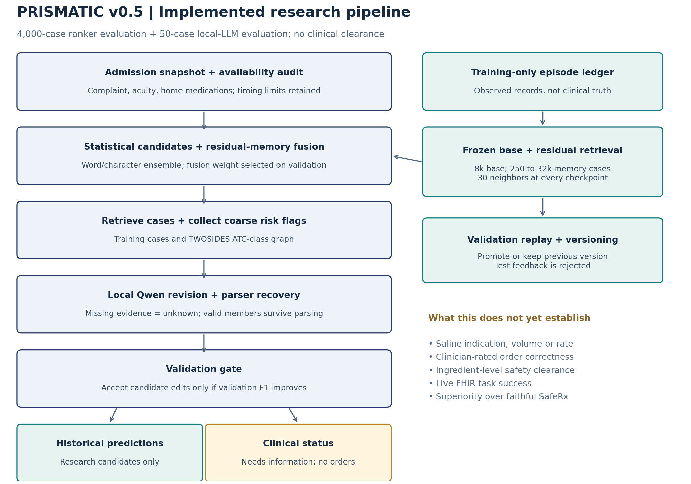
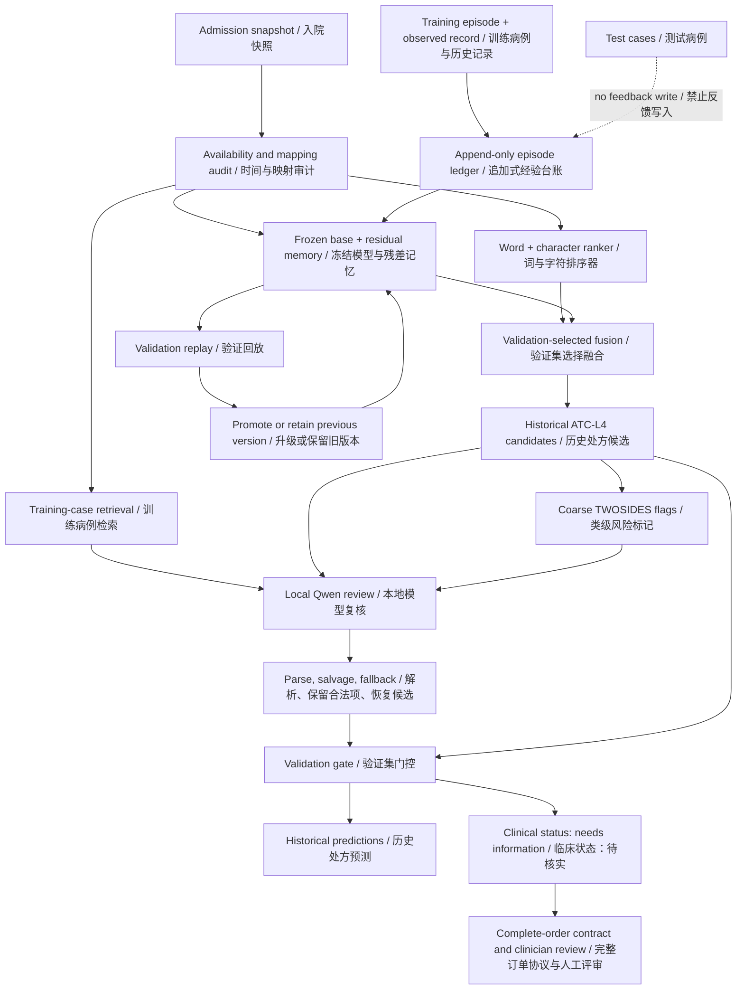

# PRISMATIC v0.5: implemented architecture / 已实现结构

This diagram describes executable v5 components, not a clinically complete prescribing system.
本图对应 v5 已执行代码；临床完整处方系统尚未完成。

## 1. Why half the old outputs disappeared / 旧版为何清空一半病例

The v4 reviewer received the same missing-allergy/weight/renal warning for every patient and an instruction to remove unsupported selections. It conflated uncertain clinical clearance with the separate target of predicting historical orders. All 25 empty outputs were valid arrays; 20 erased nonempty RAG proposals, and 19 had mapped historical targets. The separate all-or-nothing parser also discarded an entire response if any code was invalid, though this did not cause those 25 final empty arrays.

v4 为每位患者附加相同的过敏、体重、肾功能缺失警告，并要求删除缺乏支持的药物，把“尚不能确认临床可执行”混成“历史处方不应包含任何药物”。25 次空输出都是合法空数组，其中 20 次清空了已有检索候选，19 例有已映射历史处方。旧解析器另外存在“一项非法就整单清空”的缺陷，但它不是这 25 次最终空输出的直接原因。

## 2. What was repaired / 本轮修复

| Component / 模块 | Executed behavior / 已执行行为 |
| --- | --- |
| Candidate parsing / 候选解析 | Preserve valid members; deduplicate; cap at five; distinguish genuine empty arrays, partial repair and invalid JSON. Invalid revisions recover the prior candidate set. / 保留合法项、去重、最多五项；区分真实弃答、部分修复和解析失败；非法复核恢复前一候选。 |
| Historical review / 历史预测复核 | Explicitly model missing evidence as unknown rather than automatic exclusion; genuine empty arrays remain allowed. / 缺失信息记为未知，不能自动删光；仍允许真正的空预测。 |
| Clinical state / 临床状态 | Separate from historical predictions. No output receives clinical clearance; no executable order is issued. / 与预测独立；本轮不产生临床执行授权。 |
| Risk flags / 风险标记 | Execute class-level TWOSIDES lookup; flags require ingredient-level verification. They do not automatically delete classes. / 实际查询类级 TWOSIDES 图；需成分级核验，不自动删药。 |
| Revision gate / 复核门控 | Compare anchor and LLM revision on 50 validation cases, freeze the decision before 50 test inferences. When rejected, the LLM runs in shadow mode and its cost is still charged. / 先在 50 验证例比较，再冻结决策；拒绝修改时保留排序候选，但报告模型实际消耗。 |
| Memory gate / 经验门控 | Only training episodes can enter memory. Version hashes, validation scores, promotion decisions and replayable state are stored. / 仅训练病例可写入；保存版本哈希、验证分数、升级记录与可回放状态。 |

The numerical top-five ranker always returns five research candidates. Its zero-empty rate is a budget property, not evidence that every patient needs drugs. The free-output LLM repair is evaluated separately so its empty-output change can be inspected without this constraint.

固定 top-5 排序器始终输出五个研究候选，因此其空输出率为零是协议属性，不能解释为所有患者都需要用药。自由输出的 LLM 修复另设实验，避免用强制补满掩盖问题。

## 3. What “evolution” means here / 这里的“进化”到底是什么

**Old v4: no experience update. New v5: implemented training-only residual episode memory; no LLM weight updates and no autonomous clinical self-improvement claim.**

**旧 v4 没有经验更新。新 v5 实现了仅用训练反馈的残差病例记忆；没有更新大模型权重，不能称为自主临床能力进化。**

1. Train a base statistical ranker on 8,000 admissions; freeze its weights and text representation. Base and memory admissions belong to disjoint training patients.
2. For each later training episode, compute the difference between observed mapped labels and the frozen ranker's scores. Store the episode in an append-only ledger.
3. Retrieve 30 similar memory episodes and use their similarity-weighted residuals to correct the base scores. Query/context budget stays fixed as memory grows.
4. Replay 250 / 1,000 / 4,000 / 16,000 / 32,000 episodes; select the correction weight on the same 4,000 validation admissions. Promote only a strictly better validation version; otherwise retain the old version.
5. Freeze the selected policies before test scoring. Test/validation episodes cannot be written back. Historical labels are behavior feedback, not clinician-confirmed indications.

中文：先用 8,000 例训练并冻结基础排序器；后续训练病例产生“实际记录减去预测分数”的残差；检索最相似的 30 条残差修正排序；在五个病例量检查点用验证集决定升级或保留旧版；测试集不反馈。药物词表和映射固定来自共同 40,000 例训练队列，所以这是**固定表示与映射条件下的记忆增长实验**，不是完整系统只见过 8,000 例的低数据实验，也不是按真实日期进行的前瞻性部署。

There are two different gates: the 4,000-case validation gate controls memory versions/fusion; the 50-case validation gate controls LLM edits. A small validation improvement can fail to transfer to the development test. All such failures must remain in the report.

门控分两层：4,000 例验证集选择记忆版本与融合比例；50 例验证集决定是否接受 LLM 改写。验证集上的小提升未必能泛化，失败结果必须保留。

## 4. What we borrowed from the literature / 从相关工作借鉴什么

| Primary source / 原始来源 | Mechanism / 机制 | Implemented scope / 本轮边界 |
| --- | --- | --- |
| [SafeRx-Agent](https://arxiv.org/html/2605.29146v1) | Collect risk evidence, then adjudicate flagged medications using the case. / 先找证据，再逐项复核。 | Class-level flag lookup and separate uncertainty state. No claim of reproducing its specialty routing, MEDI indications or contraindication matrices. / 实现类级标记和未知状态；未复现其完整专科路由、适应证和禁忌知识。 |
| [MedAgentSim](https://arxiv.org/html/2503.22678v1) | Replay successful and corrected diagnostic episodes. / 回放成功与纠错诊断经验。 | Residual medication-behavior memory, with validation promotion and test-feedback exclusion. It is a new statistical adaptation, not a reproduction of diagnostic simulation. / 改为处方行为残差记忆；不是该诊断模拟论文的复现。 |
| [MedAgentBench](https://github.com/stanfordmlgroup/MedAgentBench) | Evaluate actions against real FHIR state and task outcomes. / 以真实 FHIR 状态验证动作结果。 | Explicit local state traces only; live FHIR/server evaluation remains pending. It is a benchmark, not a prescription baseline that can be assigned an ATC F1. / 本轮仅有本地状态轨迹；真实 FHIR 测试待补。 |

## 5. What remains necessary for supportive drugs and saline / 辅助药、盐水还缺什么

The present ATC map misses all saline-name proxy orders. Therefore an ATC gain cannot show that saline purpose, amount, rate, diluent/flush use or supportive-drug indication has been learned. The next experience source must be clinician-rated **complete orders**, preserving ingredient identity, route, indication, fluid role, volume, rate, renal context, missing-information requests, and accepted/rejected revisions. The existing two-reviewer protocol can provide that feedback; no reviewer labels have yet been supplied.

当前 ATC 映射遗漏了全部盐水名称匹配订单。因此 ATC 分数提高不能证明学会盐水用途、剂量、速度、溶媒/冲管区分或辅助药指征。下一步必须接入两位评审者对**完整订单**的反馈：成分、途径、指征、液体角色、量、速度、肾功能依据、应补问信息、接受/拒绝及原因。现在还没有这类人工反馈，不能把历史记录当作临床正确答案。
