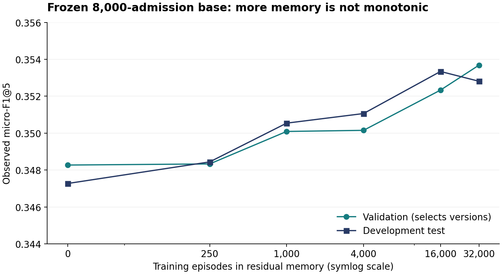

# PRISMATIC v0.5 执行结果：空输出修复与经验更新

版本：2026-10-14，v5-r1。保留 v4 原始负结果；本文由真实结果 JSON 自动生成。

## 摘要

**旧版确有设计问题。** 50 例中 25 次空输出全部是合法空数组；其中 20 次清空非空检索候选，19 例有已映射历史处方。主要原因是把缺失临床信息解释为统一删药条件。旧解析器另有单项非法导致整单丢失的问题。

修复后，自由输出的 RAG 复核 F1 为 **0.31130**，空输出率 **0%**；旧版为 0.20820 和 50%。这一行没有强制补满五项。独立的验证门控 harness F1 为 **0.41015**。它使用监督排序与记忆候选，资源条件与纯 LLM 不同，必须结合消融解释。

4,000 例上，静态词/字符集成 seed 42 F1=0.39185，旧 SGD seed 42=0.38701，配对差值 +0.00484，患者聚类 bootstrap 95% CI [0.00160,0.00803]。三种固定种子结果见主表。残差记忆独立实验从 0.34727 升至 0.35281，差值 +0.00554，CI [0.00282,0.00833]；但最终融合比强静态排序器低 0.00163。这不是所有迭代都会提高的证据。

## 数据、协议与可比性

- MIMIC-IV v3.1 + MIMIC-IV-ED v2.2；入院时刻，预测未来六小时全途径历史处方的 ATC-L4 集合。
- 训练 40,000、验证 4,000、开发测试 4,000 例，患者不跨划分；80 个训练高频类别。50 例 LLM 测试是此前相同开发病例，另用 50 验证例决定接受或拒绝改写。
- 目标映射覆盖 45.535%；盐水名称代理订单未映射。这里是历史记录重叠度，不是合理处方、盐水指征或临床安全率。
- Table 1 固定五类候选，Table 2 的模型自由输出最多五类；不同 N 和输出数量不能直接混比。Table 1 的 4,000 例没有运行 LLM。
- 验证集选择所有新参数；测试结果不用于选择。测试集此前已反复查看，不能声称独立确认。
- 新模型仍为本地固定 Qwen3-4B-Instruct-2507 4bit；没有受限病例上传 OpenRouter。原 v4 每次生成上限 192，新复核上限 384，实际 token 在 Table 4 报告，非严格等成本实验。

## Table 1. Same-cohort method comparison / 同队列跨方法主表

| Method / 方法 | N | Observed micro-F1@5 | Classes/case | Scope / 范围 |
| --- | --- | --- | --- | --- |
| Training prevalence | 4000 | 0.28390 | 5 | v4 fixed |
| Case retrieval (30 neighbors) | 4000 | 0.32813 | 5 | v4 fixed |
| TF-IDF/SGD | 4000 | 0.38635 ± 0.00067 | 5 | 3 seeds |
| GAMENet text/single-visit adaptation | 4000 | 0.34357 ± 0.00219 | 5 | 3 seeds; NOT original reproduction |
| Static word + character ensemble | 4000 | 0.39176 ± 0.00012 | 5 | 3 seeds; validation-selected configuration |
| Static ensemble, seed 42 | 4000 | 0.39185 | 5 | ablation: no growing memory |
| PRISMATIC candidate ranker + residual memory | 4000 | 0.39022 | 5 | seed 42; 10% memory fusion; no LLM at 4k |
| SafeDrug compatible reproduction | — | — | — | not executed |
| SafeRx-Agent compatible reproduction | — | — | — | not executed |
| Clinically complete PRISMATIC | — | — | — | clinical ratings and full-order evidence missing |

## Table 2. Same 50-case local-LLM comparison / 相同 50 例本地模型对照

| Method / 方法 | F1 | Precision | Recall | Empty | Raw valid | Mean classes |
| --- | --- | --- | --- | --- | --- | --- |
| Training prevalence | 0.37632 | 0.35600 | 0.39910 | 0% | N/A (structured) | 5.00 |
| 30-neighbor voting | 0.37209 | 0.35200 | 0.39462 | 0% | N/A (structured) | 5.00 |
| v4 TF-IDF/SGD seed 42 | 0.42706 | 0.40400 | 0.45291 | 0% | N/A (structured) | 5.00 |
| GAMENet text adaptation seed 42 | 0.41438 | 0.39200 | 0.43946 | 0% | N/A (structured) | 5.00 |
| v4 direct | 0.24454 | 0.23830 | 0.25112 | 6% | 94% | 4.70 |
| v4 ordinary repeat | 0.24454 | 0.23830 | 0.25112 | 6% | 94% | 4.70 |
| v4 RAG | 0.28706 | 0.30198 | 0.27354 | 10% | 90% | 4.04 |
| v4 bounded harness | 0.20820 | 0.35106 | 0.14798 | 50% | 100% | 1.88 |
| v5 repaired RAG review | 0.31130 | 0.29675 | 0.32735 | 0% | 92% | 4.92 |
| v5 candidate ranker + memory only | 0.41015 | 0.38800 | 0.43498 | 0% | 100% | 5.00 |
| v5 unrestricted anchor LLM revision | 0.42038 | 0.39919 | 0.44395 | 0% | 96% | 4.96 |
| v5 validation-gated harness | 0.41015 | 0.38800 | 0.43498 | 0% | 96% | 5.00 |
| v4 RAG + parser repair only (no new call) | 0.31081 | 0.31222 | 0.30942 | 0% | 90% raw unchanged | 4.42 |

## Table 3. Frozen-base memory growth / 冻结模型病例记忆增长

| Memory episodes | Residual weight | Validation F1 | Development test F1 |
| --- | --- | --- | --- |
| 0 | 0.0 | 0.34827 | 0.34727 |
| 250 | 0.1 | 0.34833 | 0.34844 |
| 1000 | 0.5 | 0.35009 | 0.35054 |
| 4000 | 0.5 | 0.35015 | 0.35106 |
| 16000 | 0.5 | 0.35233 | 0.35334 |
| 32000 | 0.5 | 0.35368 | 0.35281 |

## Table 4. Actual LLM budget / 实际模型预算

| Arm | Input tokens | Output tokens | Seconds (sum) |
| --- | --- | --- | --- |
| retrieval_proposal | 113861 | 1291 | 162.09 |
| repaired_review | 234013 | 2695 | 339.23 |
| anchor_llm_revision | 133933 | 1400 | 196.98 |
| gated_harness | 133933 | 1400 | 196.98 |

## 仅修解析器的消融：额外复核尚无明显收益

把旧 RAG 原始回答直接交给新解析器，**不增加任何 LLM 调用**，F1 就达到 0.31081，空输出为零，几乎等于新复核的 0.31130。新复核若仍用旧严格解析器，则 F1=0.30022、空输出 8%。旧 bounded harness 在两种解析器下都维持 0.20820 / 50%。因此，本轮主要恢复了旧复核造成的损失，尚未证明额外复核优于“RAG＋可靠解析”。新增调用最多生成 32 token，因此本次没有触及提高后的 384 token 上限。

最终 50 例 harness 的 0.41015 仍低于旧监督 SGD 的 0.42706。自由 LLM 改写在测试上偶然高于门控结果，但在验证上更差；不能看到测试结果后反过来更换已冻结门控。

## 配对差值与门控结果

- 新复核减旧 harness：+0.10310, 95% CI [+0.03807, +0.16748]。
- 新复核减原 RAG：+0.02424, 95% CI [-0.00348, +0.05914]。
- 验证 F1：候选排序 0.36889，自由 LLM 改写 0.34222；是否接受改写：**False**。
- 门控拒绝改写时，仍执行并计入 LLM 成本。固定五类排序器的零空输出是构造性质，不能当作临床正确性提升。

## 已实现的修复、自进化和迭代

详见[中英结构图与模块说明](ARCHITECTURE.md)。旧版没有经验更新；本轮冻结 8,000 例训练的基础排序器，用其他训练患者的最多 32,000 例历史记录建立残差经验记忆，每次检索 30 条，用验证集回放决定版本升级或保留。没有更新大模型权重。词表和映射固定自共同 40,000 例，因此是条件记忆增长实验，历史记录也不等于医生认可的处方。

静态排序改进和记忆贡献分开报告。融合在验证集上有微弱提高，但没有迁移到测试集；保留验证集选中的 10% 记忆比例，不看测试结果换成另一配置。完整的本地 LLM、状态、风险标记链路仅在 50 例面板执行。

## 与相关方法的关系

SafeRx-Agent 启发先收集风险再逐项核验，MedAgentSim 启发经验回放，MedAgentBench 要求验证真实工具状态。[结构文档及原始来源](ARCHITECTURE.md)记录具体边界。这一轮没有完整复现这些方法，不能把对方论文分数贴进我们的表，也不能因为超过本地 GAMENet 改编版，就宣称超过原始 GAMENet、SafeRx-Agent 或最新最佳方法。

## 下一轮逐项交付与验收

1. **完整订单反馈：**收取两位盲评者对指征、盐水用途/量/速度、漏开、误报、DDI、肾功能调整的独立评分；保留未知与分歧。ATC 提升不能替代这一项。
2. **有效知识：**补齐成分/RxNorm 映射，以及时间可用的肾功能、体重、过敏事实和带来源的指征/禁忌证据；类级 DDI 标记不能用于自动处方授权。
3. **经验质量：**加入医生接受的纠错经验、预先固定的升级幅度门槛、患者独立的嵌套验证和严重退化指标；比较普通病例检索、残差记忆、临床评审记忆。
4. **真正跨方法：**补齐 SafeDrug 兼容成分和 SafeRx 可执行架构，在同数据、同输入、同预算下测量，独立改编必须标注。
5. **确认实验：**冻结最终配置，在新患者队列验证；补真实 FHIR 的 MedAgentBench 和公开次级集完整消融。

## 复现与交付

命令与文件索引见 [README](README.md)。`results/` 为可公开汇总，病例、轨迹、权重和预测保存在受限 `prismatic-v5` 目录。8 个契约测试覆盖解析恢复、未知/矛盾状态、训练反馈限制、回放和回滚。旧版 v4 结果未改动。
