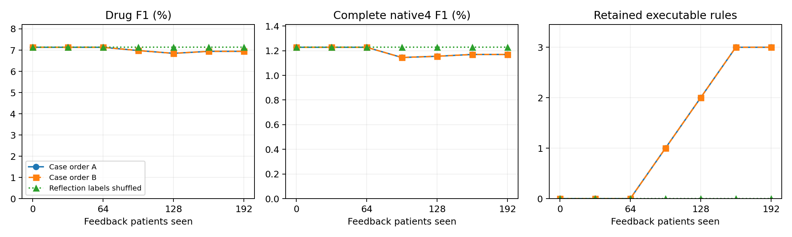

# RxRSIAgent：新患者上的条件化可执行技能实验

**结论：尚未证明完整命题。统一兼容接口后，学习使药物F1从7.38%降到7.20%，丢失6个正确目标药物；实验记忆不作为默认状态启用。**

## 1. 本轮到底验证什么

验证“病例反馈是否能自动诱导带适用条件、例外条件的处方修复程序，并在新患者上减少漏开、多开和完整订单错误”。已完成 **6轮×32例反馈、两种病例顺序、64例提案集＋64例守门集、256例独立患者审计，以及128例 Llama 迁移**。全部患者排除既往 v25 所有训练、开发、测试患者。测试医院曾用于其他患者的开发，不能声称从未见过这些机构。

**真实结果：药物F1 7.13% → 6.94%；原生四字段订单F1 1.23% → 1.17%。** 保留3条规则，改变59/256例输出；按分项差错统计，53例改善且其他项不增加，6例至少一项变差。是否同时减少三类错误、是否逐轮改善，必须看下面的分项结果。

## 2. 数据、任务和评分

这次用 eICU 的新患者。输入是 ICU 前6小时已记录的诊断、既往订单和可用化验；预测第6—12小时新录入的药物订单。不是出院处方，也不是把所有既往药物再开一遍。保留没有新订单的患者，避免模型多开却被忽略。

“多病”操作定义是6小时前记录了至少两个疾病系统类别；可能有急性、暂定或已缓解的诊断，不能等同于已确诊慢性多病共存。[官方字段说明](https://github.com/MIT-LCP/eicu-code/blob/main/website/content/eicutables/diagnosis.md)明确了诊断录入时间，也说明缺乏已排除/缓解状态。未使用出院时诊断状态。药物完整修订历史仍缺失。

药物使用 HICL 编码；订单使用“药物、途径、剂量字符串、频次字符串”四字段。与 MIMIC 的 Core4 不是同一指标，不能横向拼分。候选目录覆盖54.21%的GT药物、11.30%的完整GT订单。GT四字段完整率79.37%。目录外药物仍计入漏开；完整订单指标只统计字段齐全的元组，因此必须同时看字段覆盖率。四字段齐全不等于临床处方完整、正确。

## 3. 我们实际让什么成长了

不是重新拟合药物概率。所有组从开始就有相同的冻结预测草稿和训练病例检索。模型权重、工具实现固定；算法从失败反馈中选择操作、学习`when`条件、`unless`例外和保留的规则组合。可执行操作有：检索共识补漏、删除缺少多方支持的预测、修改联合订单字段、核对既往订单。药名不作为规则谓词，但底层模型和预测器仍可能含药物先验。

反例分两种：条件不满足的病例；实际执行操作会变差的病例。后者至少出现2例才可诱导例外条件。每条候选至少4例适用、2例不适用。训练、提案、守门三处都必须总错误严格减少，且漏开、多开、完整元组错误分别不增加。每轮最多3条进入守门、最多保留1条；测试结果不参与选规则。

**这里是有边界的程序记忆学习。四种工具的代码和初始假设由研究者写好，规则的条件和组合由反馈选择；不能包装成模型已经自动发明新药学知识或升级了自己的学习算法。**

## 4. 同患者真实对照表

| Method | N | Drug F1 % | Native4 F1 % | Missed/patient ↓ | Extra/patient ↓ | Joint errors/patient ↓ |
|---|---:|---:|---:|---:|---:|---:|
| Frozen supervised predictor | 256 | 12.98 | 2.93 | 1.305 | 1.105 | 2.074 |
| Fixed Qwen prescription agent | 256 | 7.13 | 1.23 | 1.172 | 6.965 | 6.914 |
| RxRSIAgent (case order A) | 256 | 6.94 | 1.17 | 1.195 | 6.555 | 6.602 |
| RxRSIAgent (case order B) | 256 | 6.94 | 1.17 | 1.195 | 6.555 | 6.602 |
| Shuffled-feedback learner | 256 | 7.13 | 1.23 | 1.172 | 6.965 | 6.914 |
| Conditional repair of predictor (no LLM) | 256 | 12.41 | 2.99 | 1.316 | 1.055 | 2.031 |
| Learned repairs without scopes/exceptions | 256 | 8.24 | 1.04 | 1.258 | 3.785 | 4.469 |
| Static all-repair bundle | 256 | 7.21 | 0.72 | 1.242 | 4.992 | 5.422 |
| Fixed Llama (128 patients) | 128 | 3.61 | 0.44 | 1.164 | 7.594 | 6.992 |
| Llama + frozen Qwen memory (128 patients) | 128 | 3.69 | 0.45 | 1.164 | 7.406 | 6.891 |

Missed=漏开的唯一药物数/患者；Extra=GT外药物数/患者；Joint errors=完整GT与预测订单元组的对称差/患者。三项越低越好。固定 Qwen、RxRSIAgent 和静态组合共享1次调用/256输出token；程序修复不增加LLM调用，但工具执行量不同。冻结预测器不调用LLM。Qwen无效输出11/256；Llama无效输出73/128。

这是新的同设置机制实验，不能冒充 SafeRx-Agent、MedAgents 等原论文完整复现。已有 MIMIC、RxSafe 和 RxQA 对比保留，未把不同任务的分数混为一张排名表。

## 5. 六轮到底更新了什么

| Round | Feedback cases | Retained rules | Exception clauses | Drug F1 % | Native4 F1 % | Missed | Extra | Joint errors |
|---|---:|---:|---:|---:|---:|---:|---:|---:|
| 0 | 0 | 0 | 0 | 7.13 | 1.23 | 1.172 | 6.965 | 6.914 |
| 1 | 32 | 0 | 0 | 7.13 | 1.23 | 1.172 | 6.965 | 6.914 |
| 2 | 64 | 0 | 0 | 7.13 | 1.23 | 1.172 | 6.965 | 6.914 |
| 3 | 96 | 1 | 0 | 6.98 | 1.14 | 1.188 | 6.727 | 6.746 |
| 4 | 128 | 2 | 0 | 6.85 | 1.15 | 1.195 | 6.668 | 6.688 |
| 5 | 160 | 3 | 0 | 6.94 | 1.17 | 1.195 | 6.555 | 6.602 |
| 6 | 192 | 3 | 0 | 6.94 | 1.17 | 1.195 | 6.555 | 6.602 |

实际保留规则（operator=操作，when=条件，unless=例外）：

- `prune_unsupported` when `dx:gastrointestinal`, unless `none established`; round 3, 96 feedback patients, 14 scope-positive training cases, 0 observed harmful training exceptions.
- `prune_unsupported` when `dx:burns/trauma`, unless `none established`; round 4, 128 feedback patients, 7 scope-positive training cases, 0 observed harmful training exceptions.
- `prune_unsupported` when `labs_missing`, unless `none established`; round 5, 160 feedback patients, 7 scope-positive training cases, 0 observed harmful training exceptions.

第二病例顺序最终药物/订单F1：6.94% / 1.17%。完整候选、通过和拒绝记录见 `results/qwen-52-learning.json`、`results/qwen-152-learning.json`。重复评估未变化状态不算独立重复实验。

## 6. 多疾病系统、无新订单及跨模型表现

| Stratum | N | Drug F1 % | Missed/patient | Extra/patient | Joint errors/patient |
|---|---:|---:|---:|---:|---:|
| single | 128 | 7.45 → 7.44 | 1.047 → 1.062 | 6.719 → 6.328 | 6.789 → 6.445 |
| multi | 128 | 6.84 → 6.49 | 1.297 → 1.328 | 7.211 → 6.781 | 7.039 → 6.758 |
| zero_target | 135 | 0.00 → 0.00 | 0.000 → 0.000 | 7.674 → 7.193 | 5.837 → 5.467 |
| nonzero_target | 121 | 13.26 → 12.75 | 2.479 → 2.529 | 6.174 → 5.843 | 8.116 → 7.868 |

single=单疾病系统；multi=多疾病系统；zero_target=无新目标药物；nonzero_target=有新目标药物。特别检查有新订单患者，避免只靠减少输出获利。

最终减初始的配对患者bootstrap 95%区间（错误差小于0有利；F1百分点差大于0有利）：

- missed_drugs_per_patient: [0.0078, 0.0430]
- extra_drugs_per_patient: [-0.5039, -0.3203]
- joint_errors_per_patient: [-0.3945, -0.2344]
- drug_f1_pp: [-0.6331, 0.1710]
- joint_f1_pp: [-0.3291, 0.0843]

同一冻结技能迁移到 Llama：药物F1 3.61% → 3.69%；订单F1 0.44% → 0.45%。完整区间在结果JSON。所有区间是2000次重采样的探索性分析，未作多重检验校正。

## 7. 失败病例与机制结论的边界

真实改善、退步、仍失败病例连同GT及前后处方，保存在受限目录的 `case_studies.json` 和 `CASE_STUDIES.md`，不上传GitHub。条件外病例不等于已证实的伤害反例。测试上的例外触发、去掉例外后变好/变坏的计数见 `results/evaluation.json`。

我们分别追踪“药物未进入候选”“已有候选但漏选”“药物正确但联合字段错误”“既往订单复制到未来窗口”等程序问题。它们是可通过干预检验的工作流假设，还不是临床因果机制。仅减少多开不代表治疗覆盖提升；技能数量增长不代表收益；开发集通过也不保证新患者改善。

## 追加：收益来源及学习器修复结果

更新前后集合对照：**新找回正确药物0个、丢失原本正确药物6个、删除额外药物105个、新增额外药物0个**；新增匹配完整GT元组0个，丢失匹配元组1个。三项主要错误是否全部严格下降：**否**。因此不能把减少输出自动解释为学会补漏或修正剂量。

开发集检查发现：旧反例检测看“总错误增加”，但守门看“三项中任一项不能增加”。删掉一个正确药同时删掉更多错误药，会被旧反例检测漏掉。另一问题是重复提交已经失败的状态/规则组合。

在计算任何测试指标之前，我冻结了明确标注的探索性修正版：按分项损失识别反例，并记忆已拒绝规则；还分别测试了只修反例、只加拒绝记忆、两项一起修，后者跑两种病例顺序。此时测试模型生成已经开始，但修正版没有读取测试预测或分数。原实验保留不变；**这是研究者修复学习器，不能算agent已经自我升级了学习算法**。

| Updater | Rules | Exception clauses | Drug F1 % | Native4 F1 % | Missed/patient | Extra/patient |
|---|---:|---:|---:|---:|---:|---:|
| Both updater repairs (order A) | 1 | 0 | 6.98 | 1.14 | 1.188 | 6.727 |
| Both updater repairs (order B) | 4 | 0 | 7.12 | 1.07 | 1.191 | 6.453 |
| Componentwise counterexamples only | 0 | 0 | 7.13 | 1.23 | 1.172 | 6.965 |
| Rejected-program memory only | 3 | 0 | 6.94 | 1.17 | 1.195 | 6.555 |

更正确的反例检测不保证能学出可迁移的例外。当前条件作用于整位患者，操作却改变某一药物；用整位患者的排除条件，可能同时挡住有益和有害的修改。这是下一步需要检验的“患者级条件与订单级动作粒度不一致”假设，还不是已发现的临床机制。

源表审计另发现：测试目标473条原始订单行中有7条最终标记取消（不等于药物去重计数）；取消时间不可用，未将取消状态作为输入或筛选目标。[官方药物表说明](https://raw.githubusercontent.com/MIT-LCP/eicu-code/main/website/content/eicutables/medication.md)也区分订单和实际给药。所以GT只能先表示记录行为，不能直接等同于临床正确答案。

## 当前兼容接口结果与是否启用记忆

已修复“完整JSON里混入一个未知编号，就把所有有效订单丢掉”的问题：保留可核验编号、记录未知编号、接受完整代码围栏、不补猜截断结构。Qwen测试中恢复8例非空输出，Llama恢复13例。**开发集门控也在相同解码器下重新执行，并在查看测试指标前冻结**；没有把解析器修复当成进化，也没有新增模型推理。

| Method | Drug F1 % | Native4 F1 % | Missed/patient | Extra/patient | Joint errors/patient |
|---|---:|---:|---:|---:|---:|
| Fixed Qwen, compatible runtime | 7.38 | 1.64 | 1.152 | 7.184 | 7.035 |
| RxRSIAgent, compatible runtime + gated memory | 7.20 | 1.60 | 1.176 | 6.773 | 6.723 |
| Reflection-label shuffle, true development gates | 7.32 | 1.49 | 1.172 | 6.746 | 6.707 |
| Static all repairs, compatible runtime | 7.48 | 1.12 | 1.227 | 5.148 | 5.512 |
| Fixed Llama, compatible runtime (128) | 3.17 | 0.37 | 1.156 | 9.352 | 8.305 |
| Llama + transferred memory, compatible runtime (128) | 3.24 | 0.38 | 1.156 | 9.102 | 8.172 |

兼容接口下的学习器仍删掉6个正确药物，漏开率差95%区间为每患者[0.0078, 0.0430]；6例至少一项主要错误增加。不能用总错误下降掩盖这些取舍。打乱反馈对照只打乱**反思训练标签**，提案/守门仍使用正确GT；修复解码后它也保留3条规则，所以不能把门控选择的收益全部归因于逐病例反思。

**目前没有证明完整研究命题。** 已实现条件规则的自动选择，但没有保留有效的显式例外，没有补回新的正确药物，也没有实现三项指标一起改善。候选空间只包含54.21%的目标药物、11.30%的完整目标订单；目录外目标不可能靠继续选择已有编号找回来。下一步真正需要改变的是订单级适用性、联合字段构造和可核验证据，而非只增加轮次；本次审计集已经暴露，后续必须重新冻结新患者。

**本轮记忆不启用为默认状态。** `serve.py`默认使用修复接口后的初始actor；只有`--experimental-memory`才复现退步的实验记忆。回退不会改写本轮真实结果，也不算进化成功。

## 8. 距离强结论还差什么

要完整支持用户提出的命题，需要三类错误可靠下降、真正有临床含义的疾病条件与反例、不同病例顺序与模型上的稳定保留收益，以及适当性审查。目前不能预先宣布上述各项都已成立，更不能把有界规则搜索称为学习算法本身的递归升级。本轮结果必须与这些更强目标分开。

## 9. 费用与交付

新增API费用 **0美元**；本地成功调用704次，输入/输出token 1,312,065/81,438。本地算力未折价。当前10美元授权累计API支出仍为此前的0.085203美元；历史已定位约89.53美元账目另计。

代码、冻结协议、患者隔离检查、状态哈希、完整结果JSON均在本目录。英文ACL论文原位更新；中英文结果同步。没有将受限病例或凭证上传GitHub。
