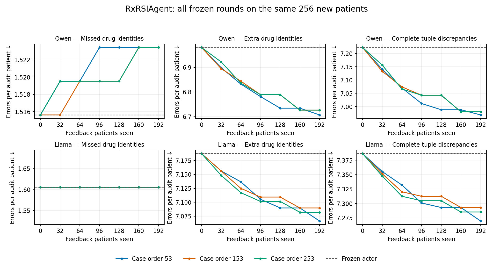

# RxRSIAgent：256位新患者的订单级记忆实验

**完整命题仍未得到支持。** 本轮已经跑完实验。三种病例顺序分别保留5、4、4条规则，全部是删除，没有保留带实证反例的规则。首个预设顺序下，Qwen 药物F1从 6.61% 变为 6.65%；Llama 从 4.58% 变为 4.64%。F1提高或多余订单减少，均不能替代三类错误同时可靠下降的证据。

## 做了什么

- 新增256位患者，与此前v25/v52所有患者无重叠；两个模型均跑完整256位。开发复用192位反馈、64位proposal、64位guard，明确属于已暴露开发集。
- 六轮，每轮累计新增32个反馈病例；三种顺序53/153/253。把Qwen学到的程序原样迁移到Llama，没有针对Llama测试结果调参。
- 固定prompt、候选目录、权重、完整JSON解析器；每个模型每个患者一次256-token上限调用。后处理复用同一输出；相同LLM调用量不等于监督信息和工具计算完全相同。
- 目标是入ICU后第6—12小时实际记录的新增/修改订单，不是患者全部治疗方案。Native4为HICL、途径、剂量字符串、频次字符串；字符串不匹配不直接等于临床错误。
- 学习内容由粗疾病类别改成具体诊断路径、目标药物、既往记录状态与增补/删除/字段替换。删除操作只是取消预测的未来订单，不能解释为临床停药建议。
- 发现反馈稀疏后，在看测试指标之前，引入3815种旧训练集重复联合模板；当前反馈可使用的模板由2增至125。新增14个字段修复候选均未降低proposal集的汇总错误数，因此保留状态不变。没有放宽验证门槛。

## 完整对比

| Backbone / method | Drug F1 % | Native4 F1 % | Missed / patient ↓ | Extra / patient ↓ | Joint discrepancy / patient ↓ |
|---|---:|---:|---:|---:|---:|
| qwen / Frozen LLM agent | 6.61 | 1.49 | 1.516 | 6.980 | 7.223 |
| qwen / Fixed contract fallback (not RSI) | 6.60 | 1.49 | 1.516 | 6.992 | 7.234 |
| qwen / RxRSIAgent / order53 | 6.65 | 1.44 | 1.523 | 6.707 | 6.969 |
| qwen / RxRSIAgent / order153 | 6.63 | 1.43 | 1.523 | 6.727 | 6.980 |
| qwen / RxRSIAgent / order253 | 6.63 | 1.43 | 1.523 | 6.727 | 6.980 |
| qwen / Frozen supervised draft | 14.14 | 2.98 | 1.598 | 1.059 | 2.289 |
| qwen / Raw feedback correction replay | 5.94 | 1.31 | 1.555 | 6.734 | 7.086 |
| qwen / Learned actions without conditions | 6.23 | 1.21 | 1.562 | 6.082 | 6.371 |
| qwen / Shuffled reflection feedback | 6.60 | 1.33 | 1.527 | 6.652 | 6.969 |
| llama / Frozen LLM agent | 4.58 | 0.73 | 1.605 | 7.188 | 7.387 |
| llama / Fixed contract fallback (not RSI) | 6.72 | 1.30 | 1.488 | 7.625 | 7.684 |
| llama / RxRSIAgent / order53 | 4.64 | 0.75 | 1.605 | 7.066 | 7.270 |
| llama / RxRSIAgent / order153 | 4.63 | 0.74 | 1.605 | 7.090 | 7.293 |
| llama / RxRSIAgent / order253 | 4.63 | 0.75 | 1.605 | 7.082 | 7.285 |
| llama / Frozen supervised draft | 14.14 | 2.98 | 1.598 | 1.059 | 2.289 |
| llama / Raw feedback correction replay | 4.27 | 0.54 | 1.625 | 6.965 | 7.254 |
| llama / Learned actions without conditions | 4.21 | 0.69 | 1.637 | 6.535 | 6.789 |
| llama / Shuffled reflection feedback | 4.56 | 0.64 | 1.609 | 7.059 | 7.289 |

## Frozen round trajectory / 冻结的逐轮轨迹

| Round | Feedback cases | Rules | Exceptions | Qwen drug F1 % | Missed | Extra | Joint |
|---:|---:|---:|---:|---:|---:|---:|---:|
| 0 | 0 | 0 | 0 | 6.61 | 1.516 | 6.980 | 7.223 |
| 1 | 32 | 1 | 0 | 6.59 | 1.520 | 6.898 | 7.141 |
| 2 | 64 | 2 | 0 | 6.64 | 1.520 | 6.832 | 7.070 |
| 3 | 96 | 3 | 0 | 6.59 | 1.523 | 6.781 | 7.012 |
| 4 | 128 | 4 | 0 | 6.63 | 1.523 | 6.734 | 6.988 |
| 5 | 160 | 4 | 0 | 6.63 | 1.523 | 6.734 | 6.988 |
| 6 | 192 | 5 | 0 | 6.65 | 1.523 | 6.707 | 6.969 |

## Paired uncertainty / 配对不确定性

| Model / order | Δ missed [95% CI] | Δ extra [95% CI] | Δ joint [95% CI] | Patients with any worsened component |
|---|---|---|---|---:|
| qwen / 53 | +0.0078 [+0.0000, +0.0195] | -0.2734 [-0.3594, -0.1953] | -0.2539 [-0.3359, -0.1758] | 2 |
| qwen / 153 | +0.0078 [+0.0000, +0.0195] | -0.2539 [-0.3320, -0.1836] | -0.2422 [-0.3164, -0.1719] | 2 |
| qwen / 253 | +0.0078 [+0.0000, +0.0195] | -0.2539 [-0.3320, -0.1836] | -0.2422 [-0.3164, -0.1719] | 2 |
| llama / 53 | +0.0000 [+0.0000, +0.0000] | -0.1211 [-0.1875, -0.0625] | -0.1172 [-0.1836, -0.0586] | 0 |
| llama / 153 | +0.0000 [+0.0000, +0.0000] | -0.0977 [-0.1484, -0.0508] | -0.0938 [-0.1445, -0.0469] | 0 |
| llama / 253 | +0.0000 [+0.0000, +0.0000] | -0.1055 [-0.1602, -0.0547] | -0.1016 [-0.1562, -0.0508] | 0 |

## Recorded disease-system strata / 记录的疾病系统分层

| Model / stratum | Baseline → final drug F1 % | Baseline → final missed | Baseline → final extra | Baseline → final joint |
|---|---:|---:|---:|---:|
| qwen / one_system | 8.08 → 8.03 | 1.859 → 1.867 | 5.961 → 5.828 | 6.984 → 6.875 |
| qwen / multiple_systems | 5.32 → 5.40 | 1.172 → 1.180 | 8.000 → 7.586 | 7.461 → 7.062 |
| llama / one_system | 5.34 → 5.36 | 1.938 → 1.938 | 7.477 → 7.438 | 8.180 → 8.141 |
| llama / multiple_systems | 3.68 → 3.77 | 1.273 → 1.273 | 6.898 → 6.695 | 6.594 → 6.398 |

## Output contract / 输出协议

| Backbone | Syntax failure | Responses with unknown IDs | Empty output | Empty with nonempty target |
|---|---:|---:|---:|---:|
| qwen | 2/256 | 4/256 | 2/256 | 0/256 |
| llama | 104/256 | 43/256 | 125/256 | 65/256 |

上述轮次共享同一256位独立患者，不是每轮新增256位独立实验。表中为边际95%配对区间；JSON另含36项错误/方案/顺序/模型检验的Bonferroni单侧上界。所有状态在读取测试指标前冻结，未选择测试分数最好的一轮。固定解析回退使Llama药物F1从4.58%升至6.72%，但多开和联合差异增加，Qwen也略有退步；因此保持显式可选，不默认推广，也不计作RSI。

## 这轮能证明什么

1. 外部规则记忆确实发生了变化；但没有自主修改LLM权重、发现药理知识或生成新的工具代码。
2. 扩充联合模板没有改变最终规则；问题从“拿不到模板”进一步定位到“条件能否迁移并触发正确修复”。
3. 首个顺序Qwen的三类错误/患者是 `1.516, 6.980, 7.223` → `1.523, 6.707, 6.969`，Llama为 `1.605, 7.188, 7.387` → `1.605, 7.066, 7.270`。不能只挑下降的一项。
4. 候选目录覆盖 244/465 个GT药物（52.47%）、43/411 个完整GT订单（10.46%）。
5. Qwen共同药物上的字段错误从 61/75 变为 59/72；分母变化须与漏开一起看，不能把删药当作剂量修复。
6. 打乱反馈对照仍使用真实proposal/guard标签，其收益可能来自开发集筛选。两个小模型、三种顺序不能证明任意模型稳定受益；多系统分组也不等于经过验证的慢性多病共存。

## 适当性审查与交付

已接入三种带说明书来源的局部核验工具：保留信息未知状态，区分首次与继续用药，并由 `runtime.py` 返回预筛记录。实际仅覆盖Qwen最终1836条订单中的1条，三个核验项全部返回未知，远未达到完整适当性审查。这是固定工具工程，不计入学习收益；没有改变已冻结实验订单，也不构成临床安全认证。详见[调研与设计](RESEARCH.zh.md)。

双人盲评包包含32位分层随机患者和 7 条唯一规则，隐藏方法来源、随机展示、合并相同方案，并纳入实际记录订单。**已完成临床标注：0。** [评分规程](REVIEW_PROTOCOL.zh.md)明确可评估分母与信息缺失比例。真实失败案例位于本地受限目录 `prismatic-v53/CASE_STUDIES.md`；病例包和规则正文未上传GitHub。

本轮新增API费用 **$0**；本地新推理 512 次，输入/输出token为 937,139/70,649，本地算力未折算价格。当前$10额度此前已用$0.085203，剩余$9.914797；此前全部研究可定位响应费用约$89.53另计，不能把本地推理说成零总成本。

## 下一步应该补的证据

需要具有时间依据的治疗意图与活跃疾病证据，使补漏和字段修复能在独立病例真正执行；需要超过原始反馈回放；需要两位评审者完成技能与处方适当性标注。上述256位测试患者现已暴露，后续调优不能继续把它们称为独立确认集。当前默认研究运行时仍不推广实验技能库。
