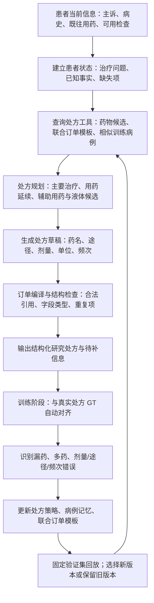

# RxRSIAgent：为处方生成设计的进化式 Agent

版本：v0.6，2026-10-14。继承 PRISMATIC 的实验资产。当前代码入口为 `run_local_agent.py`，策略进化入口为 `run_evolution.py` 和 `run_error_replay.py`。

## 1. 论文到底要证明什么

**论文目标：RxRSIAgent 在可比较的数据协议上超过现有处方方法，并随着训练病例积累提高处方质量。**“超过别人”是研究假设与实验结论，不写入患者推理提示词，也不是处方选择规则。

三项核心假设：

1. 在相同 benchmark 的官方输入、标签、划分、指标下，RxRSIAgent 优于已有论文报告的方法。
2. 固定测试患者、基础模型和单例推理预算，增加训练反馈后，药物、订单字段及整张处方指标提高。
3. 相比普通 RAG 和同数据量静态训练，错误驱动的经验更新在漏药、多药、错误剂量/途径等方面有额外收益。

第 1、3 项不能由单纯扩大训练集推出。本轮先把真正的订单输出、GT 自动评价、更新闭环和消融执行起来；原始文献数字已经加入报告，未把不同协议的分数混算成胜负。

## 2. 开一张处方的整体流程

**本轮实际执行：**患者状态使用入院主诉、分诊等级和家庭用药；本地 Qwen 候选分支先列治疗问题，再选择订单工具；编译器展开药名、途径、剂量、单位、频次。验证实验发现该 LLM 分支弱于直接学习策略，因此当前选用学习策略输出，保留 LLM 分支作为真实消融。所有被调用模板来自训练集，测试 GT 不进入提示词。当前目录覆盖初始 8,000 训练例中最常见的 128 个原始药名，最多 20 个策略候选，LLM 小样本使用前 12 个候选。

**尚待扩展：**完整时间线、可验证过敏/体重/肾功能、成分级知识工具、自由生成新剂量、医生未记录的治疗意图。不能把图中长期接口当成已经实测完成；本轮的当前输入仍受入院代理字段可用性限制。

这个系统的 Agent 是“规划并调用处方工具的决策过程”；harness 是其运行环境，负责输入时间边界、工具接口、上下文、状态、输出编译、自动评分和版本管理。二者分工明确。

## 3. 到底怎么进化

### 3.1 一次更新的具体例子

假设训练病例中旧版本预测了 A 药，却漏了真实处方中的 B 药，A 药的给药途径也不一致：

1. 先保存旧版本的实际输出，之后才读取该训练病例的 GT。
2. 自动产生 `missed_drug=B`、`route_error=A`；无须请医生重复标注已经存在的标签。
3. 把病例与完整订单加入病例记忆；重新统计**联合**药物—途径—剂量—单位—频次模板，避免分别拼接不相容字段。
4. 用累计训练病例更新处方选择模型；尝试提高错误病例的回放权重。
5. 在固定验证集比较新旧版本，选择输出阈值、病例模板/全局模板和回放权重。
6. 保存通过验证的版本；未通过的修改不生效。测试病例只计分，不写入训练记忆。

这里的 A/B 只是机制示例，不是患者或临床建议。

### 3.2 更新的是什么

| 可进化对象 | 本轮状态 | 作用 |
| --- | --- | --- |
| 病例记忆 | 已执行 | 新增训练输入与真实订单，支持相似病例工具 |
| 联合订单模板 | 已执行 | 学习具体药物常见的剂量、途径、单位、频次组合 |
| 处方选择策略权重 | 已执行 | 从 8k → 16k → 32k → 40k 重新拟合累计训练数据 |
| 错误驱动回放 | 已执行消融 | 32k 个新病例的预更新错误决定回放难度；验证比较 0/0.25/1 权重 |
| LLM 规划时的经验上下文 | 已运行小样本对照 | 比较订单目录规划、加入病例经验后的规划、直接策略输出 |
| 自然语言处方技能的自动增删改 | 后续实现 | 将重复失败提炼为带触发条件和来源的技能，需独立回归测试 |
| 大模型参数 SFT/DPO/LoRA | 尚未执行 | 可以用 GT 构造训练目标或偏好；不得把当前策略模型训练称为 LLM 微调 |

所以当前是**GT 驱动的系统级学习**。没有声称大模型已经自己发现临床规律，也没有声称完成通用递归自改代码。

### 3.3 为什么可能更好，如何知道真的更好

- 病例增加帮助识别哪些药物经常共同出现、在哪些输入下应被选择；是否更好由固定测试集测量。
- 订单模板学习字段组合，降低“药名对了但剂量/途径错了”的情况；以联合订单匹配检验。
- 错误回放针对具体遗漏或字段错误，而不是让模型无目标地“再想一次”；必须与同样 40k 数据的普通回放比较。
- 验证选择可以拒绝失败的进化。本轮错误加权未获选，局部病例模板也没有超过全局联合模板；报告保留这些结果。
- 不能只报病例量曲线：必须增加**同病例量、同模型、同预算**的更新机制消融，才能说明收益来自进化设计。

## 4. GT 与医生评审的正确关系

| 评价问题 | 本轮如何评价 | 医生是否前置条件 |
| --- | --- | --- |
| 药开对了哪些、漏了哪些、多了哪些 | 本轮已报药名集合 P/R/F1；规范编码、Jaccard、整单匹配待补 | 否 |
| 途径、剂量、单位、频次是否匹配 | 对有标签的字段自动评分；联合字段严格匹配 | 否 |
| 盐水有没有开 | 原始盐水药名存在性；不再先经过 ATC 过滤 | 否 |
| 是否因禁忌、DDI 等触犯已编码规则 | 使用版本化知识库自动检查并报告覆盖 | 否；需可用规则 |
| 数据中没有写明的盐水用途、输液速度、指征合理性 | 字段未知就不伪造 GT；可补知识规则或人工抽样 | 可选补充 |

医生审核从主实验前置流程中移除。历史记录是监督标签，但不保证它包含所有合理替代方案；这一点影响临床结论范围，不妨碍立即训练、比较和自动评分。

## 5. 已有论文结果直接引用，怎样组织主表

详见 [reported_baselines.json](reported_baselines.json)，每个数都有原始来源和表号。

- **主表：官方 benchmark 分组的 reported baseline。** 不要求重训别人。我们的行必须在该组的同一协议上测得，再标注是否超过。
- **本地订单实验表：**本轮固定 40k/4k/4k，比较病例检索、静态策略、进化策略、字段模板与 LLM 规划，全部是真实执行。
- **进化表：**固定测试集的病例量曲线，以及同数据量下去掉经验、错误回放、规划、字段校验的消融。
- **补充表：**RxSafeBench/RxQA 与 FHIR 工具任务。诊断准确率、工具任务成功率和处方 F1 保持各自单位。

例如 GAMENet 原文 145 类与 SafeDrug 的 131 类协议不同，同一个 GAMENet 在这两篇文章的报告分数本来就不同。引用这些结果完全可以；不能把不同药物空间的数值大小当作我们已超过对方。

## 6. 下一步按论文目标执行

1. **优先 RxEval：**核实正式数据发布与授权，在其药物—剂量—途径多选任务上运行 RxRSIAgent，直接与论文 reported rows 比较。候选正确选项由 benchmark 提供，与我们的自由候选检索任务分开。
2. **SafeRx-ATC4：**对齐其 MIMIC-IV/III 任务、患者划分、ICD 输入与指标；不重训基线，只测我们并引用原分数。若无法取得相同测试病例，将其列为协议近似实验而非严格胜负。
3. **原始完整订单任务：**补时间点轨迹与标准成分标识，扩充目录，保留盐水；评估药物/字段/整单一致性及数据覆盖。
4. **经验技能机制：**从训练失败提议技能，使用旧成功病例＋旧失败病例的独立 probe 验证“修复数减退化数”；禁止测试标签参与提议和选择。
5. **参数进化：**固定基座比较仅记忆、仅 SFT、记忆＋SFT、GT 偏好优化；统一训练病例量和推理预算。记录各自改善，不把模型变大当成机制收益。
6. **确认实验：**冻结最佳策略后，使用独立患者与多种随机种子检验；论文只把实测成立的假设写成结论。

## 7. 相关工作与所用机制

- [SafeRx-Agent](https://arxiv.org/html/2605.29146v1)：专科候选生成、风险证据与逐项核验。
- [MedAgentSim](https://arxiv.org/html/2503.22678v1)：成功与纠错经验回放；其主要任务是诊断。
- [GRASP](https://arxiv.org/html/2605.29668v1)：失败分类、技能编辑提议及防退化筛选。其 FHIR 结果不等于处方质量。
- [RxEval](https://arxiv.org/html/2605.14543v1)：时间点处方及药物—剂量—途径评价，适合作为近期核心外部基准。
