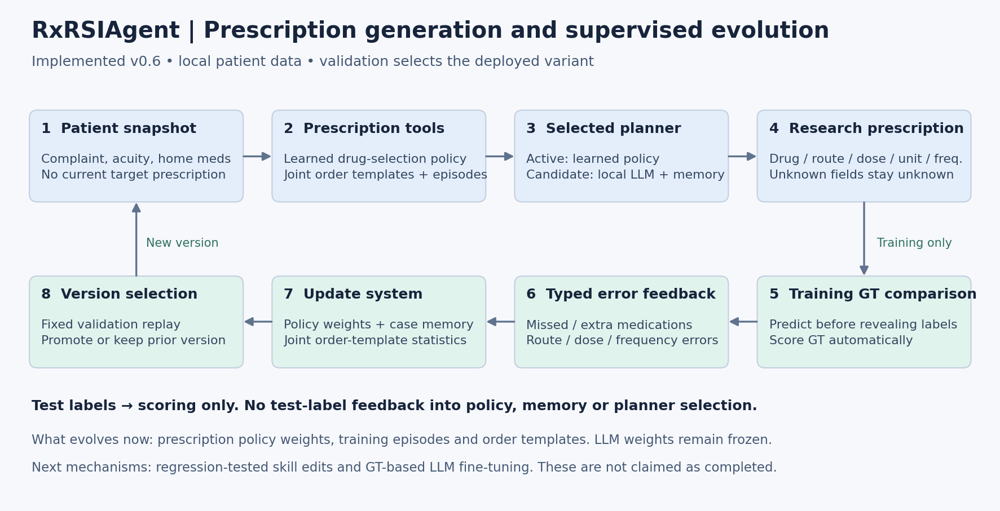

# RxRSIAgent v0.6：处方生成、GT 自动反馈与进化实验

2026-10-14。完整设计见 [中文设计与执行计划](DESIGN.zh.md)。

## 本轮修正

1. 超过现有方法是**论文目标**，不作为 Agent 的患者推理指令。
2. 输出从五个 ATC 类别扩展到药名、途径、剂量、单位、频次；原始盐水订单直接保留。
3. 有 GT 的字段自动评分，医生评审不再是训练与实验的前置条件。
4. 已有论文分数直接纳入 reported baseline 表，不要求逐个复现；不同协议分组标明。

## 已执行的结果

数据：同一 MIMIC-IV/ED 队列，40,000 训练、4,000 验证、4,000 开发测试例。药物空间变为初始 8,000 训练例选出的 128 个原始药名，测试订单覆盖率约 85.34%。**该任务与此前 ATC-L4 任务不同，分数不跨版本直接比较。**

GT 包含药名、途径、剂量字符串、单位和部分频次。Core-order F1 严格比较前四者的联合元组，只在有完整参考字段的订单上计分；测试含 33,377 个完整参考核心订单。缺失的频次不计入字段准确率分母。盐水指标只衡量是否出现，不等于用途合理性。

### A. 相同 4,000 例，已执行方法表

| 方法：同 4,000 测试例 | 药物 F1 | 核心订单 F1 | 盐水出现 F1 | 平均开药数 |
| --- | --- | --- | --- | --- |
| 病例检索（40k） | 0.34742 | 0.24761 | 0.83236 | 7.19 |
| 初始处方策略（8k） | 0.35841 | 0.24304 | 0.83090 | 10.37 |
| 普通训练＋全局订单模板（40k） | 0.40668 | 0.28003 | 0.83563 | 8.57 |
| 累计训练＋相似病例模板（40k） | 0.40668 | 0.27255 | 0.83563 | 8.57 |
| RxRSIAgent 验证选定版（40k） | 0.40668 | 0.28003 | 0.83563 | 8.57 |

### B. 病例增长：r1 的相似病例订单模板策略

| 累计训练例数 | 药物 F1 | 核心订单 F1 | 验证是否接纳 |
| --- | --- | --- | --- |
| 8000 | 0.35841 | 0.24304 | 是 |
| 16000 | 0.38211 | 0.25954 | 是 |
| 32000 | 0.40428 | 0.27329 | 是 |
| 40000 | 0.40668 | 0.27255 | 是 |

训练病例增加后药物 F1 从 0.35841 提升到 0.40668。联合订单分数在 r1 并非严格单调。r2 用验证集选择全局联合模板，联合订单 F1 达到 0.28003；相同 40k 训练数据的普通策略＋全局模板也达到这一分数，**目前不能把收益归因于独有的错误回放机制**。

病例级结果已独立重算。以 3,115 个测试患者为聚类单位做 2,000 次配对 bootstrap，r2 相比初始 8k 的药物 F1 差值为 +0.04827（95% 区间 0.04447–0.05234），核心订单 F1 差值为 +0.03698（0.03321–0.04082）。这些是开发集上的数据增长结果，不证明独有进化机制有效。

### C. 实际 LLM Agent 试验

| 方法：同 20 测试例 | 药物 F1 | 核心订单 F1 | 平均开药数 |
| --- | --- | --- | --- |
| 无病例经验的 LLM 规划 | 0.27350 | 0.21667 | 3.00 |
| 加入病例经验的 LLM 规划 | 0.32000 | 0.24199 | 5.05 |
| 直接学习的处方策略 | 0.42997 | 0.30671 | 6.65 |
| 验证选定输出（与上行相同） | 0.42997 | 0.30671 | 6.65 |

验证集选择**直接学习的处方策略**。小样本包含 20 验证例和 20 测试例；LLM 先列问题，再选择订单工具，由编译器展开字段。它选择已有模板，并未自由创造新剂量。两种 LLM 调用均为固定本地 Qwen3-4B-Instruct-2507 4bit；没有受限患者文本发往外部 API。

### D. 真实进化与消融

- 记录了 32,000 个新增训练病例的预更新错误反馈，包括漏药、多药和字段错误。
- 更新了策略模型、病例记忆、联合订单模板；固定最初 8k 的词表与输入表示，测试患者不反馈。
- r2 在验证集比较回放权重 0 / 0.25 / 1，选中 **0**；订单模式选中 **global**，阈值 **0.2**。错误加权未产生额外收益，保留失败候选与原 r1 结果。
- 大模型参数未微调；自然语言技能自动编辑与 SFT/DPO 属于下一阶段，未伪装为已完成。

## 别人在哪些数据集、做了哪些实验

| 论文 | 数据与规模 | 所做实验 |
| --- | --- | --- |
| [GAMENet](https://arxiv.org/pdf/1809.01852) | MIMIC-III：6,350 患者、15,016 就诊、145 药物类 | 药物集合预测、药物相互作用、记忆消融 |
| [SafeDrug](https://arxiv.org/pdf/2105.02711) | MIMIC-III：6,350 患者、14,995 就诊、131 药物类 | 药物预测、相互作用、分子编码消融、效率 |
| [SafeRx-Agent](https://arxiv.org/html/2605.29146v1) | MIMIC-IV：100 开发、1,586 测试；MIMIC-III：901 患者 | ATC-L4 预测、专家路由、安全过滤 |
| [RxEval](https://arxiv.org/html/2605.14543v1) | MIMIC-IV：1,547 题、584 患者 | 药物—剂量—途径多选、整题匹配、宏平均 F1 |
| [MedAgentSim](https://arxiv.org/html/2503.22678v1) | NEJM 15/扩展120；MedQA 106/扩展214；MIMIC-IV 288 | 诊断准确率、检查/记忆/推理/集成消融 |
| [MedAgentBench](https://arxiv.org/abs/2501.14654) | 300 个 FHIR 任务、100 患者 | 工具任务成功率、按任务类型分析 |
| [GRASP](https://arxiv.org/html/2605.29668v1) | MedAgentBench 及 v2：开发/验证/测试/分布外 96/80/64/60 | 技能更新、退化检查、分布外、跨模型迁移 |

## 直接引用的 reported baseline 数据

下表来自原论文，不是本地复现；来源、表号与协议分组均保留。GAMENet 在原文、SafeDrug 和 SafeRx 的不同分数对应不同协议。RxRSIAgent 在这些正式协议上的结果尚待测量，因此不能用本地 raw-name 分数宣称超过。

| Source | Protocol | Reported method | Reported metrics | Source location |
| --- | --- | --- | --- | --- |
| [GAMENet](https://arxiv.org/pdf/1809.01852) | GAMENet-145-ATC3 | GAMENet | f1=0.6081; jaccard=0.4509; prauc=0.6904; ddi=0.0749 | Tables 2 and 3 |
| [SafeDrug](https://arxiv.org/pdf/2105.02711) | SafeDrug-131-ATC3 | GAMENet as reported by SafeDrug | f1=0.6626; jaccard=0.5067; prauc=0.7631; ddi=0.0864 | Tables 1 and 2 |
| [SafeDrug](https://arxiv.org/pdf/2105.02711) | SafeDrug-131-ATC3 | SafeDrug | f1=0.6768; jaccard=0.5213; prauc=0.7647; ddi=0.0589 | Tables 1 and 2 |
| [SafeRx-Agent](https://arxiv.org/html/2605.29146v1) | SafeRx-ATC4 | GAMENet (reported in SafeRx) | mimiciv_f1=0.3356; mimiciii_f1=0.2153 | Section 5, Table 2 |
| [SafeRx-Agent](https://arxiv.org/html/2605.29146v1) | SafeRx-ATC4 | SafeDrug (reported in SafeRx) | mimiciv_f1=0.3519; mimiciii_f1=0.2361 | Section 5, Table 2 |
| [SafeRx-Agent](https://arxiv.org/html/2605.29146v1) | SafeRx-ATC4 | SafeRx / GPT-5.2 / no safety filter | mimiciv_f1=0.4138; mimiciii_f1=0.2812 | Section 5, Table 2 |
| [SafeRx-Agent](https://arxiv.org/html/2605.29146v1) | SafeRx-ATC4 | SafeRx / GPT-5.2 / safety filter | mimiciv_f1=0.3934; mimiciii_f1=0.2641 | Section 5, Table 2 |
| [SafeRx-Agent](https://arxiv.org/html/2605.29146v1) | SafeRx-ATC4 | SafeRx / Claude Sonnet-4.6 / no safety filter | mimiciv_f1=0.4325; mimiciii_f1=0.2758 | Section 5, Table 2 |
| [SafeRx-Agent](https://arxiv.org/html/2605.29146v1) | SafeRx-ATC4 | SafeRx / Claude Sonnet-4.6 / safety filter | mimiciv_f1=0.4229; mimiciii_f1=0.2667 | Section 5, Table 2 |
| [MedAgentSim](https://arxiv.org/html/2503.22678v1) | MedAgentSim-diagnosis | MedAgentSim / Llama-3.3-70B | mimiciv_diagnosis_accuracy_percent=79.5 | Section 4, Tables 1 and 2 |
| [MedAgentBench](https://arxiv.org/abs/2501.14654) | MedAgentBench-300 | Claude-3.5-Sonnet-v2 | success_percent=69.67 | 300-task version abstract |
| [GRASP](https://arxiv.org/html/2605.29668v1) | GRASP-MAB-split | GRASP / gpt-oss-120b | mab_test_percent=88.8; mab_test_sd=5.8; mab_v2_test_percent=76.9; mab_v2_test_sd=4.0 | Tables 1 and 8 |
| [RxEval](https://arxiv.org/html/2605.14543v1) | RxEval-prescription-MCQ | Gemini-3.1-Pro | f1_percent=77.1; exact_match_percent=46.1 | Table 2 |
| [RxEval](https://arxiv.org/html/2605.14543v1) | RxEval-prescription-MCQ | Qwen3.6-27B | f1_percent=71.7; exact_match_percent=40.0 | Table 2 |

## 下一步与验收

优先接入 RxEval 全量 1,547 道处方多选题，再对齐 SafeRx-ATC4 的 MIMIC 协议；无需重训 published baselines。运行我们的正式 benchmark 行后再判断胜负。机制方面，以同训练病例量比较普通回放、错误加权、技能记忆、SFT 与组合，并加入独立测试患者和多种子。详细逐项计划见 [DESIGN.zh.md](DESIGN.zh.md)。

医生评审仅用于 GT 未覆盖的临床问题，可作为补充实验。当前 GT 自动评价、训练与版本迭代已经正常执行，均不等待医生标注。
