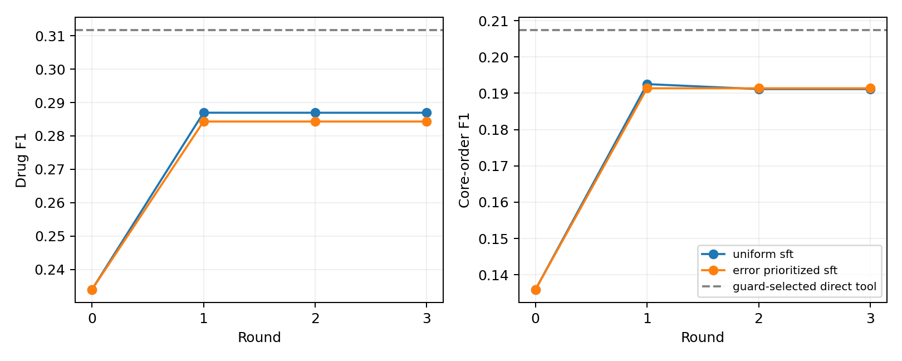

# v0.9：真实本地 QLoRA 参数进化

## 协议

Qwen3-4B 量化模型，最后八层共 367 万可训练适配参数。三个患者互不交叉的 600 例反馈块；普通采样与更新前错误优先采样每轮均用 400 例、100 步。两臂共用初始 8k 固定候选/订单工具、100 例损失验证、200 例选择检查及新的 500 次住院（494 位患者）测试。先冻结全部选择再评价测试。每轮重置优化器，继续训练最新适配器；推理保留检查集最优版本。模型权重、反馈和患者数据均只在本地。

## 同数据方法结果

| Method | Drug F1 | Core-order F1 | Mean predicted drugs |
|---|---:|---:|---:|
| base | 0.23399 | 0.13593 | 5.46 |
| uniform_sft | 0.28694 | 0.19115 | 17.42 |
| error_prioritized_sft | 0.28432 | 0.19137 | 18.98 |
| all_20_candidate_tools | 0.28390 | 0.19181 | 20.00 |
| guard_selected_top_k_tools | 0.31169 | 0.20739 | 8.00 |

## Round trajectories / 逐轮轨迹

| Arm | Round | Selected checkpoint | Drug F1 | Order F1 | Cases improved / regressed |
|---|---:|---:|---:|---:|---:|
| uniform_sft | 0 | 0 | 0.23399 | 0.13593 | 0 / 0 |
| uniform_sft | 1 | 1 | 0.28695 | 0.19253 | 257 / 79 |
| uniform_sft | 2 | 2 | 0.28694 | 0.19115 | 143 / 155 |
| uniform_sft | 3 | 2 | 0.28694 | 0.19115 | 0 / 0 |
| error_prioritized_sft | 0 | 0 | 0.23399 | 0.13593 | 0 / 0 |
| error_prioritized_sft | 1 | 1 | 0.28432 | 0.19137 | 248 / 84 |
| error_prioritized_sft | 2 | 1 | 0.28432 | 0.19137 | 0 / 0 |
| error_prioritized_sft | 3 | 1 | 0.28432 | 0.19137 | 0 / 0 |

## 到底进化了什么

每轮真实改变适配器权重文件和训练采样成员哈希；候选检索及联合订单模板固定。模型学习选择已有模板，没有学习新剂量生成。历史医嘱一致性不等于指征、DDI 或肾功能安全；已有 GT 可自动评分，不要求医生重新标注后才能计算。

同时保留原始/归一化有效率，仅去除 Qwen 空 reasoning 标签。解析和缓存修复发生在测试前，原始输出保留。已独立按药物集合及药物/途径/剂量/单位完整元组重算，并给出患者聚类配对区间；未知字段不计分。只比初始模型好还不能证明 RSI 优势，必须看错误优先是否优于普通更新，以及是否优于直接使用相同工具。
